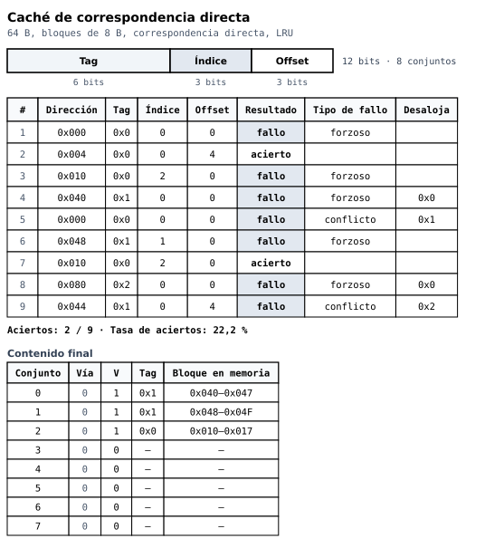
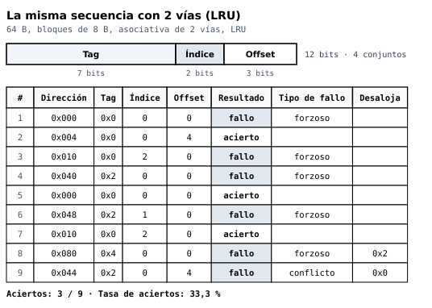

[Manual](../../README.md) › [Sistemas de computación](../README.md) › [Arquitectura de computadoras](README.md)

# Memoria caché (`cache`)

Divide la dirección en tag, índice y offset, simula cada acceso y dibuja una tabla con su
tag, índice, offset, si fue acierto o fallo (y de qué tipo) y qué bloque desalojó. Debajo, la
tasa de aciertos y el contenido final de la caché.

## Qué calcula

- Los bits de tag, índice y offset a partir de los tamaños.
- Aciertos y fallos con reemplazo LRU o FIFO.
- El tipo de cada fallo: forzoso (primer acceso al bloque), de capacidad (fallaría también en una caché totalmente asociativa del mismo tamaño) o de conflicto.

## Campos

| Campo | Tipo | Valores y valor por defecto | Descripción |
| :--- | :--- | :--- | :--- |
| `type` | texto | `cache` | Obligatorio. |
| `addressBits` | número |  | Bits de la dirección (de 4 a 64, por omisión 16). |
| `cacheSize` | número |  | Tamaño de la caché en bytes, potencia de 2 (`64`, `"1KB"`). |
| `blockSize` | número |  | Tamaño de bloque en bytes, potencia de 2. |
| `associativity` | número |  | `1` (correspondencia directa), 2, 4… vías o `"full"` (totalmente asociativa). |
| `policy` | texto | `lru`, `fifo` · por defecto `lru` | `lru` o `fifo`. |
| `accesses` | lista |  | Las direcciones accedidas: `"0x040"`, `"0b1010"` o enteros (hasta 64). |
| `missTypes` | sí/no |  | La columna con el tipo de fallo (por omisión, sí). |
| `finalState` | sí/no |  | La tabla con el contenido final (por omisión, sí; hasta 64 bloques). |
| `blank` | sí/no |  | Deja en blanco tag, índice, offset, resultado y el contenido final. |

Además, los campos comunes a todos los tipos: `title`, `subtitle`, `id`, `inkSaver` y `theme` (ver [Campos comunes](../../campos-comunes.md)).

## Modo ejercicio

Campos que dejan casilleros para completar: `blank`.

## Ejemplos

### Caché de correspondencia directa

```yaml
type: cache
title: Caché de correspondencia directa
addressBits: 12
cacheSize: 64
blockSize: 8
associativity: 1
accesses: ["0x000", "0x004", "0x010", "0x040", "0x000", "0x048", "0x010", "0x080", "0x044"]
```

[](https://ingcom-unrn.github.io/dibu-web/#t=dHlwZTogY2FjaGUKdGl0bGU6IENhY2jDqSBkZSBjb3JyZXNwb25kZW5jaWEgZGlyZWN0YQphZGRyZXNzQml0czogMTIKY2FjaGVTaXplOiA2NApibG9ja1NpemU6IDgKYXNzb2NpYXRpdml0eTogMQphY2Nlc3NlczogWyIweDAwMCIsICIweDAwNCIsICIweDAxMCIsICIweDA0MCIsICIweDAwMCIsICIweDA0OCIsICIweDAxMCIsICIweDA4MCIsICIweDA0NCJdCg)

[Abrir en el editor](https://ingcom-unrn.github.io/dibu-web/#t=dHlwZTogY2FjaGUKdGl0bGU6IENhY2jDqSBkZSBjb3JyZXNwb25kZW5jaWEgZGlyZWN0YQphZGRyZXNzQml0czogMTIKY2FjaGVTaXplOiA2NApibG9ja1NpemU6IDgKYXNzb2NpYXRpdml0eTogMQphY2Nlc3NlczogWyIweDAwMCIsICIweDAwNCIsICIweDAxMCIsICIweDA0MCIsICIweDAwMCIsICIweDA0OCIsICIweDAxMCIsICIweDA4MCIsICIweDA0NCJdCg) para explorarlo y modificarlo.

### La misma secuencia con 2 vías (LRU)

```yaml
type: cache
title: La misma secuencia con 2 vías (LRU)
addressBits: 12
cacheSize: 64
blockSize: 8
associativity: 2
accesses: ["0x000", "0x004", "0x010", "0x040", "0x000", "0x048", "0x010", "0x080", "0x044"]
finalState: false
```

[](https://ingcom-unrn.github.io/dibu-web/#t=dHlwZTogY2FjaGUKdGl0bGU6IExhIG1pc21hIHNlY3VlbmNpYSBjb24gMiB2w61hcyAoTFJVKQphZGRyZXNzQml0czogMTIKY2FjaGVTaXplOiA2NApibG9ja1NpemU6IDgKYXNzb2NpYXRpdml0eTogMgphY2Nlc3NlczogWyIweDAwMCIsICIweDAwNCIsICIweDAxMCIsICIweDA0MCIsICIweDAwMCIsICIweDA0OCIsICIweDAxMCIsICIweDA4MCIsICIweDA0NCJdCmZpbmFsU3RhdGU6IGZhbHNlCg)

[Abrir en el editor](https://ingcom-unrn.github.io/dibu-web/#t=dHlwZTogY2FjaGUKdGl0bGU6IExhIG1pc21hIHNlY3VlbmNpYSBjb24gMiB2w61hcyAoTFJVKQphZGRyZXNzQml0czogMTIKY2FjaGVTaXplOiA2NApibG9ja1NpemU6IDgKYXNzb2NpYXRpdml0eTogMgphY2Nlc3NlczogWyIweDAwMCIsICIweDAwNCIsICIweDAxMCIsICIweDA0MCIsICIweDAwMCIsICIweDA0OCIsICIweDAxMCIsICIweDA4MCIsICIweDA0NCJdCmZpbmFsU3RhdGU6IGZhbHNlCg) para explorarlo y modificarlo.

## Ver también

[`pipeline`](pipeline.md), [`ieee754`](ieee754.md)
