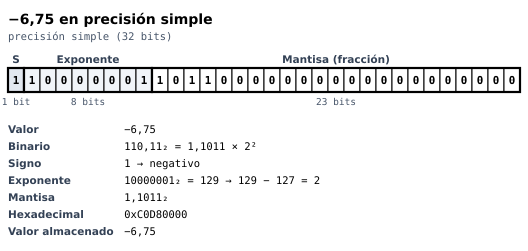
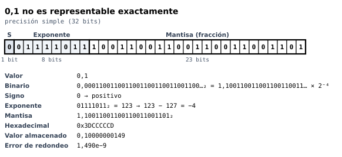
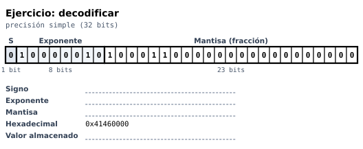

[Manual](../../README.md) › [Sistemas de computación](../README.md) › [Arquitectura de computadoras](README.md)

# IEEE 754 (`ieee754`)

Dibuja los campos de signo, exponente y mantisa de un número en precisión media, simple o
doble, y los pasos: el número en binario y normalizado, el exponente sesgado, la mantisa, el
hexadecimal, el valor que queda guardado y el error de redondeo. Parte de un valor decimal o de
los bits.

## Qué calcula

- La codificación con redondeo al par más cercano, también para media precisión.
- Los casos especiales: cero, subnormales, infinito y NaN.

## Campos

| Campo | Tipo | Valores y valor por defecto | Descripción |
| :--- | :--- | :--- | :--- |
| `type` | texto | `ieee754` | Obligatorio. |
| `value` | número |  | El número: `-6.75`, `0.1`, o `"inf"`, `"-inf"`, `"nan"`. |
| `bits` | texto |  | Los bits, en hexadecimal (`"0x41460000"`) o en binario con todos sus dígitos. |
| `hex` | texto |  | Lo mismo que `bits`. |
| `format` | texto | `half`, `single`, `double`, `16`, `32`, `64` · por defecto `single` | `half` (16 bits), `single` (32) o `double` (64). |
| `blank` | sí/no |  | Si se dio el valor, oculta los bits y los pasos; si se dieron los bits, oculta los pasos. |

Además, los campos comunes a todos los tipos: `title`, `subtitle`, `id`, `inkSaver` y `theme` (ver [Campos comunes](../../campos-comunes.md)).

## Modo ejercicio

Campos que dejan casilleros para completar: `blank`.

## Ejemplos

### −6,75 en precisión simple

```yaml
type: ieee754
title: "−6,75 en precisión simple"
value: -6.75
```

[](https://ingcom-unrn.github.io/dibu-web/#z=K6ksSLVSyExNTTU3NeEqySzJAXKVHnVMMtMxN1VIzVMoKEpNzizOPLw5T6E4M7cgJ1WJqywxpxSoStdMz9yUCwA)

[Abrir en el editor](https://ingcom-unrn.github.io/dibu-web/#z=K6ksSLVSyExNTTU3NeEqySzJAXKVHnVMMtMxN1VIzVMoKEpNzizOPLw5T6E4M7cgJ1WJqywxpxSoStdMz9yUCwA) para explorarlo y modificarlo.

### 0,1 no es representable exactamente

```yaml
type: ieee754
title: "0,1 no es representable exactamente"
value: 0.1
format: single
```

[](https://ingcom-unrn.github.io/dibu-web/#z=DcpNCoAgEAbQvacYXEcoFIG3meIrhPEHnaJun8sHT7-KQBHAti5Go8qgdZOnXAidGmpDR1beBYSXD-U0CGselntkN3tzlpZYA_WYL4H5AQ)

[Abrir en el editor](https://ingcom-unrn.github.io/dibu-web/#z=DcpNCoAgEAbQvacYXEcoFIG3meIrhPEHnaJun8sHT7-KQBHAti5Go8qgdZOnXAidGmpDR1beBYSXD-U0CGselntkN3tzlpZYA_WYL4H5AQ) para explorarlo y modificarlo.

### Ejercicio: decodificar

```yaml
type: ieee754
title: "Ejercicio: decodificar"
bits: "0x41460000"
blank: true
```

[](https://ingcom-unrn.github.io/dibu-web/#z=K6ksSLVSyExNTTU3NeEqySzJAXKVXLNSi5IzkzPzrRRSUpPzUzLTMpMTi5S4kjJLioHSBhUmhiZmBkAAFMpJzMu2UigpKk3lAgA)

[Abrir en el editor](https://ingcom-unrn.github.io/dibu-web/#z=K6ksSLVSyExNTTU3NeEqySzJAXKVXLNSi5IzkzPzrRRSUpPzUzLTMpMTi5S4kjJLioHSBhUmhiZmBkAAFMpJzMu2UigpKk3lAgA) para explorarlo y modificarlo.

## Ver también

[`pipeline`](pipeline.md), [`cache`](cache.md)
