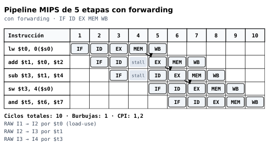
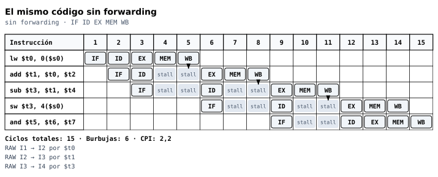

[Manual](../../README.md) › [Sistemas de computación](../README.md) › [Arquitectura de computadoras](README.md)

# Pipeline (`pipeline`)

Ubica cada instrucción en las etapas IF, ID, EX, MEM y WB ciclo por ciclo. Detecta las
dependencias de datos (RAW) entre instrucciones e inserta las burbujas necesarias, con o sin
forwarding; dibuja las flechas de cada dependencia y debajo los ciclos totales, las burbujas y
el CPI.

## Qué calcula

- Sin forwarding, el consumidor lee en ID en el mismo ciclo del WB del productor (escritura en la primera mitad, lectura en la segunda).
- Con forwarding, de EX a EX; después de un load, de MEM a EX, con una burbuja (load-use).
- Mientras una instrucción espera en ID, la siguiente queda retenida en IF.

## Campos

| Campo | Tipo | Valores y valor por defecto | Descripción |
| :--- | :--- | :--- | :--- |
| `type` | texto | `pipeline` | Obligatorio. |
| `instructions` | lista |  | Las instrucciones (hasta 40): `"lw $t0, 0($s0)"`, `"add $t1, $t0, $t2"`. Reconoce cargas, almacenamientos, saltos y operaciones; `$zero` no genera dependencias. También `{text, dest, src, load}` para fijar los registros. |
| `forwarding` | sí/no |  | Con forwarding (por omisión, sí). |
| `arrows` | sí/no |  | Dibuja las flechas de las dependencias (por omisión, sí). |
| `summary` | sí/no |  | Escribe los ciclos totales, las burbujas y el CPI (por omisión, sí). |
| `hazards` | sí/no |  | Lista las dependencias RAW debajo (por omisión, sí). |
| `blank` | sí/no |  | Deja la grilla de ciclos vacía y los resultados en blanco. |

Además, los campos comunes a todos los tipos: `title`, `subtitle`, `id`, `inkSaver` y `theme` (ver [Campos comunes](../../campos-comunes.md)).

## Modo ejercicio

Campos que dejan casilleros para completar: `blank`.

## Ejemplos

### Pipeline MIPS de 5 etapas con forwarding

```yaml
type: pipeline
title: Pipeline MIPS de 5 etapas con forwarding
instructions:
  - "lw $t0, 0($s0)"
  - "add $t1, $t0, $t2"
  - "sub $t3, $t1, $t4"
  - "sw $t3, 4($s0)"
  - "and $t5, $t6, $t7"
```

[](https://ingcom-unrn.github.io/dibu-web/#t=dHlwZTogcGlwZWxpbmUKdGl0bGU6IFBpcGVsaW5lIE1JUFMgZGUgNSBldGFwYXMgY29uIGZvcndhcmRpbmcKaW5zdHJ1Y3Rpb25zOgogIC0gImx3ICR0MCwgMCgkczApIgogIC0gImFkZCAkdDEsICR0MCwgJHQyIgogIC0gInN1YiAkdDMsICR0MSwgJHQ0IgogIC0gInN3ICR0MywgNCgkczApIgogIC0gImFuZCAkdDUsICR0NiwgJHQ3Igo)

[Abrir en el editor](https://ingcom-unrn.github.io/dibu-web/#t=dHlwZTogcGlwZWxpbmUKdGl0bGU6IFBpcGVsaW5lIE1JUFMgZGUgNSBldGFwYXMgY29uIGZvcndhcmRpbmcKaW5zdHJ1Y3Rpb25zOgogIC0gImx3ICR0MCwgMCgkczApIgogIC0gImFkZCAkdDEsICR0MCwgJHQyIgogIC0gInN1YiAkdDMsICR0MSwgJHQ0IgogIC0gInN3ICR0MywgNCgkczApIgogIC0gImFuZCAkdDUsICR0NiwgJHQ3Igo) para explorarlo y modificarlo.

### El mismo código sin forwarding

```yaml
type: pipeline
title: El mismo código sin forwarding
forwarding: false
instructions:
  - "lw $t0, 0($s0)"
  - "add $t1, $t0, $t2"
  - "sub $t3, $t1, $t4"
  - "sw $t3, 4($s0)"
  - "and $t5, $t6, $t7"
```

[](https://ingcom-unrn.github.io/dibu-web/#t=dHlwZTogcGlwZWxpbmUKdGl0bGU6IEVsIG1pc21vIGPDs2RpZ28gc2luIGZvcndhcmRpbmcKZm9yd2FyZGluZzogZmFsc2UKaW5zdHJ1Y3Rpb25zOgogIC0gImx3ICR0MCwgMCgkczApIgogIC0gImFkZCAkdDEsICR0MCwgJHQyIgogIC0gInN1YiAkdDMsICR0MSwgJHQ0IgogIC0gInN3ICR0MywgNCgkczApIgogIC0gImFuZCAkdDUsICR0NiwgJHQ3Igo)

[Abrir en el editor](https://ingcom-unrn.github.io/dibu-web/#t=dHlwZTogcGlwZWxpbmUKdGl0bGU6IEVsIG1pc21vIGPDs2RpZ28gc2luIGZvcndhcmRpbmcKZm9yd2FyZGluZzogZmFsc2UKaW5zdHJ1Y3Rpb25zOgogIC0gImx3ICR0MCwgMCgkczApIgogIC0gImFkZCAkdDEsICR0MCwgJHQyIgogIC0gInN1YiAkdDMsICR0MSwgJHQ0IgogIC0gInN3ICR0MywgNCgkczApIgogIC0gImFuZCAkdDUsICR0NiwgJHQ3Igo) para explorarlo y modificarlo.

## Notas

- No modela riesgos de control (saltos) ni estructurales.

## Ver también

[`ieee754`](ieee754.md), [`cache`](cache.md)
