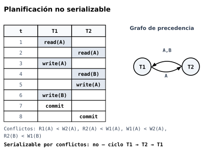
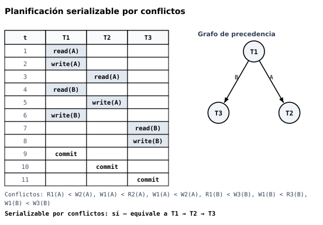

[Manual](../../README.md) › [Sistemas de computación](../README.md) › [Bases de datos](README.md)

# Planificación de transacciones (`transaction_schedule`)

Dibuja la planificación con una columna por transacción y una fila por operación, resaltando
las que están en conflicto. Al lado, el grafo de precedencia; debajo, la lista de conflictos y
si la planificación es serializable por conflictos, con un orden serial equivalente o el
ciclo que lo impide.

## Qué calcula

- Los pares en conflicto (distintas transacciones, el mismo ítem y al menos una escritura).
- Un orden topológico del grafo de precedencia o un ciclo.

## Campos

| Campo | Tipo | Valores y valor por defecto | Descripción |
| :--- | :--- | :--- | :--- |
| `type` | texto | `transaction_schedule` | Obligatorio. |
| `schedule` | lista |  | Las operaciones en orden: `R1(A)`, `W2(B)`, `C1` (commit), `A3` (abort); también `"T1: R(A)"`. Una lista o un texto separado por comas. |
| `highlight` | sí/no |  | Resalta las operaciones en conflicto (por omisión, sí). |
| `conflicts` | sí/no |  | Lista los conflictos debajo (por omisión, sí). |
| `blank` | sí/no |  | Oculta las aristas del grafo y el veredicto. |

Además, los campos comunes a todos los tipos: `title`, `subtitle`, `id`, `inkSaver` y `theme` (ver [Campos comunes](../../campos-comunes.md)).

## Modo ejercicio

Campos que dejan casilleros para completar: `blank`.

## Ejemplos

### Planificación no serializable

```yaml
type: transaction_schedule
title: Planificación no serializable
schedule: [R1(A), R2(A), W1(A), R2(B), W2(A), W1(B), C1, C2]
```

[](https://ingcom-unrn.github.io/dibu-web/#t=dHlwZTogdHJhbnNhY3Rpb25fc2NoZWR1bGUKdGl0bGU6IFBsYW5pZmljYWNpw7NuIG5vIHNlcmlhbGl6YWJsZQpzY2hlZHVsZTogW1IxKEEpLCBSMihBKSwgVzEoQSksIFIyKEIpLCBXMihBKSwgVzEoQiksIEMxLCBDMl0K)

[Abrir en el editor](https://ingcom-unrn.github.io/dibu-web/#t=dHlwZTogdHJhbnNhY3Rpb25fc2NoZWR1bGUKdGl0bGU6IFBsYW5pZmljYWNpw7NuIG5vIHNlcmlhbGl6YWJsZQpzY2hlZHVsZTogW1IxKEEpLCBSMihBKSwgVzEoQSksIFIyKEIpLCBXMihBKSwgVzEoQiksIEMxLCBDMl0K) para explorarlo y modificarlo.

### Planificación serializable por conflictos

```yaml
type: transaction_schedule
title: Planificación serializable por conflictos
schedule: [R1(A), W1(A), R2(A), R1(B), W2(A), W1(B), R3(B), W3(B), C1, C2, C3]
```

[](https://ingcom-unrn.github.io/dibu-web/#t=dHlwZTogdHJhbnNhY3Rpb25fc2NoZWR1bGUKdGl0bGU6IFBsYW5pZmljYWNpw7NuIHNlcmlhbGl6YWJsZSBwb3IgY29uZmxpY3RvcwpzY2hlZHVsZTogW1IxKEEpLCBXMShBKSwgUjIoQSksIFIxKEIpLCBXMihBKSwgVzEoQiksIFIzKEIpLCBXMyhCKSwgQzEsIEMyLCBDM10K)

[Abrir en el editor](https://ingcom-unrn.github.io/dibu-web/#t=dHlwZTogdHJhbnNhY3Rpb25fc2NoZWR1bGUKdGl0bGU6IFBsYW5pZmljYWNpw7NuIHNlcmlhbGl6YWJsZSBwb3IgY29uZmxpY3RvcwpzY2hlZHVsZTogW1IxKEEpLCBXMShBKSwgUjIoQSksIFIxKEIpLCBXMihBKSwgVzEoQiksIFIzKEIpLCBXMyhCKSwgQzEsIEMyLCBDM10K) para explorarlo y modificarlo.
