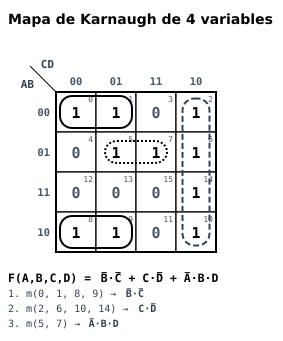
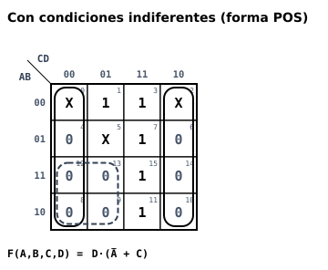
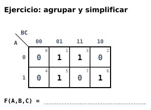

[Manual](../../README.md) › [Sistemas de computación](../README.md) › [Sistemas digitales](README.md)

# Mapa de Karnaugh (`karnaugh`)

Dibuja el mapa de Karnaugh de la función, con las filas y columnas en código Gray y el número
de mintérmino en cada celda. Minimiza la función (Quine-McCluskey con cobertura exacta),
dibuja cada grupo, también los que dan la vuelta por los bordes, y escribe la suma de
productos o el producto de sumas mínimo.

## Qué calcula

- Los implicantes primos y una cobertura mínima (menos términos y, a igualdad, menos literales).
- La expresión mínima en SOP (agrupando unos) o POS (agrupando ceros), usando las indiferentes.

## Campos

| Campo | Tipo | Valores y valor por defecto | Descripción |
| :--- | :--- | :--- | :--- |
| `type` | texto | `karnaugh` | Obligatorio. |
| `expr` | texto |  | La función como expresión (ver [`truth_table`](truth_table.md)). |
| `vars` | lista |  | Las variables (de 2 a 4); las primeras van en las filas. |
| `minterms` | lista |  | La función por sus mintérminos. |
| `maxterms` | lista |  | La función por sus maxtérminos. |
| `dontcares` | lista |  | Las combinaciones indiferentes, que salen como X. |
| `name` | texto |  | El nombre de la función (por omisión `F`). |
| `form` | texto | `sop`, `pos` · por defecto `sop` | `sop` (suma de productos) o `pos` (producto de sumas). |
| `groups` | sí/no |  | Dibuja los agrupamientos (por omisión, sí). |
| `implicants` | sí/no |  | Lista debajo cada implicante con los mintérminos que cubre. |
| `result` | sí/no |  | Escribe la expresión simplificada (por omisión, sí). |
| `notation` | texto |  | `overline`, `prime` o `neg`. |
| `multiLetterVars` | sí/no |  | Con `true`, `AB` es una variable. |
| `blank` | sí/no |  | Oculta los grupos y deja la expresión en blanco; las celdas se ven. |
| `blankGroups` | sí/no |  | Oculta sólo los grupos. |
| `blankCells` | sí/no |  | Oculta también los valores de las celdas. |

Además, los campos comunes a todos los tipos: `title`, `subtitle`, `id`, `inkSaver` y `theme` (ver [Campos comunes](../../campos-comunes.md)).

## Modo ejercicio

Campos que dejan casilleros para completar: `blank`, `blankGroups`, `blankCells`.

## Ejemplos

### Mapa de Karnaugh de 4 variables

```yaml
type: karnaugh
title: Mapa de Karnaugh de 4 variables
vars: [A, B, C, D]
minterms: [0, 1, 2, 5, 6, 7, 8, 9, 10, 14]
implicants: true
```

[](https://ingcom-unrn.github.io/dibu-web/#z=LYo7DgIxDAV7n-IdwAWg5bcdLB3iBGgLAxZYJFGU9SJxexKJbt7M82_WHm8pSebni9w81H2RLHgozn_fuMNHiskt6ESVph7XA-PIGBinkaIl1xKbXjCWjBVjzdgwtowdY19lC91IFnOwuySvZy-z0g8)

[Abrir en el editor](https://ingcom-unrn.github.io/dibu-web/#z=LYo7DgIxDAV7n-IdwAWg5bcdLB3iBGgLAxZYJFGU9SJxexKJbt7M82_WHm8pSebni9w81H2RLHgozn_fuMNHiskt6ESVph7XA-PIGBinkaIl1xKbXjCWjBVjzdgwtowdY19lC91IFnOwuySvZy-z0g8) para explorarlo y modificarlo.

### Con condiciones indiferentes (forma POS)

```yaml
type: karnaugh
title: Con condiciones indiferentes (forma POS)
vars: [A, B, C, D]
minterms: [1, 3, 7, 11, 15]
dontcares: [0, 2, 5]
form: pos
```

[](https://ingcom-unrn.github.io/dibu-web/#z=FYyxCgIxEET7fMWUClsYRYR0evYKlnJFyOU0aLLHJgr-vZtu3pth2m-JDi8vxX8eT9NSeysPXBC4TCkkLrEiaZyjxNIUVjNL9rhebmvz9VId7kfCiTAQzqPJSVeSu7aEHeFAsJrsfjQTlxa8xF5uCFuCyn7nsHA1fw)

[Abrir en el editor](https://ingcom-unrn.github.io/dibu-web/#z=FYyxCgIxEET7fMWUClsYRYR0evYKlnJFyOU0aLLHJgr-vZtu3pth2m-JDi8vxX8eT9NSeysPXBC4TCkkLrEiaZyjxNIUVjNL9rhebmvz9VId7kfCiTAQzqPJSVeSu7aEHeFAsJrsfjQTlxa8xF5uCFuCyn7nsHA1fw) para explorarlo y modificarlo.

### Ejercicio: agrupar y simplificar

```yaml
type: karnaugh
title: "Ejercicio: agrupar y simplificar"
expr: "A'B'C + A'BC + AB'C + ABC'"
blank: true
```

[](https://ingcom-unrn.github.io/dibu-web/#z=LcpBCoAgEEDRvacY3LjoBu5SOsgkZpNmMink7ZNo9Xnway9eQ0TO2MIuKtU0LJfDsyNHlwYM3AoydLjpLIk2cshS-KfwGGdllIUJRr_8MlZJsSbMUUPl5sUL)

[Abrir en el editor](https://ingcom-unrn.github.io/dibu-web/#z=LcpBCoAgEEDRvacY3LjoBu5SOsgkZpNmMink7ZNo9Xnway9eQ0TO2MIuKtU0LJfDsyNHlwYM3AoydLjpLIk2cshS-KfwGGdllIUJRr_8MlZJsSbMUUPl5sUL) para explorarlo y modificarlo.

## Ver también

[`truth_table`](truth_table.md), [`logic_circuit`](logic_circuit.md)
