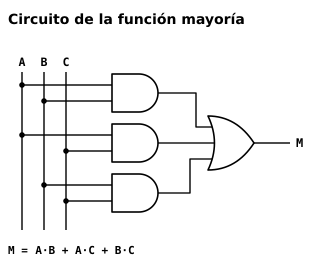
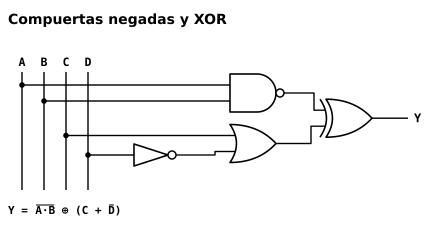

[Manual](../../README.md) › [Sistemas de computación](../README.md) › [Sistemas digitales](README.md)

# Circuito lógico (`logic_circuit`)

Convierte la expresión en un circuito con compuertas AND, OR, XOR, NAND, NOR, XNOR y NOT. Las
entradas bajan por rieles verticales a la izquierda y cada compuerta se ubica por su
profundidad; la negación de una AND, OR o XOR se dibuja como la compuerta negada.

## Campos

| Campo | Tipo | Valores y valor por defecto | Descripción |
| :--- | :--- | :--- | :--- |
| `type` | texto | `logic_circuit` | Obligatorio. |
| `expr` | texto |  | La expresión (ver [`truth_table`](truth_table.md)). |
| `output` | texto |  | El nombre de la salida (por omisión `F`). |
| `vars` | lista |  | El orden de las variables en los rieles. |
| `rails` | sí/no |  | Rieles verticales para las entradas (por omisión, sí); sin ellos, cada entrada se rotula en su compuerta. |
| `basicGates` | sí/no |  | Sólo AND, OR, XOR y NOT (una NAND sale como AND y NOT). |
| `showExpr` | sí/no |  | Escribe la expresión debajo (por omisión, sí). |
| `notation` | texto |  | `overline`, `prime` o `neg`. |
| `multiLetterVars` | sí/no |  | Con `true`, `AB` es una variable. |

Además, los campos comunes a todos los tipos: `title`, `subtitle`, `id`, `inkSaver` y `theme` (ver [Campos comunes](../../campos-comunes.md)).

## Ejemplos

### Circuito de la función mayoría

```yaml
type: logic_circuit
title: Circuito de la función mayoría
expr: "A·B + A·C + B·C"
output: M
```



### Compuertas negadas y XOR

```yaml
type: logic_circuit
title: Compuertas negadas y XOR
expr: "!(A·B) ⊕ (C + !D)"
output: Y
```



## Ver también

[`truth_table`](truth_table.md), [`karnaugh`](karnaugh.md)
