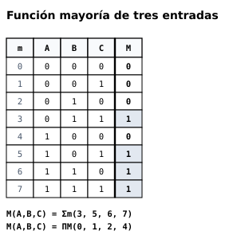
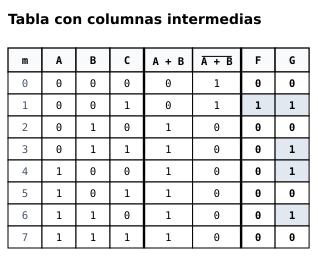
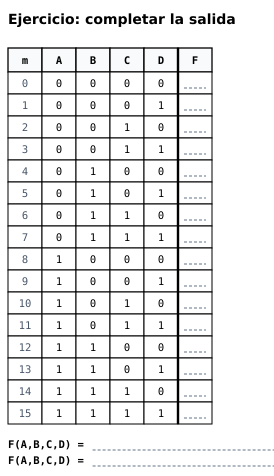

[Manual](../../README.md) › [Sistemas de computación](../README.md) › [Sistemas digitales](README.md)

# Tabla de verdad (`truth_table`)

Evalúa una o varias expresiones booleanas en todas las combinaciones de sus variables y
dibuja la tabla, con los unos resaltados. Con `steps`, agrega una columna por cada
subexpresión, para mostrar cómo se llega al resultado; con `canonical`, la suma de mintérminos
y el producto de maxtérminos.

## Qué calcula

- El valor de cada salida y de cada subexpresión en cada fila.
- Las formas canónicas Σm(…) y ΠM(…).

## Campos

| Campo | Tipo | Valores y valor por defecto | Descripción |
| :--- | :--- | :--- | :--- |
| `type` | texto | `truth_table` | Obligatorio. |
| `expr` | texto |  | La expresión, como `A·B + !C`. NOT: `!A`, `~A`, `¬A`, `A'`; AND: `&`, `·`, `*` o yuxtaposición (`A B`, `AB'C`); OR: `+`, `\|`; XOR: `^`, `⊕`; también `AND`, `OR`, `NOT`, `XOR`, `NAND`, `NOR`, `XNOR`. |
| `outputs` | lista |  | Varias salidas que comparten variables: `[{name, expr}]` o una lista de expresiones (hasta 8). |
| `name` | texto |  | El nombre de la salida (por omisión `F`). |
| `vars` | lista |  | Las variables, en orden (por omisión, alfabético). Obligatorias con `minterms`. |
| `minterms` | lista |  | La función por sus mintérminos, en lugar de `expr`. |
| `maxterms` | lista |  | La función por sus maxtérminos. |
| `dontcares` | lista |  | Las combinaciones indiferentes, que salen como X. |
| `steps` | sí/no |  | Agrega una columna por cada subexpresión (hasta 10). |
| `canonical` | sí/no |  | Escribe las formas canónicas debajo. |
| `index` | sí/no |  | La columna con el número de mintérmino (por omisión, sí). |
| `notation` | texto |  | Cómo se escribe la negación en los encabezados: `overline` (barra), `prime` (A') o `neg` (¬A). |
| `multiLetterVars` | sí/no |  | Con `true`, `AB` es una variable; por omisión, varias mayúsculas juntas son variables de una letra. |
| `blank` | sí/no |  | Deja en blanco las salidas, las columnas intermedias y las formas canónicas. |

Además, los campos comunes a todos los tipos: `title`, `subtitle`, `id`, `inkSaver` y `theme` (ver [Campos comunes](../../campos-comunes.md)).

## Modo ejercicio

Campos que dejan casilleros para completar: `blank`.

## Ejemplos

### Función mayoría de tres entradas

```yaml
type: truth_table
title: Función mayoría de tres entradas
expr: "A·B + A·C + B·C"
name: M
canonical: true
```

[](https://ingcom-unrn.github.io/dibu-web/#t=dHlwZTogdHJ1dGhfdGFibGUKdGl0bGU6IEZ1bmNpw7NuIG1heW9yw61hIGRlIHRyZXMgZW50cmFkYXMKZXhwcjogIkHCt0IgKyBBwrdDICsgQsK3QyIKbmFtZTogTQpjYW5vbmljYWw6IHRydWUK)

[Abrir en el editor](https://ingcom-unrn.github.io/dibu-web/#t=dHlwZTogdHJ1dGhfdGFibGUKdGl0bGU6IEZ1bmNpw7NuIG1heW9yw61hIGRlIHRyZXMgZW50cmFkYXMKZXhwcjogIkHCt0IgKyBBwrdDICsgQsK3QyIKbmFtZTogTQpjYW5vbmljYWw6IHRydWUK) para explorarlo y modificarlo.

### Tabla con columnas intermedias

```yaml
type: truth_table
title: Tabla con columnas intermedias
outputs:
  - { name: F, expr: "!(A + B) · C" }
  - { name: G, expr: "A XOR C" }
steps: true
```

[](https://ingcom-unrn.github.io/dibu-web/#t=dHlwZTogdHJ1dGhfdGFibGUKdGl0bGU6IFRhYmxhIGNvbiBjb2x1bW5hcyBpbnRlcm1lZGlhcwpvdXRwdXRzOgogIC0geyBuYW1lOiBGLCBleHByOiAiIShBICsgQikgwrcgQyIgfQogIC0geyBuYW1lOiBHLCBleHByOiAiQSBYT1IgQyIgfQpzdGVwczogdHJ1ZQo)

[Abrir en el editor](https://ingcom-unrn.github.io/dibu-web/#t=dHlwZTogdHJ1dGhfdGFibGUKdGl0bGU6IFRhYmxhIGNvbiBjb2x1bW5hcyBpbnRlcm1lZGlhcwpvdXRwdXRzOgogIC0geyBuYW1lOiBGLCBleHByOiAiIShBICsgQikgwrcgQyIgfQogIC0geyBuYW1lOiBHLCBleHByOiAiQSBYT1IgQyIgfQpzdGVwczogdHJ1ZQo) para explorarlo y modificarlo.

### Ejercicio: completar la salida

```yaml
type: truth_table
title: "Ejercicio: completar la salida"
vars: [A, B, C, D]
minterms: [1, 3, 7, 11, 15]
dontcares: [0, 2, 5]
blank: true
canonical: true
```

[](https://ingcom-unrn.github.io/dibu-web/#t=dHlwZTogdHJ1dGhfdGFibGUKdGl0bGU6ICJFamVyY2ljaW86IGNvbXBsZXRhciBsYSBzYWxpZGEiCnZhcnM6IFtBLCBCLCBDLCBEXQptaW50ZXJtczogWzEsIDMsIDcsIDExLCAxNV0KZG9udGNhcmVzOiBbMCwgMiwgNV0KYmxhbms6IHRydWUKY2Fub25pY2FsOiB0cnVlCg)

[Abrir en el editor](https://ingcom-unrn.github.io/dibu-web/#t=dHlwZTogdHJ1dGhfdGFibGUKdGl0bGU6ICJFamVyY2ljaW86IGNvbXBsZXRhciBsYSBzYWxpZGEiCnZhcnM6IFtBLCBCLCBDLCBEXQptaW50ZXJtczogWzEsIDMsIDcsIDExLCAxNV0KZG9udGNhcmVzOiBbMCwgMiwgNV0KYmxhbms6IHRydWUKY2Fub25pY2FsOiB0cnVlCg) para explorarlo y modificarlo.

## Ver también

[`karnaugh`](karnaugh.md), [`logic_circuit`](logic_circuit.md)
