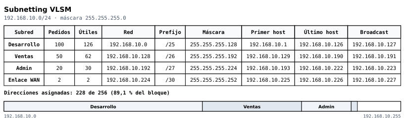
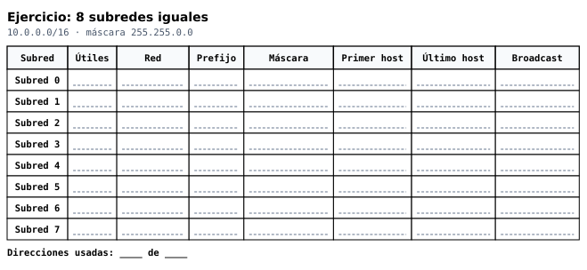

[Manual](../../README.md) › [Sistemas de computación](../README.md) › [Redes](README.md)

# Subnetting (`subnetting`)

Divide una red IPv4 en subredes, de igual tamaño o con VLSM según los hosts que necesita cada
una, y dibuja la tabla con la red, el prefijo, la máscara, el primer y el último host y el
broadcast de cada subred, más un mapa del espacio de direcciones.

## Qué calcula

- Con VLSM, el prefijo mínimo para cada pedido y la asignación alineada, de la subred más grande a la más chica.
- Los hosts útiles de cada subred (las /31 y /32, 2 y 1).

## Campos

| Campo | Tipo | Valores y valor por defecto | Descripción |
| :--- | :--- | :--- | :--- |
| `type` | texto | `subnetting` | Obligatorio. |
| `network` | texto |  | La red, `A.B.C.D/n` (prefijo de 0 a 30). |
| `subnets` | lista |  | Las subredes con VLSM: `{name, hosts}` o sólo la cantidad de hosts (hasta 64). |
| `count` | número |  | Cantidad de subredes iguales, en lugar de `subnets`. |
| `sort` | sí/no |  | Con VLSM, asigna de la más grande a la más chica (por omisión, sí). |
| `summary` | sí/no |  | Escribe cuántas direcciones se usan (por omisión, sí). |
| `map` | sí/no |  | Dibuja el mapa del espacio de direcciones (por omisión, sí). |
| `binary` | sí/no |  | Escribe cada red en binario, con los bits de red y de host. |
| `blank` | sí/no |  | Deja en blanco todo salvo el nombre y los hosts pedidos. |

Además, los campos comunes a todos los tipos: `title`, `subtitle`, `id`, `inkSaver` y `theme` (ver [Campos comunes](../../campos-comunes.md)).

## Modo ejercicio

Campos que dejan casilleros para completar: `blank`.

## Ejemplos

### Subnetting VLSM

```yaml
type: subnetting
title: Subnetting VLSM
network: 192.168.10.0/24
subnets:
  - { name: Ventas, hosts: 50 }
  - { name: Desarrollo, hosts: 100 }
  - { name: Admin, hosts: 20 }
  - { name: Enlace WAN, hosts: 2 }
```



### Ejercicio: 8 subredes iguales

```yaml
type: subnetting
title: "Ejercicio: 8 subredes iguales"
network: 10.0.0.0/16
count: 8
blank: true
```


