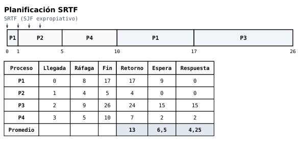
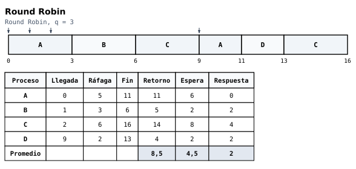
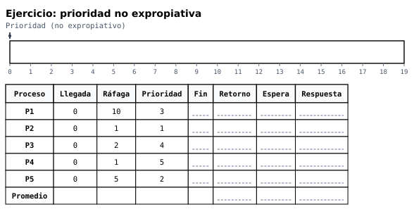

[Manual](../../README.md) › [Sistemas de computación](../README.md) › [Sistemas operativos](README.md)

# Planificación de CPU (`cpu_scheduling`)

Simula la planificación de los procesos y dibuja el diagrama de Gantt, con la CPU ociosa
cuando no hay nadie listo y una flecha en cada llegada. Debajo, la tabla con el instante de
fin y los tiempos de retorno, espera y respuesta de cada proceso, y sus promedios.

## Qué calcula

- FCFS, SJF y prioridad no expropiativos; SRTF y prioridad expropiativos; Round Robin con quantum.
- En Round Robin, los que llegan durante un quantum entran a la cola antes que el expropiado.
- Los empates se rompen por llegada y después por el orden de la lista.

## Campos

| Campo | Tipo | Valores y valor por defecto | Descripción |
| :--- | :--- | :--- | :--- |
| `type` | texto | `cpu_scheduling` | Obligatorio. |
| `processes` | lista |  | Los procesos (hasta 26): `{name, arrival, burst, priority}`. `arrival` es 0 por omisión; la prioridad más alta es el número menor. |
| `algorithm` | texto | `fcfs`, `sjf`, `srtf`, `rr`, `priority`, `priority_preemptive` · por defecto `fcfs` | `fcfs`, `sjf`, `srtf`, `rr`, `priority` o `priority_preemptive`. |
| `quantum` | número |  | El quantum de Round Robin (por omisión 2). |
| `blank` | sí/no |  | Deja el Gantt vacío (con la escala de tiempo) y los tiempos en blanco. |

Además, los campos comunes a todos los tipos: `title`, `subtitle`, `id`, `inkSaver` y `theme` (ver [Campos comunes](../../campos-comunes.md)).

## Modo ejercicio

Campos que dejan casilleros para completar: `blank`.

## Ejemplos

### Planificación SRTF

```yaml
type: cpu_scheduling
title: Planificación SRTF
algorithm: srtf
processes:
  - { name: P1, arrival: 0, burst: 8 }
  - { name: P2, arrival: 1, burst: 4 }
  - { name: P3, arrival: 2, burst: 9 }
  - { name: P4, arrival: 3, burst: 5 }
```

[](https://ingcom-unrn.github.io/dibu-web/#z=XctLCsIwFEbheVbxL6CCfQiaBTgWdS4xpu2FNA3JjSDSVbkEN6ZOQu308B1-eCOhfbpE3ZtbsuQ6wcT2Ww9WOWpJK03vl8PpeN4LZbsxEPeDRAzcCh9GbWI0UQpghSecGn5rWUCFQHdlJdYFrilElthi-mfVjJWZNUtWz1iV2W7JmhmrM9tgEh8)

[Abrir en el editor](https://ingcom-unrn.github.io/dibu-web/#z=XctLCsIwFEbheVbxL6CCfQiaBTgWdS4xpu2FNA3JjSDSVbkEN6ZOQu308B1-eCOhfbpE3ZtbsuQ6wcT2Ww9WOWpJK03vl8PpeN4LZbsxEPeDRAzcCh9GbWI0UQpghSecGn5rWUCFQHdlJdYFrilElthi-mfVjJWZNUtWz1iV2W7JmhmrM9tgEh8) para explorarlo y modificarlo.

### Round Robin

```yaml
type: cpu_scheduling
title: Round Robin
algorithm: rr
quantum: 3
processes:
  - { name: A, arrival: 0, burst: 5 }
  - { name: B, arrival: 1, burst: 3 }
  - { name: C, arrival: 2, burst: 6 }
  - { name: D, arrival: 9, burst: 2 }
```

[](https://ingcom-unrn.github.io/dibu-web/#z=XctNCsIwEAXg_ZxiDlBBWxTMzp8TeAFJ09AG0qROZgSR3t2sQuzm8Xh8jz-LVWgWeSYz2UG8CyOwY5_XR5Qw5OxdAO3HSI6nWSERvEQHltw7WCgam5JNChB3-MWg5_y9NKiJ3Ft7hfsGe6HECo-4_qlrpQ5FdRt1q1Rb1Gmj7pU6F9XiCj8)

[Abrir en el editor](https://ingcom-unrn.github.io/dibu-web/#z=XctNCsIwEAXg_ZxiDlBBWxTMzp8TeAFJ09AG0qROZgSR3t2sQuzm8Xh8jz-LVWgWeSYz2UG8CyOwY5_XR5Qw5OxdAO3HSI6nWSERvEQHltw7WCgam5JNChB3-MWg5_y9NKiJ3Ft7hfsGe6HECo-4_qlrpQ5FdRt1q1Rb1Gmj7pU6F9XiCj8) para explorarlo y modificarlo.

### Ejercicio: prioridad no expropiativa

```yaml
type: cpu_scheduling
title: "Ejercicio: prioridad no expropiativa"
algorithm: priority
blank: true
processes:
  - { name: P1, arrival: 0, burst: 10, priority: 3 }
  - { name: P2, arrival: 0, burst: 1, priority: 1 }
  - { name: P3, arrival: 0, burst: 2, priority: 4 }
  - { name: P4, arrival: 0, burst: 1, priority: 5 }
  - { name: P5, arrival: 0, burst: 5, priority: 2 }
```

[](https://ingcom-unrn.github.io/dibu-web/#z=hc09CsMwDAXg3acQnVNo_hbv3XuD4jgmUevYRpZLQ8nd6yWQhkA3Ib3viedgJOiQ7lGPpk8W3SAY2ebt6fowpFGjlxAIPWGvenAezDuQD6gYX-oklB3yicdpTfEsOqvcUwJTMiJntYnRRCkAzvABp6bcfisLUES5wkq4FNAliiyhzONaI6GG5RdVx2hryr2pD021Nc3eNP__tHvTHpp2aypYxBc)

[Abrir en el editor](https://ingcom-unrn.github.io/dibu-web/#z=hc09CsMwDAXg3acQnVNo_hbv3XuD4jgmUevYRpZLQ8nd6yWQhkA3Ib3viedgJOiQ7lGPpk8W3SAY2ebt6fowpFGjlxAIPWGvenAezDuQD6gYX-oklB3yicdpTfEsOqvcUwJTMiJntYnRRCkAzvABp6bcfisLUES5wkq4FNAliiyhzONaI6GG5RdVx2hryr2pD021Nc3eNP__tHvTHpp2aypYxBc) para explorarlo y modificarlo.

## Ver también

[`page_table`](page_table.md), [`page_replacement`](page_replacement.md)
