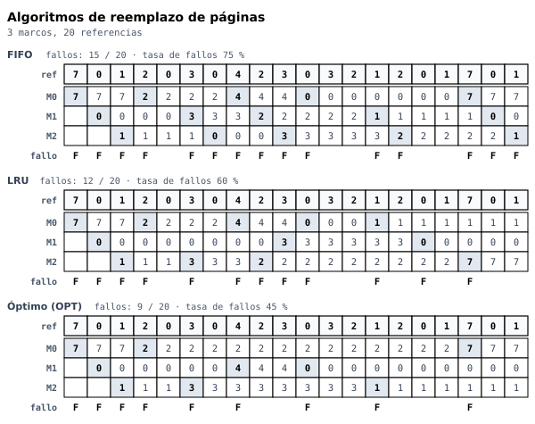
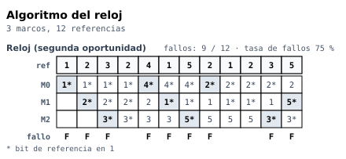

[Manual](../../README.md) › [Sistemas de computación](../README.md) › [Sistemas operativos](README.md)

# Reemplazo de páginas (`page_replacement`)

Simula los algoritmos de reemplazo sobre la cadena de referencias y dibuja, para cada uno,
una grilla con el contenido de cada marco en cada paso, la página que entra resaltada y los
fallos marcados. Con varios algoritmos, uno debajo del otro, con sus tasas de fallos.

## Qué calcula

- FIFO, LRU, óptimo (OPT, el que se usa más lejos en el futuro) y reloj (segunda oportunidad, con el bit de referencia marcado *).

## Campos

| Campo | Tipo | Valores y valor por defecto | Descripción |
| :--- | :--- | :--- | :--- |
| `type` | texto | `page_replacement` | Obligatorio. |
| `frames` | número |  | Cantidad de marcos (de 1 a 16, por omisión 3). |
| `references` | lista |  | La cadena de referencias (hasta 60). |
| `algorithm` | texto |  | Un algoritmo, `fifo`, `lru`, `opt` o `clock`. |
| `algorithms` | lista |  | Varios algoritmos para comparar. |
| `blank` | sí/no |  | Deja la grilla y los fallos en blanco. |

Además, los campos comunes a todos los tipos: `title`, `subtitle`, `id`, `inkSaver` y `theme` (ver [Campos comunes](../../campos-comunes.md)).

## Modo ejercicio

Campos que dejan casilleros para completar: `blank`.

## Ejemplos

### Algoritmos de reemplazo de páginas

```yaml
type: page_replacement
title: Algoritmos de reemplazo de páginas
frames: 3
references: [7, 0, 1, 2, 0, 3, 0, 4, 2, 3, 0, 3, 2, 1, 2, 0, 1, 7, 0, 1]
algorithms: [fifo, lru, opt]
```

[](https://ingcom-unrn.github.io/dibu-web/#t=dHlwZTogcGFnZV9yZXBsYWNlbWVudAp0aXRsZTogQWxnb3JpdG1vcyBkZSByZWVtcGxhem8gZGUgcMOhZ2luYXMKZnJhbWVzOiAzCnJlZmVyZW5jZXM6IFs3LCAwLCAxLCAyLCAwLCAzLCAwLCA0LCAyLCAzLCAwLCAzLCAyLCAxLCAyLCAwLCAxLCA3LCAwLCAxXQphbGdvcml0aG1zOiBbZmlmbywgbHJ1LCBvcHRdCg)

[Abrir en el editor](https://ingcom-unrn.github.io/dibu-web/#t=dHlwZTogcGFnZV9yZXBsYWNlbWVudAp0aXRsZTogQWxnb3JpdG1vcyBkZSByZWVtcGxhem8gZGUgcMOhZ2luYXMKZnJhbWVzOiAzCnJlZmVyZW5jZXM6IFs3LCAwLCAxLCAyLCAwLCAzLCAwLCA0LCAyLCAzLCAwLCAzLCAyLCAxLCAyLCAwLCAxLCA3LCAwLCAxXQphbGdvcml0aG1zOiBbZmlmbywgbHJ1LCBvcHRdCg) para explorarlo y modificarlo.

### Algoritmo del reloj

```yaml
type: page_replacement
title: Algoritmo del reloj
frames: 3
references: [1, 2, 3, 2, 4, 1, 5, 2, 1, 2, 3, 5]
algorithm: clock
```

[](https://ingcom-unrn.github.io/dibu-web/#t=dHlwZTogcGFnZV9yZXBsYWNlbWVudAp0aXRsZTogQWxnb3JpdG1vIGRlbCByZWxvagpmcmFtZXM6IDMKcmVmZXJlbmNlczogWzEsIDIsIDMsIDIsIDQsIDEsIDUsIDIsIDEsIDIsIDMsIDVdCmFsZ29yaXRobTogY2xvY2sK)

[Abrir en el editor](https://ingcom-unrn.github.io/dibu-web/#t=dHlwZTogcGFnZV9yZXBsYWNlbWVudAp0aXRsZTogQWxnb3JpdG1vIGRlbCByZWxvagpmcmFtZXM6IDMKcmVmZXJlbmNlczogWzEsIDIsIDMsIDIsIDQsIDEsIDUsIDIsIDEsIDIsIDMsIDVdCmFsZ29yaXRobTogY2xvY2sK) para explorarlo y modificarlo.

## Ver también

[`cpu_scheduling`](cpu_scheduling.md), [`page_table`](page_table.md)
