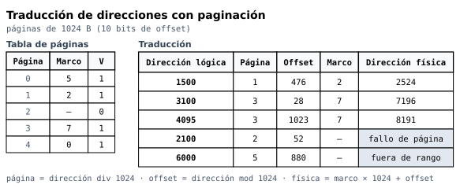

[Manual](../../README.md) › [Sistemas de computación](../README.md) › [Sistemas operativos](README.md)

# Tabla de páginas (`page_table`)

Dibuja la tabla de páginas (página, marco, bit de validez) y la traducción de cada dirección
lógica: número de página, desplazamiento, marco y dirección física, o el fallo de página.

## Qué calcula

- página = dirección div tamaño; offset = dirección mod tamaño; física = marco × tamaño + offset.

## Campos

| Campo | Tipo | Valores y valor por defecto | Descripción |
| :--- | :--- | :--- | :--- |
| `type` | texto | `page_table` | Obligatorio. |
| `pageSize` | número |  | Tamaño de página en bytes, potencia de 2. |
| `table` | lista |  | El marco de cada página; `null` es una página que no está en memoria. |
| `addresses` | lista |  | Las direcciones lógicas, en decimal o en hexadecimal. |
| `base` | texto | `dec`, `hex` · por defecto `dec` | `dec` o `hex`: cómo se escriben las direcciones. |
| `formula` | sí/no |  | Escribe las fórmulas debajo (por omisión, sí). |
| `blank` | sí/no |  | Deja en blanco la traducción. |

Además, los campos comunes a todos los tipos: `title`, `subtitle`, `id`, `inkSaver` y `theme` (ver [Campos comunes](../../campos-comunes.md)).

## Modo ejercicio

Campos que dejan casilleros para completar: `blank`.

## Ejemplos

### Traducción de direcciones con paginación

```yaml
type: page_table
title: Traducción de direcciones con paginación
pageSize: 1024
table: [5, 2, null, 7, 0]
addresses: [1500, 3100, 4095, 2100, 6000]
```

[](https://ingcom-unrn.github.io/dibu-web/#t=dHlwZTogcGFnZV90YWJsZQp0aXRsZTogVHJhZHVjY2nDs24gZGUgZGlyZWNjaW9uZXMgY29uIHBhZ2luYWNpw7NuCnBhZ2VTaXplOiAxMDI0CnRhYmxlOiBbNSwgMiwgbnVsbCwgNywgMF0KYWRkcmVzc2VzOiBbMTUwMCwgMzEwMCwgNDA5NSwgMjEwMCwgNjAwMF0K)

[Abrir en el editor](https://ingcom-unrn.github.io/dibu-web/#t=dHlwZTogcGFnZV90YWJsZQp0aXRsZTogVHJhZHVjY2nDs24gZGUgZGlyZWNjaW9uZXMgY29uIHBhZ2luYWNpw7NuCnBhZ2VTaXplOiAxMDI0CnRhYmxlOiBbNSwgMiwgbnVsbCwgNywgMF0KYWRkcmVzc2VzOiBbMTUwMCwgMzEwMCwgNDA5NSwgMjEwMCwgNjAwMF0K) para explorarlo y modificarlo.

## Ver también

[`cpu_scheduling`](cpu_scheduling.md), [`page_replacement`](page_replacement.md)
