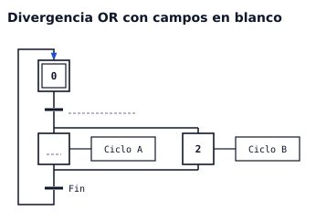

[Manual](../../README.md) › [Control de procesos](../README.md) › [Instrumentación y automatización](README.md)

# GRAFCET (`grafcet`)

Dibuja un GRAFCET: etapas con sus acciones, transiciones con su receptividad y divergencias
y convergencias en O y en Y. Por omisión, la última transición vuelve a la etapa inicial.

## Campos

| Campo | Tipo | Valores y valor por defecto | Descripción |
| :--- | :--- | :--- | :--- |
| `type` | texto | `grafcet` | Obligatorio. |
| `steps` | lista |  | En orden: `step` (número, `initial`, `actions`, `blank`), `transition` (la receptividad, `blank`), `or` y `and` (divergencias: listas de secuencias). |
| `loop` | sí/no |  | Vuelve a la etapa inicial al final (por omisión, sí). |

Además, los campos comunes a todos los tipos: `title`, `subtitle`, `id`, `inkSaver` y `theme` (ver [Campos comunes](../../campos-comunes.md)).

## Ejemplos

### Llenado y mezcla en paralelo

```yaml
type: grafcet
title: Llenado y mezcla en paralelo
steps:
  - {step: 0, initial: true}
  - {transition: "Marcha · nivel bajo"}
  - {step: 1, actions: ["Abrir V1"]}
  - {transition: "nivel alto"}
  - and:
      - [{step: 2, actions: ["Agitador"]}, {transition: "t/X2/30 s"}, {step: 4}]
      - [{step: 3, actions: ["Calentar"]}, {transition: "T > 60 °C"}, {step: 5}]
  - {transition: "1"}
  - {step: 6, actions: ["Abrir V2"]}
  - {transition: "nivel bajo"}
```

[](https://ingcom-unrn.github.io/dibu-web/#z=fdCxTsMwEAbgPU_xy3OqJil08ICEurYbQkhVh2t6FCPjRPaBVFDeiY29T4ZNitSUCE-2z_5098uhZY29p8eaJRMjNh6Xlh3tGhzwwu-1JbBDS54s2yYLwm3QGTDBR9prFDmMM2LIaoh_5a4viicX4nXjNNSKfP1EOH7BmTe22NJzo7pzpcxBdXodNNbqduuNx32pNmNab5CVX4PcLrWU1gTrk1gNxb2ROJSPYn7ByfShms4KBJVK_eerbvMHnA3ARczDCY2Bd7jBvMDxc3EmXv-Il6OUwxTmYylU_6VwSvIb)

[Abrir en el editor](https://ingcom-unrn.github.io/dibu-web/#z=fdCxTsMwEAbgPU_xy3OqJil08ICEurYbQkhVh2t6FCPjRPaBVFDeiY29T4ZNitSUCE-2z_5098uhZY29p8eaJRMjNh6Xlh3tGhzwwu-1JbBDS54s2yYLwm3QGTDBR9prFDmMM2LIaoh_5a4viicX4nXjNNSKfP1EOH7BmTe22NJzo7pzpcxBdXodNNbqduuNx32pNmNab5CVX4PcLrWU1gTrk1gNxb2ROJSPYn7ByfShms4KBJVK_eerbvMHnA3ARczDCY2Bd7jBvMDxc3EmXv-Il6OUwxTmYylU_6VwSvIb) para explorarlo y modificarlo.

### Divergencia OR con campos en blanco

```yaml
type: grafcet
title: Divergencia OR con campos en blanco
steps:
  - {step: 0, initial: true}
  - {transition: "Auto & <Listo>", blank: true}
  - or:
      - [{step: 1, actions: ["Ciclo A"], blank: true}]
      - [{step: 2, actions: ["Ciclo B"]}]
  - {transition: "Fin"}
inkSaver: false
```

[](https://ingcom-unrn.github.io/dibu-web/#z=bY8xiwJBDIX7-RWPKaxWUMtBBE-xEgQtZYvcMEpwzCwzURDxv7urFqdequTlvY9EL01w2Gfa-aBGWWM7zvkc8j6IZ8JqDZ8Eno5NKgiC30jikykamuIM0Me16x0GFVhYmaKD5lO4PZeaSUorJ3Gw05Mm9DBectE0sdWDdvjrT7mDdtXH9kUeViDfEYrD1s7Yx4Sprd_T9Vds9E_sx9YP5-dhCxZ7MyyHDbW_O-wolmDu)

[Abrir en el editor](https://ingcom-unrn.github.io/dibu-web/#z=bY8xiwJBDIX7-RWPKaxWUMtBBE-xEgQtZYvcMEpwzCwzURDxv7urFqdequTlvY9EL01w2Gfa-aBGWWM7zvkc8j6IZ8JqDZ8Eno5NKgiC30jikykamuIM0Me16x0GFVhYmaKD5lO4PZeaSUorJ3Gw05Mm9DBectE0sdWDdvjrT7mDdtXH9kUeViDfEYrD1s7Yx4Sprd_T9Vds9E_sx9YP5-dhCxZ7MyyHDbW_O-wolmDu) para explorarlo y modificarlo.

## Ver también

[`instrumentation`](instrumentation.md), [`ladder`](ladder.md)
