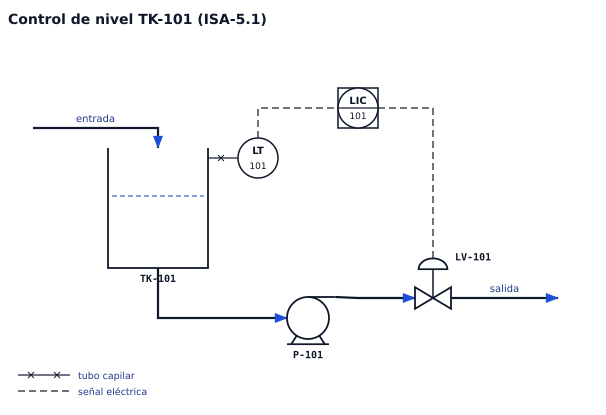

[Manual](../../README.md) › [Control de procesos](../README.md) › [Instrumentación y automatización](README.md)

# P&ID (`instrumentation`)

Dibuja un diagrama de cañerías e instrumentos: equipos (tanques, bombas, válvulas,
intercambiadores), instrumentos con su tag y su ubicación (campo, panel, DCS, PLC) y las
líneas de proceso, eléctricas, neumáticas o de datos que los unen, sobre una grilla.

## Campos

| Campo | Tipo | Valores y valor por defecto | Descripción |
| :--- | :--- | :--- | :--- |
| `type` | texto | `instrumentation` | Obligatorio. |
| `equipment` | lista |  | Los equipos: `id`, `kind` (`tank`, `vessel`, `reactor`, `column`, `pump`, `control_valve`, `valve`, `heat_exchanger`), `at: [x, y]` en la grilla, `label`, `size`, `level`, `orientation: v`. |
| `instruments` | lista |  | Los instrumentos: `id`, `tag` (`"LIC 101"`), `at`, `location` (`field`, `panel`, `panel_back`, `dcs`, `plc`) y `blank`. |
| `lines` | lista |  | Las líneas: `from` y `to` (un id o `[x, y]`), `kind` (`process`, `electric`, `pneumatic`, `data`, `capillary`), `via`, `route` (`hv` o `vh`), `label`, `arrow`. |
| `grid` | número |  | Píxeles por unidad de la grilla. |
| `legend` | sí/no |  | Agrega la leyenda de los tipos de línea. |

Además, los campos comunes a todos los tipos: `title`, `subtitle`, `id`, `inkSaver` y `theme` (ver [Campos comunes](../../campos-comunes.md)).

## Ejemplos

### Control de nivel TK-101 (ISA-5.1)

```yaml
type: instrumentation
title: Control de nivel TK-101 (ISA-5.1)
equipment:
  - {id: TK, kind: tank, at: [3, 3], label: "TK-101", level: 0.6}
  - {id: P1, kind: pump, at: [6, 5.2], label: "P-101"}
  - {id: LV, kind: control_valve, at: [8.5, 4.8], label: "LV-101"}
instruments:
  - {id: LT, tag: "LT 101", at: [5, 2]}
  - {id: LIC, tag: "LIC 101", at: [7, 1], location: dcs}
lines:
  - {from: [0.5, 1.4], to: TK, label: "entrada", via: [[3, 1.4]]}
  - {from: TK, to: P1, via: [[3, 5.2]]}
  - {from: P1, to: LV, via: [[7, 4.8]]}
  - {from: LV, to: [11, 4.8], label: "salida"}
  - {from: TK, to: LT, kind: capillary, via: [[4, 2]]}
  - {from: LT, to: LIC, kind: electric, via: [[5, 1]]}
  - {from: LIC, to: LV, kind: electric, via: [[8.5, 1]]}
inkSaver: false
```

[](https://ingcom-unrn.github.io/dibu-web/#t=dHlwZTogaW5zdHJ1bWVudGF0aW9uCnRpdGxlOiBDb250cm9sIGRlIG5pdmVsIFRLLTEwMSAoSVNBLTUuMSkKZXF1aXBtZW50OgogIC0ge2lkOiBUSywga2luZDogdGFuaywgYXQ6IFszLCAzXSwgbGFiZWw6ICJUSy0xMDEiLCBsZXZlbDogMC42fQogIC0ge2lkOiBQMSwga2luZDogcHVtcCwgYXQ6IFs2LCA1LjJdLCBsYWJlbDogIlAtMTAxIn0KICAtIHtpZDogTFYsIGtpbmQ6IGNvbnRyb2xfdmFsdmUsIGF0OiBbOC41LCA0LjhdLCBsYWJlbDogIkxWLTEwMSJ9Cmluc3RydW1lbnRzOgogIC0ge2lkOiBMVCwgdGFnOiAiTFQgMTAxIiwgYXQ6IFs1LCAyXX0KICAtIHtpZDogTElDLCB0YWc6ICJMSUMgMTAxIiwgYXQ6IFs3LCAxXSwgbG9jYXRpb246IGRjc30KbGluZXM6CiAgLSB7ZnJvbTogWzAuNSwgMS40XSwgdG86IFRLLCBsYWJlbDogImVudHJhZGEiLCB2aWE6IFtbMywgMS40XV19CiAgLSB7ZnJvbTogVEssIHRvOiBQMSwgdmlhOiBbWzMsIDUuMl1dfQogIC0ge2Zyb206IFAxLCB0bzogTFYsIHZpYTogW1s3LCA0LjhdXX0KICAtIHtmcm9tOiBMViwgdG86IFsxMSwgNC44XSwgbGFiZWw6ICJzYWxpZGEifQogIC0ge2Zyb206IFRLLCB0bzogTFQsIGtpbmQ6IGNhcGlsbGFyeSwgdmlhOiBbWzQsIDJdXX0KICAtIHtmcm9tOiBMVCwgdG86IExJQywga2luZDogZWxlY3RyaWMsIHZpYTogW1s1LCAxXV19CiAgLSB7ZnJvbTogTElDLCB0bzogTFYsIGtpbmQ6IGVsZWN0cmljLCB2aWE6IFtbOC41LCAxXV19Cmlua1NhdmVyOiBmYWxzZQo)

[Abrir en el editor](https://ingcom-unrn.github.io/dibu-web/#t=dHlwZTogaW5zdHJ1bWVudGF0aW9uCnRpdGxlOiBDb250cm9sIGRlIG5pdmVsIFRLLTEwMSAoSVNBLTUuMSkKZXF1aXBtZW50OgogIC0ge2lkOiBUSywga2luZDogdGFuaywgYXQ6IFszLCAzXSwgbGFiZWw6ICJUSy0xMDEiLCBsZXZlbDogMC42fQogIC0ge2lkOiBQMSwga2luZDogcHVtcCwgYXQ6IFs2LCA1LjJdLCBsYWJlbDogIlAtMTAxIn0KICAtIHtpZDogTFYsIGtpbmQ6IGNvbnRyb2xfdmFsdmUsIGF0OiBbOC41LCA0LjhdLCBsYWJlbDogIkxWLTEwMSJ9Cmluc3RydW1lbnRzOgogIC0ge2lkOiBMVCwgdGFnOiAiTFQgMTAxIiwgYXQ6IFs1LCAyXX0KICAtIHtpZDogTElDLCB0YWc6ICJMSUMgMTAxIiwgYXQ6IFs3LCAxXSwgbG9jYXRpb246IGRjc30KbGluZXM6CiAgLSB7ZnJvbTogWzAuNSwgMS40XSwgdG86IFRLLCBsYWJlbDogImVudHJhZGEiLCB2aWE6IFtbMywgMS40XV19CiAgLSB7ZnJvbTogVEssIHRvOiBQMSwgdmlhOiBbWzMsIDUuMl1dfQogIC0ge2Zyb206IFAxLCB0bzogTFYsIHZpYTogW1s3LCA0LjhdXX0KICAtIHtmcm9tOiBMViwgdG86IFsxMSwgNC44XSwgbGFiZWw6ICJzYWxpZGEifQogIC0ge2Zyb206IFRLLCB0bzogTFQsIGtpbmQ6IGNhcGlsbGFyeSwgdmlhOiBbWzQsIDJdXX0KICAtIHtmcm9tOiBMVCwgdG86IExJQywga2luZDogZWxlY3RyaWMsIHZpYTogW1s1LCAxXV19CiAgLSB7ZnJvbTogTElDLCB0bzogTFYsIGtpbmQ6IGVsZWN0cmljLCB2aWE6IFtbOC41LCAxXV19Cmlua1NhdmVyOiBmYWxzZQo) para explorarlo y modificarlo.

### Instrumento en blanco

```yaml
type: instrumentation
title: Instrumento en blanco
equipment:
  - {id: TK, kind: tank, at: [2, 2], label: "TK-1"}
instruments:
  - {id: LT, tag: "LT 1", at: [5, 1], blank: true}
lines:
  - {from: TK, to: LT, kind: capillary}
```

[](https://ingcom-unrn.github.io/dibu-web/#t=dHlwZTogaW5zdHJ1bWVudGF0aW9uCnRpdGxlOiBJbnN0cnVtZW50byBlbiBibGFuY28KZXF1aXBtZW50OgogIC0ge2lkOiBUSywga2luZDogdGFuaywgYXQ6IFsyLCAyXSwgbGFiZWw6ICJUSy0xIn0KaW5zdHJ1bWVudHM6CiAgLSB7aWQ6IExULCB0YWc6ICJMVCAxIiwgYXQ6IFs1LCAxXSwgYmxhbms6IHRydWV9CmxpbmVzOgogIC0ge2Zyb206IFRLLCB0bzogTFQsIGtpbmQ6IGNhcGlsbGFyeX0K)

[Abrir en el editor](https://ingcom-unrn.github.io/dibu-web/#t=dHlwZTogaW5zdHJ1bWVudGF0aW9uCnRpdGxlOiBJbnN0cnVtZW50byBlbiBibGFuY28KZXF1aXBtZW50OgogIC0ge2lkOiBUSywga2luZDogdGFuaywgYXQ6IFsyLCAyXSwgbGFiZWw6ICJUSy0xIn0KaW5zdHJ1bWVudHM6CiAgLSB7aWQ6IExULCB0YWc6ICJMVCAxIiwgYXQ6IFs1LCAxXSwgYmxhbms6IHRydWV9CmxpbmVzOgogIC0ge2Zyb206IFRLLCB0bzogTFQsIGtpbmQ6IGNhcGlsbGFyeX0K) para explorarlo y modificarlo.

## Ver también

[`ladder`](ladder.md), [`grafcet`](grafcet.md)
