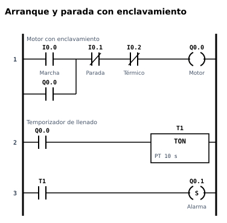

[Manual](../../README.md) › [Control de procesos](../README.md) › [Instrumentación y automatización](README.md)

# Diagrama escalera (`ladder`)

Dibuja los escalones de un programa en lenguaje escalera entre los dos rieles de
alimentación. Cada escalón es una secuencia de contactos (en serie, o en paralelo con `or`)
que termina en sus salidas.

## Campos

| Campo | Tipo | Valores y valor por defecto | Descripción |
| :--- | :--- | :--- | :--- |
| `type` | texto | `ladder` | Obligatorio. |
| `rungs` | lista |  | Los escalones, cada uno con `logic` y `comment`. En `logic`: contactos `no` (o `na`), `nc`, `p`, `n`; salidas `coil`, `ncoil`, `set`, `reset`; temporizadores `ton`, `tof`, `tp` y contadores `ctu`, `ctd` con `preset`; `or` (ramas en paralelo, cada una una lista). Cada elemento con `label` y `blank`. |

Además, los campos comunes a todos los tipos: `title`, `subtitle`, `id`, `inkSaver` y `theme` (ver [Campos comunes](../../campos-comunes.md)).

## Ejemplos

### Arranque y parada con enclavamiento

```yaml
type: ladder
title: Arranque y parada con enclavamiento
rungs:
  - comment: "Motor con enclavamiento"
    logic:
      - or:
          - [{"no": "I0.0", label: "Marcha"}]
          - [{"no": "Q0.0"}]
      - {nc: "I0.1", label: "Parada"}
      - {nc: "I0.2", label: "Térmico"}
      - {coil: "Q0.0", label: "Motor"}
  - comment: "Temporizador de llenado"
    logic:
      - {"no": "Q0.0"}
      - {ton: "T1", preset: "10 s"}
  - logic:
      - {"no": "T1"}
      - {set: "Q0.1", label: "Alarma"}
inkSaver: true
```

[](https://ingcom-unrn.github.io/dibu-web/#t=dHlwZTogbGFkZGVyCnRpdGxlOiBBcnJhbnF1ZSB5IHBhcmFkYSBjb24gZW5jbGF2YW1pZW50bwpydW5nczoKICAtIGNvbW1lbnQ6ICJNb3RvciBjb24gZW5jbGF2YW1pZW50byIKICAgIGxvZ2ljOgogICAgICAtIG9yOgogICAgICAgICAgLSBbeyJubyI6ICJJMC4wIiwgbGFiZWw6ICJNYXJjaGEifV0KICAgICAgICAgIC0gW3sibm8iOiAiUTAuMCJ9XQogICAgICAtIHtuYzogIkkwLjEiLCBsYWJlbDogIlBhcmFkYSJ9CiAgICAgIC0ge25jOiAiSTAuMiIsIGxhYmVsOiAiVMOpcm1pY28ifQogICAgICAtIHtjb2lsOiAiUTAuMCIsIGxhYmVsOiAiTW90b3IifQogIC0gY29tbWVudDogIlRlbXBvcml6YWRvciBkZSBsbGVuYWRvIgogICAgbG9naWM6CiAgICAgIC0geyJubyI6ICJRMC4wIn0KICAgICAgLSB7dG9uOiAiVDEiLCBwcmVzZXQ6ICIxMCBzIn0KICAtIGxvZ2ljOgogICAgICAtIHsibm8iOiAiVDEifQogICAgICAtIHtzZXQ6ICJRMC4xIiwgbGFiZWw6ICJBbGFybWEifQppbmtTYXZlcjogdHJ1ZQo)

[Abrir en el editor](https://ingcom-unrn.github.io/dibu-web/#t=dHlwZTogbGFkZGVyCnRpdGxlOiBBcnJhbnF1ZSB5IHBhcmFkYSBjb24gZW5jbGF2YW1pZW50bwpydW5nczoKICAtIGNvbW1lbnQ6ICJNb3RvciBjb24gZW5jbGF2YW1pZW50byIKICAgIGxvZ2ljOgogICAgICAtIG9yOgogICAgICAgICAgLSBbeyJubyI6ICJJMC4wIiwgbGFiZWw6ICJNYXJjaGEifV0KICAgICAgICAgIC0gW3sibm8iOiAiUTAuMCJ9XQogICAgICAtIHtuYzogIkkwLjEiLCBsYWJlbDogIlBhcmFkYSJ9CiAgICAgIC0ge25jOiAiSTAuMiIsIGxhYmVsOiAiVMOpcm1pY28ifQogICAgICAtIHtjb2lsOiAiUTAuMCIsIGxhYmVsOiAiTW90b3IifQogIC0gY29tbWVudDogIlRlbXBvcml6YWRvciBkZSBsbGVuYWRvIgogICAgbG9naWM6CiAgICAgIC0geyJubyI6ICJRMC4wIn0KICAgICAgLSB7dG9uOiAiVDEiLCBwcmVzZXQ6ICIxMCBzIn0KICAtIGxvZ2ljOgogICAgICAtIHsibm8iOiAiVDEifQogICAgICAtIHtzZXQ6ICJRMC4xIiwgbGFiZWw6ICJBbGFybWEifQppbmtTYXZlcjogdHJ1ZQo) para explorarlo y modificarlo.

## Notas

- YAML lee `no:` como `false`; dibu lo entiende igual, y `na:` también vale.

## Ver también

[`instrumentation`](instrumentation.md), [`grafcet`](grafcet.md)
