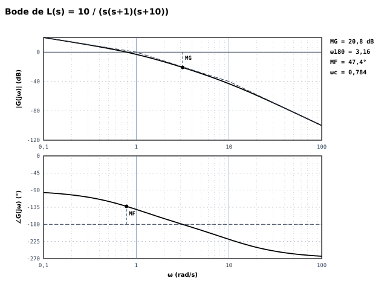

[Manual](../../README.md) › [Control de procesos](../README.md) › [Respuesta en frecuencia](README.md)

# Diagrama de Bode (`bode`)

Evalúa la respuesta en frecuencia y dibuja la magnitud en dB y la fase en grados, en escala
logarítmica. Opcionalmente, las asíntotas y los márgenes de ganancia y de fase con sus
frecuencias de cruce. Con `closedLoop` dibuja el lazo abierto L(s) = C·G·H.

## Qué calcula

- El margen de ganancia (en ω180) y el de fase (en ωc).
- Las asíntotas a partir de los polos y ceros.

## Campos

| Campo | Tipo | Valores y valor por defecto | Descripción |
| :--- | :--- | :--- | :--- |
| `type` | texto | `bode` | Obligatorio. |
| `system` | objeto |  | El sistema (ver la nota de [`time_response`](../respuesta/time_response.md)). |
| `systems` | lista |  | Varios sistemas para comparar, cada uno con `label`. |
| `closedLoop` | objeto |  | Un lazo; se dibuja su lazo abierto. |
| `wMin` | número |  | La frecuencia mínima, en rad/s. |
| `wMax` | número |  | La frecuencia máxima, en rad/s. |
| `show` | texto | `both`, `magnitude`, `phase` · por defecto `both` | `both`, `magnitude` o `phase`. |
| `asymptotes` | sí/no |  | Dibuja las asíntotas de la magnitud. |
| `margins` | sí/no |  | Marca los márgenes de ganancia y de fase. |
| `blankMargins` | sí/no |  | Deja los márgenes en blanco. |

Además, los campos comunes a todos los tipos: `title`, `subtitle`, `id`, `inkSaver` y `theme` (ver [Campos comunes](../../campos-comunes.md)).

## Modo ejercicio

Campos que dejan casilleros para completar: `blankMargins`.

## Ejemplos

### Bode de L(s) = 10 / (s(s+1)(s+10))

```yaml
type: bode
title: Bode de L(s) = 10 / (s(s+1)(s+10))
system: {k: 10, poles: [0, -1, -10]}
asymptotes: true
margins: true
```



## Ver también

[`nyquist`](nyquist.md)
