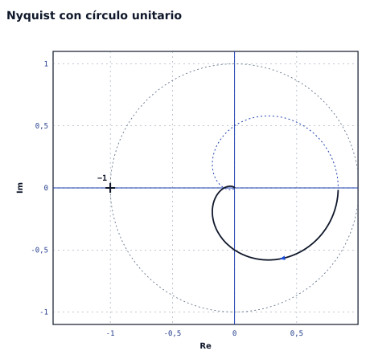

[Manual](../../README.md) › [Control de procesos](../README.md) › [Respuesta en frecuencia](README.md)

# Diagrama de Nyquist (`nyquist`)

Dibuja la curva de Nyquist del lazo abierto en el plano complejo, con el punto −1 marcado.
Opcionalmente, el círculo unitario y la rama de las frecuencias negativas, punteada.

## Campos

| Campo | Tipo | Valores y valor por defecto | Descripción |
| :--- | :--- | :--- | :--- |
| `type` | texto | `nyquist` | Obligatorio. |
| `system` | objeto |  | El sistema (ver la nota de [`time_response`](../respuesta/time_response.md)). |
| `systems` | lista |  | Varios sistemas para comparar. |
| `closedLoop` | objeto |  | Un lazo; se dibuja su lazo abierto. |
| `wMin` | número |  | La frecuencia mínima. |
| `wMax` | número |  | La frecuencia máxima. |
| `limit` | número |  | El radio máximo que se dibuja (recorta las ramas que se van al infinito). |
| `unitCircle` | sí/no |  | Dibuja el círculo unitario. |
| `showNegative` | sí/no |  | Dibuja la rama de ω negativas, punteada. |

Además, los campos comunes a todos los tipos: `title`, `subtitle`, `id`, `inkSaver` y `theme` (ver [Campos comunes](../../campos-comunes.md)).

## Ejemplos

### Nyquist con círculo unitario

```yaml
type: nyquist
title: Nyquist con círculo unitario
system: {k: 5, poles: [-1, -2, -3]}
unitCircle: true
inkSaver: false
```

[](https://ingcom-unrn.github.io/dibu-web/#z=K6ksSLVSyKssLM0sLuEqySzJAXL9IFyF5Pw8heTDa4uSS3PyFUrzMksSizLzuYori0tSc60UqrOtFEx1FAryc1KLrRSidQ11FHSNgNg4tpYLpNg5sygZZFpJUWkqV2ZednBiWWqRlUJaYk5xKhcA)

[Abrir en el editor](https://ingcom-unrn.github.io/dibu-web/#z=K6ksSLVSyKssLM0sLuEqySzJAXL9IFyF5Pw8heTDa4uSS3PyFUrzMksSizLzuYori0tSc60UqrOtFEx1FAryc1KLrRSidQ11FHSNgNg4tpYLpNg5sygZZFpJUWkqV2ZednBiWWqRlUJaYk5xKhcA) para explorarlo y modificarlo.

## Ver también

[`bode`](bode.md)
