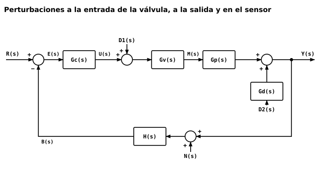
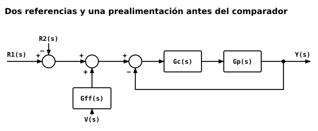
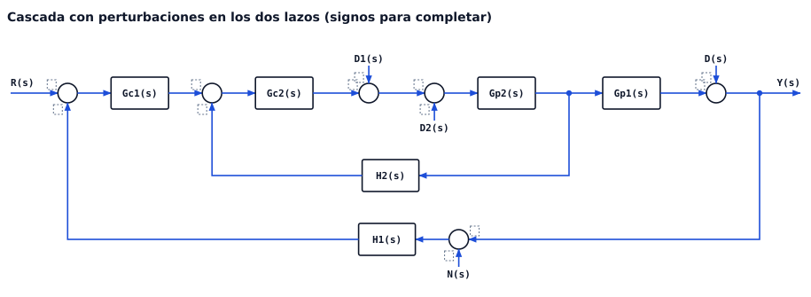

[Manual](../../README.md) › [Control de procesos](../README.md) › [Modelado](README.md)

# Diagrama de bloques (`block_diagram`)

Dibuja un diagrama de bloques: los bloques del camino directo en serie, el sumador con su
signo, la realimentación y las señales con sus nombres. Cada perturbación entra en un sumador
propio, desde arriba o desde abajo, antes del bloque que se indique del camino directo o de la
realimentación (como el ruido del sensor). Las entradas extra se suman a la referencia antes
del comparador. Un bloque puede ser a su vez un lazo interno, con sus propias perturbaciones,
para los esquemas en cascada.

## Campos

| Campo | Tipo | Valores y valor por defecto | Descripción |
| :--- | :--- | :--- | :--- |
| `type` | texto | `block_diagram` | Obligatorio. |
| `forward` | lista |  | Los bloques del camino directo: un texto, `{label, out, blank}` (`out` es el nombre de la señal de salida) o `{loop: {forward, feedback}}` para un lazo interno. |
| `feedback` | lista |  | Los bloques de la realimentación; `[]` es realimentación unitaria. Sin la clave, el lazo queda abierto. |
| `sign` | texto |  | El signo de la realimentación en el sumador, `-` (por omisión) o `+`. |
| `input` | texto | por defecto `R(s)` | El nombre de la entrada, como `R(s)`. |
| `output` | texto | por defecto `Y(s)` | El nombre de la salida, como `Y(s)`. |
| `error` | texto |  | El nombre de la señal de error. |
| `measured` | texto |  | El nombre de la señal medida (la salida de la realimentación). |
| `disturbance` | objeto o lista |  | Una perturbación o una lista (hasta 8): `at` (antes de qué bloque entra, desde 0; el último más uno es a la salida), `label` (por omisión `D(s)`, o `D1(s)`, `D2(s)`… si hay varias), `sign` (`+` o `-`), `block` (un bloque propio por el que pasa), `from` (`top`, por omisión, o `bottom`) y `path` (`forward`, por omisión, o `feedback`: entra en la realimentación, desde abajo, con rótulo `N(s)`; ahí `at` cuenta los bloques de `feedback` desde la toma de la salida y por omisión es 0). Varias en el mismo `at` van en el orden de la lista. |
| `inputs` | lista |  | Entradas que se suman a la referencia antes del comparador (hasta 6): un rótulo o `{label, sign, block, from}`, con rótulos por omisión `R2(s)`, `R3(s)`… |
| `blankSigns` | sí/no |  | Deja en blanco los signos de los sumadores. |

Además, los campos comunes a todos los tipos: `title`, `subtitle`, `id`, `inkSaver` y `theme` (ver [Campos comunes](../../campos-comunes.md)).

## Modo ejercicio

Campos que dejan casilleros para completar: `blankSigns`.

## Ejemplos

### Lazo con perturbación <D(s) & H(s)>

```yaml
type: block_diagram
title: "Lazo con perturbación <D(s) & H(s)>"
input: "R(s)"
output: "Y(s)"
error: "E(s)"
forward:
  - {label: "Gc(s)", out: "U(s)"}
  - {label: "Gv(s)", out: "M(s)"}
  - "Gp(s)"
disturbance: {at: 2, label: "D(s)", block: "Gd(s)"}
feedback: ["H(s)"]
measured: "B(s)"
inkSaver: true
```

[](https://ingcom-unrn.github.io/dibu-web/#t=dHlwZTogYmxvY2tfZGlhZ3JhbQp0aXRsZTogIkxhem8gY29uIHBlcnR1cmJhY2nDs24gPEQocykgJiBIKHMpPiIKaW5wdXQ6ICJSKHMpIgpvdXRwdXQ6ICJZKHMpIgplcnJvcjogIkUocykiCmZvcndhcmQ6CiAgLSB7bGFiZWw6ICJHYyhzKSIsIG91dDogIlUocykifQogIC0ge2xhYmVsOiAiR3YocykiLCBvdXQ6ICJNKHMpIn0KICAtICJHcChzKSIKZGlzdHVyYmFuY2U6IHthdDogMiwgbGFiZWw6ICJEKHMpIiwgYmxvY2s6ICJHZChzKSJ9CmZlZWRiYWNrOiBbIkgocykiXQptZWFzdXJlZDogIkIocykiCmlua1NhdmVyOiB0cnVlCg)

[Abrir en el editor](https://ingcom-unrn.github.io/dibu-web/#t=dHlwZTogYmxvY2tfZGlhZ3JhbQp0aXRsZTogIkxhem8gY29uIHBlcnR1cmJhY2nDs24gPEQocykgJiBIKHMpPiIKaW5wdXQ6ICJSKHMpIgpvdXRwdXQ6ICJZKHMpIgplcnJvcjogIkUocykiCmZvcndhcmQ6CiAgLSB7bGFiZWw6ICJHYyhzKSIsIG91dDogIlUocykifQogIC0ge2xhYmVsOiAiR3YocykiLCBvdXQ6ICJNKHMpIn0KICAtICJHcChzKSIKZGlzdHVyYmFuY2U6IHthdDogMiwgbGFiZWw6ICJEKHMpIiwgYmxvY2s6ICJHZChzKSJ9CmZlZWRiYWNrOiBbIkgocykiXQptZWFzdXJlZDogIkIocykiCmlua1NhdmVyOiB0cnVlCg) para explorarlo y modificarlo.

### Control en cascada (evaluación)

```yaml
type: block_diagram
title: Control en cascada (evaluación)
forward:
  - "Gc1(s)"
  - loop:
      forward: ["Gc2(s)", "Gp2(s)"]
      feedback: ["H2(s)"]
  - "Gp1(s)"
feedback: ["H1(s)"]
blankSigns: true
inkSaver: false
```

[](https://ingcom-unrn.github.io/dibu-web/#t=dHlwZTogYmxvY2tfZGlhZ3JhbQp0aXRsZTogQ29udHJvbCBlbiBjYXNjYWRhIChldmFsdWFjacOzbikKZm9yd2FyZDoKICAtICJHYzEocykiCiAgLSBsb29wOgogICAgICBmb3J3YXJkOiBbIkdjMihzKSIsICJHcDIocykiXQogICAgICBmZWVkYmFjazogWyJIMihzKSJdCiAgLSAiR3AxKHMpIgpmZWVkYmFjazogWyJIMShzKSJdCmJsYW5rU2lnbnM6IHRydWUKaW5rU2F2ZXI6IGZhbHNlCg)

[Abrir en el editor](https://ingcom-unrn.github.io/dibu-web/#t=dHlwZTogYmxvY2tfZGlhZ3JhbQp0aXRsZTogQ29udHJvbCBlbiBjYXNjYWRhIChldmFsdWFjacOzbikKZm9yd2FyZDoKICAtICJHYzEocykiCiAgLSBsb29wOgogICAgICBmb3J3YXJkOiBbIkdjMihzKSIsICJHcDIocykiXQogICAgICBmZWVkYmFjazogWyJIMihzKSJdCiAgLSAiR3AxKHMpIgpmZWVkYmFjazogWyJIMShzKSJdCmJsYW5rU2lnbnM6IHRydWUKaW5rU2F2ZXI6IGZhbHNlCg) para explorarlo y modificarlo.

### Perturbaciones a la entrada de la válvula, a la salida y en el sensor

```yaml
type: block_diagram
title: Perturbaciones a la entrada de la válvula, a la salida y en el sensor
input: "R(s)"
error: "E(s)"
forward:
  - {label: "Gc(s)", out: "U(s)"}
  - {label: "Gv(s)", out: "M(s)"}
  - "Gp(s)"
disturbance:
  - {at: 1, label: "D1(s)"}
  - {at: 3, label: "D2(s)", from: bottom, block: "Gd(s)"}
  - {path: feedback, label: "N(s)"}
feedback: ["H(s)"]
measured: "B(s)"
```

[](https://ingcom-unrn.github.io/dibu-web/#t=dHlwZTogYmxvY2tfZGlhZ3JhbQp0aXRsZTogUGVydHVyYmFjaW9uZXMgYSBsYSBlbnRyYWRhIGRlIGxhIHbDoWx2dWxhLCBhIGxhIHNhbGlkYSB5IGVuIGVsIHNlbnNvcgppbnB1dDogIlIocykiCmVycm9yOiAiRShzKSIKZm9yd2FyZDoKICAtIHtsYWJlbDogIkdjKHMpIiwgb3V0OiAiVShzKSJ9CiAgLSB7bGFiZWw6ICJHdihzKSIsIG91dDogIk0ocykifQogIC0gIkdwKHMpIgpkaXN0dXJiYW5jZToKICAtIHthdDogMSwgbGFiZWw6ICJEMShzKSJ9CiAgLSB7YXQ6IDMsIGxhYmVsOiAiRDIocykiLCBmcm9tOiBib3R0b20sIGJsb2NrOiAiR2QocykifQogIC0ge3BhdGg6IGZlZWRiYWNrLCBsYWJlbDogIk4ocykifQpmZWVkYmFjazogWyJIKHMpIl0KbWVhc3VyZWQ6ICJCKHMpIgo)

[Abrir en el editor](https://ingcom-unrn.github.io/dibu-web/#t=dHlwZTogYmxvY2tfZGlhZ3JhbQp0aXRsZTogUGVydHVyYmFjaW9uZXMgYSBsYSBlbnRyYWRhIGRlIGxhIHbDoWx2dWxhLCBhIGxhIHNhbGlkYSB5IGVuIGVsIHNlbnNvcgppbnB1dDogIlIocykiCmVycm9yOiAiRShzKSIKZm9yd2FyZDoKICAtIHtsYWJlbDogIkdjKHMpIiwgb3V0OiAiVShzKSJ9CiAgLSB7bGFiZWw6ICJHdihzKSIsIG91dDogIk0ocykifQogIC0gIkdwKHMpIgpkaXN0dXJiYW5jZToKICAtIHthdDogMSwgbGFiZWw6ICJEMShzKSJ9CiAgLSB7YXQ6IDMsIGxhYmVsOiAiRDIocykiLCBmcm9tOiBib3R0b20sIGJsb2NrOiAiR2QocykifQogIC0ge3BhdGg6IGZlZWRiYWNrLCBsYWJlbDogIk4ocykifQpmZWVkYmFjazogWyJIKHMpIl0KbWVhc3VyZWQ6ICJCKHMpIgo) para explorarlo y modificarlo.

### Dos referencias y una prealimentación antes del comparador

```yaml
type: block_diagram
title: Dos referencias y una prealimentación antes del comparador
input: "R1(s)"
inputs:
  - {label: "R2(s)", sign: "-"}
  - {label: "V(s)", block: "Gff(s)", from: bottom}
forward: ["Gc(s)", "Gp(s)"]
feedback: []
```

[](https://ingcom-unrn.github.io/dibu-web/#t=dHlwZTogYmxvY2tfZGlhZ3JhbQp0aXRsZTogRG9zIHJlZmVyZW5jaWFzIHkgdW5hIHByZWFsaW1lbnRhY2nDs24gYW50ZXMgZGVsIGNvbXBhcmFkb3IKaW5wdXQ6ICJSMShzKSIKaW5wdXRzOgogIC0ge2xhYmVsOiAiUjIocykiLCBzaWduOiAiLSJ9CiAgLSB7bGFiZWw6ICJWKHMpIiwgYmxvY2s6ICJHZmYocykiLCBmcm9tOiBib3R0b219CmZvcndhcmQ6IFsiR2MocykiLCAiR3AocykiXQpmZWVkYmFjazogW10K)

[Abrir en el editor](https://ingcom-unrn.github.io/dibu-web/#t=dHlwZTogYmxvY2tfZGlhZ3JhbQp0aXRsZTogRG9zIHJlZmVyZW5jaWFzIHkgdW5hIHByZWFsaW1lbnRhY2nDs24gYW50ZXMgZGVsIGNvbXBhcmFkb3IKaW5wdXQ6ICJSMShzKSIKaW5wdXRzOgogIC0ge2xhYmVsOiAiUjIocykiLCBzaWduOiAiLSJ9CiAgLSB7bGFiZWw6ICJWKHMpIiwgYmxvY2s6ICJHZmYocykiLCBmcm9tOiBib3R0b219CmZvcndhcmQ6IFsiR2MocykiLCAiR3AocykiXQpmZWVkYmFjazogW10K) para explorarlo y modificarlo.

### Cascada con perturbaciones en los dos lazos (signos para completar)

```yaml
type: block_diagram
title: Cascada con perturbaciones en los dos lazos (signos para completar)
forward:
  - "Gc1(s)"
  - loop:
      forward: ["Gc2(s)", "Gp2(s)"]
      feedback: ["H2(s)"]
      disturbance: [{at: 1}, {at: 1, from: bottom, sign: "-"}]
      blankSigns: true
  - "Gp1(s)"
disturbance: [{at: 3, label: "D(s)"}, {path: feedback, sign: "-"}]
feedback: ["H1(s)"]
blankSigns: true
inkSaver: false
```

[](https://ingcom-unrn.github.io/dibu-web/#t=dHlwZTogYmxvY2tfZGlhZ3JhbQp0aXRsZTogQ2FzY2FkYSBjb24gcGVydHVyYmFjaW9uZXMgZW4gbG9zIGRvcyBsYXpvcyAoc2lnbm9zIHBhcmEgY29tcGxldGFyKQpmb3J3YXJkOgogIC0gIkdjMShzKSIKICAtIGxvb3A6CiAgICAgIGZvcndhcmQ6IFsiR2MyKHMpIiwgIkdwMihzKSJdCiAgICAgIGZlZWRiYWNrOiBbIkgyKHMpIl0KICAgICAgZGlzdHVyYmFuY2U6IFt7YXQ6IDF9LCB7YXQ6IDEsIGZyb206IGJvdHRvbSwgc2lnbjogIi0ifV0KICAgICAgYmxhbmtTaWduczogdHJ1ZQogIC0gIkdwMShzKSIKZGlzdHVyYmFuY2U6IFt7YXQ6IDMsIGxhYmVsOiAiRChzKSJ9LCB7cGF0aDogZmVlZGJhY2ssIHNpZ246ICItIn1dCmZlZWRiYWNrOiBbIkgxKHMpIl0KYmxhbmtTaWduczogdHJ1ZQppbmtTYXZlcjogZmFsc2UK)

[Abrir en el editor](https://ingcom-unrn.github.io/dibu-web/#t=dHlwZTogYmxvY2tfZGlhZ3JhbQp0aXRsZTogQ2FzY2FkYSBjb24gcGVydHVyYmFjaW9uZXMgZW4gbG9zIGRvcyBsYXpvcyAoc2lnbm9zIHBhcmEgY29tcGxldGFyKQpmb3J3YXJkOgogIC0gIkdjMShzKSIKICAtIGxvb3A6CiAgICAgIGZvcndhcmQ6IFsiR2MyKHMpIiwgIkdwMihzKSJdCiAgICAgIGZlZWRiYWNrOiBbIkgyKHMpIl0KICAgICAgZGlzdHVyYmFuY2U6IFt7YXQ6IDF9LCB7YXQ6IDEsIGZyb206IGJvdHRvbSwgc2lnbjogIi0ifV0KICAgICAgYmxhbmtTaWduczogdHJ1ZQogIC0gIkdwMShzKSIKZGlzdHVyYmFuY2U6IFt7YXQ6IDMsIGxhYmVsOiAiRChzKSJ9LCB7cGF0aDogZmVlZGJhY2ssIHNpZ246ICItIn1dCmZlZWRiYWNrOiBbIkgxKHMpIl0KYmxhbmtTaWduczogdHJ1ZQppbmtTYXZlcjogZmFsc2UK) para explorarlo y modificarlo.

## Notas

- Los bloques son rótulos; para calcular la respuesta del lazo se usa `closedLoop` en [`time_response`](../respuesta/time_response.md).
- Una entrada extra que no va al comparador sino a otro punto del lazo (una prealimentación, por ejemplo) es una perturbación con su `label` y su `block`.
- Con `blankSigns`, quedan en blanco los signos de todos los sumadores del lazo: el comparador, las perturbaciones y, en el lazo exterior, las entradas. Un lazo interno lleva su propio `blankSigns`.
