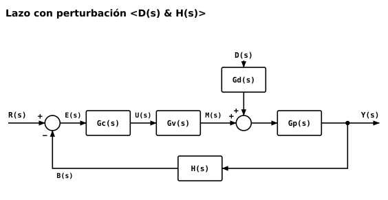
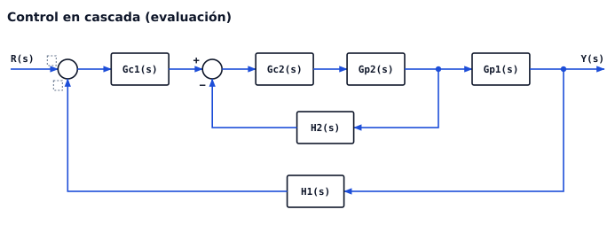

[Manual](../../README.md) › [Control de procesos](../README.md) › [Modelado](README.md)

# Diagrama de bloques (`block_diagram`)

Dibuja un diagrama de bloques: los bloques del camino directo en serie, el sumador con su
signo, la realimentación y las señales con sus nombres. Una perturbación entra en un sumador
propio antes del bloque que se indique, y un bloque puede ser a su vez un lazo interno, para
los esquemas en cascada.

## Campos

| Campo | Tipo | Valores y valor por defecto | Descripción |
| :--- | :--- | :--- | :--- |
| `type` | texto | `block_diagram` | Obligatorio. |
| `forward` | lista |  | Los bloques del camino directo: un texto, `{label, out, blank}` (`out` es el nombre de la señal de salida) o `{loop: {forward, feedback}}` para un lazo interno. |
| `feedback` | lista |  | Los bloques de la realimentación; `[]` es realimentación unitaria. Sin la clave, el lazo queda abierto. |
| `sign` | texto |  | El signo de la realimentación en el sumador, `-` (por omisión) o `+`. |
| `input` | texto | por defecto `R(s)` | El nombre de la entrada, como `R(s)`. |
| `output` | texto | por defecto `Y(s)` | El nombre de la salida, como `Y(s)`. |
| `error` | texto |  | El nombre de la señal de error. |
| `measured` | texto |  | El nombre de la señal medida (la salida de la realimentación). |
| `disturbance` | objeto |  | Una perturbación: `at` (antes de qué bloque entra, desde 0), `label`, `block` (un bloque propio) y `sign`. |
| `blankSigns` | sí/no |  | Deja en blanco los signos de los sumadores. |

Además, los campos comunes a todos los tipos: `title`, `subtitle`, `id`, `inkSaver` y `theme` (ver [Campos comunes](../../campos-comunes.md)).

## Modo ejercicio

Campos que dejan casilleros para completar: `blankSigns`.

## Ejemplos

### Lazo con perturbación <D(s) & H(s)>

```yaml
type: block_diagram
title: "Lazo con perturbación <D(s) & H(s)>"
input: "R(s)"
output: "Y(s)"
error: "E(s)"
forward:
  - {label: "Gc(s)", out: "U(s)"}
  - {label: "Gv(s)", out: "M(s)"}
  - "Gp(s)"
disturbance: {at: 2, label: "D(s)", block: "Gd(s)"}
feedback: ["H(s)"]
measured: "B(s)"
inkSaver: true
```

[](https://ingcom-unrn.github.io/dibu-web/#z=XY9BigIxEEX3OUWRhYzgbFzK4EIUZzGzmcGFiEh1UkqwTZrqRFHxVB7Bi1mdRhRXxav6_1M_HisaQFEGs11ZhxvGnYoulrLUP3gKYIKHijgmLtC429XD1_ij7kIHvmUMtXK-SlHUf4JahRRbnGck5sBCk0zrwAdkO1AAn3AusaBSblPTHHsQsm_WwOVNsX9V_D4VelrlYOvq_KA38vcZRdXvwcM9bs25YxNmW_-ayEolWS10U0Uv1Y6wTkxWVKOc6_z2H_ckDSInUnc)

[Abrir en el editor](https://ingcom-unrn.github.io/dibu-web/#z=XY9BigIxEEX3OUWRhYzgbFzK4EIUZzGzmcGFiEh1UkqwTZrqRFHxVB7Bi1mdRhRXxav6_1M_HisaQFEGs11ZhxvGnYoulrLUP3gKYIKHijgmLtC429XD1_ij7kIHvmUMtXK-SlHUf4JahRRbnGck5sBCk0zrwAdkO1AAn3AusaBSblPTHHsQsm_WwOVNsX9V_D4VelrlYOvq_KA38vcZRdXvwcM9bs25YxNmW_-ayEolWS10U0Uv1Y6wTkxWVKOc6_z2H_ckDSInUnc) para explorarlo y modificarlo.

### Control en cascada (evaluación)

```yaml
type: block_diagram
title: Control en cascada (evaluación)
forward:
  - "Gc1(s)"
  - loop:
      forward: ["Gc2(s)", "Gp2(s)"]
      feedback: ["H2(s)"]
  - "Gp1(s)"
feedback: ["H1(s)"]
blankSigns: true
inkSaver: false
```

[](https://ingcom-unrn.github.io/dibu-web/#z=VcwxDsIwDAXQPaewOrUSDGXMygA7I0LITdwqqkmiJC3iXByBi5G0KhKe7O-nn16eJHTs1HjXBoeAD5FM4hwenU3BMZAFhVGhRqhpRp5Qmc_bNqJ34YlBSwGwh-qk2jo21XKwc77EZTYF10wOhewy9st22wyR7lCNBZ1_n1Lq19I_0K6gY7TjxQw2SkhhImHyiTMFCT1yJPEF)

[Abrir en el editor](https://ingcom-unrn.github.io/dibu-web/#z=VcwxDsIwDAXQPaewOrUSDGXMygA7I0LITdwqqkmiJC3iXByBi5G0KhKe7O-nn16eJHTs1HjXBoeAD5FM4hwenU3BMZAFhVGhRqhpRp5Qmc_bNqJ34YlBSwGwh-qk2jo21XKwc77EZTYF10wOhewy9st22wyR7lCNBZ1_n1Lq19I_0K6gY7TjxQw2SkhhImHyiTMFCT1yJPEF) para explorarlo y modificarlo.

## Notas

- Los bloques son rótulos; para calcular la respuesta del lazo se usa `closedLoop` en [`time_response`](../respuesta/time_response.md).
