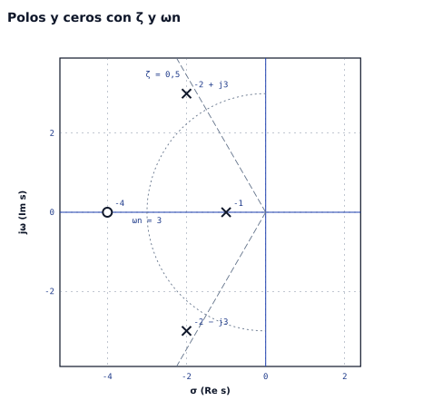

[Manual](../../README.md) › [Control de procesos](../README.md) › [Plano s](README.md)

# Polos y ceros (`pole_zero`)

Ubica los polos (×) y los ceros (○) en el plano s, a partir de las listas o de un sistema (o
los del lazo cerrado). Opcionalmente, las rectas de amortiguamiento constante y los círculos
de frecuencia natural constante.

## Campos

| Campo | Tipo | Valores y valor por defecto | Descripción |
| :--- | :--- | :--- | :--- |
| `type` | texto | `pole_zero` | Obligatorio. |
| `poles` | lista |  | Los polos; `[re, im]` es un par complejo. |
| `zeros` | lista |  | Los ceros. |
| `system` | objeto |  | Un sistema, del que salen polos y ceros. |
| `closedLoop` | objeto |  | Un lazo; se dibujan los polos y ceros del lazo cerrado. |
| `showValues` | sí/no |  | Escribe el valor de cada polo y cero. |
| `dampingLines` | lista |  | Rectas de amortiguamiento constante: una lista de valores de ζ (de 0 a 1). |
| `wnCircles` | lista |  | Círculos de frecuencia natural constante: una lista de valores de ωn. |
| `xRange` | lista |  | El rango del eje real. |
| `yRange` | lista |  | El rango del eje imaginario. |
| `blank` | sí/no |  | Dibuja sólo los ejes, para ubicarlos. |

Además, los campos comunes a todos los tipos: `title`, `subtitle`, `id`, `inkSaver` y `theme` (ver [Campos comunes](../../campos-comunes.md)).

## Modo ejercicio

Campos que dejan casilleros para completar: `blank`.

## Ejemplos

### Polos y ceros con ζ y ωn

```yaml
type: pole_zero
title: Polos y ceros con ζ y ωn
poles: [-1, [-2, 3]]
zeros: [-4]
dampingLines: [0.5]
wnCircles: [3]
showValues: true
inkSaver: false
```



## Ver también

[`root_locus`](root_locus.md)
