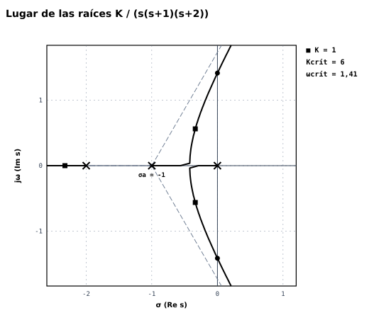

[Manual](../../README.md) › [Control de procesos](../README.md) › [Plano s](README.md)

# Lugar de las raíces (`root_locus`)

Dibuja cómo se mueven los polos del lazo cerrado al variar la ganancia desde 0 hasta `kMax`,
a partir del lazo abierto. Opcionalmente, las asíntotas, el cruce con el eje imaginario
(ganancia y frecuencia críticas) y la posición de los polos para ganancias elegidas.

## Qué calcula

- Las raíces para cada ganancia, las asíntotas y su centroide.
- La ganancia crítica y la frecuencia del cruce.

## Campos

| Campo | Tipo | Valores y valor por defecto | Descripción |
| :--- | :--- | :--- | :--- |
| `type` | texto | `root_locus` | Obligatorio. |
| `system` | objeto |  | El lazo abierto (ver la nota de [`time_response`](../respuesta/time_response.md)). |
| `closedLoop` | objeto |  | Un lazo; se usa su lazo abierto. |
| `kMax` | número |  | La ganancia máxima. |
| `asymptotes` | sí/no |  | Dibuja las asíntotas. |
| `showCrossing` | sí/no |  | Marca el cruce con el eje imaginario, con Kcrít y ωcrít. |
| `marks` | lista |  | Ganancias cuyos polos se marcan con ■. |
| `dampingLines` | lista |  | Rectas de amortiguamiento constante: una lista de valores de ζ (de 0 a 1). |
| `xRange` | lista |  | El rango del eje real. |
| `yRange` | lista |  | El rango del eje imaginario. |
| `blankMarks` | sí/no |  | Deja en blanco los valores de las marcas. |

Además, los campos comunes a todos los tipos: `title`, `subtitle`, `id`, `inkSaver` y `theme` (ver [Campos comunes](../../campos-comunes.md)).

## Modo ejercicio

Campos que dejan casilleros para completar: `blankMarks`.

## Ejemplos

### Lugar de las raíces K / (s(s+1)(s+2))

```yaml
type: root_locus
title: Lugar de las raíces K / (s(s+1)(s+2))
system: {k: 1, poles: [0, -1, -2]}
marks: [1]
```

[](https://ingcom-unrn.github.io/dibu-web/#z=K6ksSLVSKMrPL4nPyU8uLeYqySzJAYr4lKYnFimkpCrkJBYrFCUeXpucWqzgraCvoFGsUaxtqAkkjDQ1uYori0tSc60UqrOtFAx1FAryc1KLrRSiDXQUdIFcXaPYWq7cxKJskJhhLBcA)

[Abrir en el editor](https://ingcom-unrn.github.io/dibu-web/#z=K6ksSLVSKMrPL4nPyU8uLeYqySzJAYr4lKYnFimkpCrkJBYrFCUeXpucWqzgraCvoFGsUaxtqAkkjDQ1uYori0tSc60UqrOtFAx1FAryc1KLrRSiDXQUdIFcXaPYWq7cxKJskJhhLBcA) para explorarlo y modificarlo.

## Ver también

[`pole_zero`](pole_zero.md)
