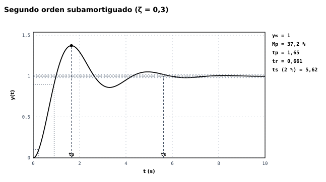
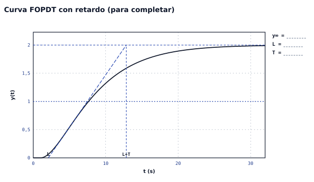
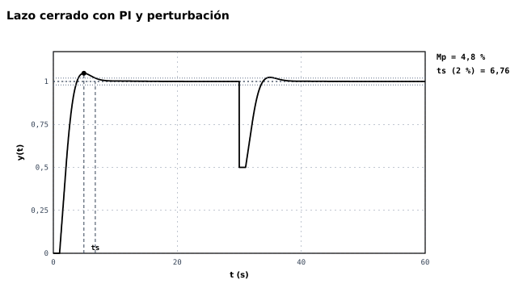

[Manual](../../README.md) › [Control de procesos](../README.md) › [Respuesta temporal](README.md)

# Respuesta temporal (`time_response`)

Simula la respuesta de uno o varios sistemas (o de un lazo cerrado) a la entrada elegida y la
dibuja con las anotaciones pedidas: valor final, sobrepico, tiempo de pico, de subida y de
establecimiento, la constante de tiempo, el tiempo muerto y la tangente de la curva de
reacción. También dibuja puntos medidos, para comparar.

## Qué calcula

- La simulación con tiempo muerto; un PID se simula discreto, con el derivativo filtrado.
- Sobrepico, tiempos de pico, subida y establecimiento (banda del 2 % o del 5 %), τ y θ.

## Campos

| Campo | Tipo | Valores y valor por defecto | Descripción |
| :--- | :--- | :--- | :--- |
| `type` | texto | `time_response` | Obligatorio. |
| `system` | objeto |  | El sistema (ver la nota sobre sistemas). |
| `systems` | lista |  | Varios sistemas para comparar, cada uno con `label`. |
| `closedLoop` | objeto |  | Un lazo cerrado: `plant`, `controller` (por omisión 1), `feedback` (por omisión 1) y `sign` (por omisión `-`). |
| `input` | texto | por defecto `step` | `step`, `ramp` o `impulse`. |
| `amplitude` | número |  | La amplitud de la entrada (por omisión 1). |
| `tEnd` | número |  | El tiempo final; por omisión, el que hace falta para que se establezca. |
| `disturbance` | objeto |  | Una perturbación en escalón: `at` (el instante), `amplitude` y `where` (`output` o `input`). |
| `annotations` | lista |  | `final`, `overshoot`, `peak`, `rise`, `settling`, `tau`, `delay`, `tangent`, o `all`. |
| `settlingBand` | número |  | La banda del tiempo de establecimiento, `0.02` o `0.05`. |
| `showInput` | sí/no |  | Dibuja también la entrada. |
| `data` | lista |  | Puntos medidos `[t, y]`, que se dibujan como marcas. |
| `dataLabel` | texto | por defecto `medición` | El rótulo de los puntos medidos. |
| `yMin` | número |  | Mínimo del eje vertical. |
| `yMax` | número |  | Máximo del eje vertical. |
| `xLabel` | texto | por defecto `t (s)` | Rótulo del eje horizontal. |
| `yLabel` | texto | por defecto `y(t)` | Rótulo del eje vertical. |
| `blankAnnotations` | sí/no |  | Deja en blanco los valores de las anotaciones. |

Además, los campos comunes a todos los tipos: `title`, `subtitle`, `id`, `inkSaver` y `theme` (ver [Campos comunes](../../campos-comunes.md)).

## Modo ejercicio

Campos que dejan casilleros para completar: `blankAnnotations`.

## Ejemplos

### Segundo orden subamortiguado (ζ = 0,3)

```yaml
type: time_response
title: Segundo orden subamortiguado (ζ = 0,3)
system: {gain: 1, zeta: 0.3, wn: 2}
annotations: [final, overshoot, peak, rise, settling]
```

[](https://ingcom-unrn.github.io/dibu-web/#t=dHlwZTogdGltZV9yZXNwb25zZQp0aXRsZTogU2VndW5kbyBvcmRlbiBzdWJhbW9ydGlndWFkbyAozrYgPSAwLDMpCnN5c3RlbToge2dhaW46IDEsIHpldGE6IDAuMywgd246IDJ9CmFubm90YXRpb25zOiBbZmluYWwsIG92ZXJzaG9vdCwgcGVhaywgcmlzZSwgc2V0dGxpbmddCg)

[Abrir en el editor](https://ingcom-unrn.github.io/dibu-web/#t=dHlwZTogdGltZV9yZXNwb25zZQp0aXRsZTogU2VndW5kbyBvcmRlbiBzdWJhbW9ydGlndWFkbyAozrYgPSAwLDMpCnN5c3RlbToge2dhaW46IDEsIHpldGE6IDAuMywgd246IDJ9CmFubm90YXRpb25zOiBbZmluYWwsIG92ZXJzaG9vdCwgcGVhaywgcmlzZSwgc2V0dGxpbmddCg) para explorarlo y modificarlo.

### Curva FOPDT con retardo (para completar)

```yaml
type: time_response
title: Curva FOPDT con retardo (para completar)
system: {gain: 2, num: [2], den: [15, 8, 1], delay: 1}
annotations: [final, tangent]
blankAnnotations: true
inkSaver: false
```

[](https://ingcom-unrn.github.io/dibu-web/#t=dHlwZTogdGltZV9yZXNwb25zZQp0aXRsZTogQ3VydmEgRk9QRFQgY29uIHJldGFyZG8gKHBhcmEgY29tcGxldGFyKQpzeXN0ZW06IHtnYWluOiAyLCBudW06IFsyXSwgZGVuOiBbMTUsIDgsIDFdLCBkZWxheTogMX0KYW5ub3RhdGlvbnM6IFtmaW5hbCwgdGFuZ2VudF0KYmxhbmtBbm5vdGF0aW9uczogdHJ1ZQppbmtTYXZlcjogZmFsc2UK)

[Abrir en el editor](https://ingcom-unrn.github.io/dibu-web/#t=dHlwZTogdGltZV9yZXNwb25zZQp0aXRsZTogQ3VydmEgRk9QRFQgY29uIHJldGFyZG8gKHBhcmEgY29tcGxldGFyKQpzeXN0ZW06IHtnYWluOiAyLCBudW06IFsyXSwgZGVuOiBbMTUsIDgsIDFdLCBkZWxheTogMX0KYW5ub3RhdGlvbnM6IFtmaW5hbCwgdGFuZ2VudF0KYmxhbmtBbm5vdGF0aW9uczogdHJ1ZQppbmtTYXZlcjogZmFsc2UK) para explorarlo y modificarlo.

### Lazo cerrado con PI y perturbación

```yaml
type: time_response
title: Lazo cerrado con PI y perturbación
closedLoop:
  plant: {gain: 2, tau: 5, delay: 1}
  controller: {kp: 1.2, ki: 0.25}
disturbance: {at: 30, amplitude: -0.5}
tEnd: 60
annotations: [overshoot, settling]
```

[](https://ingcom-unrn.github.io/dibu-web/#t=dHlwZTogdGltZV9yZXNwb25zZQp0aXRsZTogTGF6byBjZXJyYWRvIGNvbiBQSSB5IHBlcnR1cmJhY2nDs24KY2xvc2VkTG9vcDoKICBwbGFudDoge2dhaW46IDIsIHRhdTogNSwgZGVsYXk6IDF9CiAgY29udHJvbGxlcjoge2twOiAxLjIsIGtpOiAwLjI1fQpkaXN0dXJiYW5jZToge2F0OiAzMCwgYW1wbGl0dWRlOiAtMC41fQp0RW5kOiA2MAphbm5vdGF0aW9uczogW292ZXJzaG9vdCwgc2V0dGxpbmddCg)

[Abrir en el editor](https://ingcom-unrn.github.io/dibu-web/#t=dHlwZTogdGltZV9yZXNwb25zZQp0aXRsZTogTGF6byBjZXJyYWRvIGNvbiBQSSB5IHBlcnR1cmJhY2nDs24KY2xvc2VkTG9vcDoKICBwbGFudDoge2dhaW46IDIsIHRhdTogNSwgZGVsYXk6IDF9CiAgY29udHJvbGxlcjoge2twOiAxLjIsIGtpOiAwLjI1fQpkaXN0dXJiYW5jZToge2F0OiAzMCwgYW1wbGl0dWRlOiAtMC41fQp0RW5kOiA2MAphbm5vdGF0aW9uczogW292ZXJzaG9vdCwgc2V0dGxpbmddCg) para explorarlo y modificarlo.

## Notas

- Un sistema se escribe como `num` y `den` (coeficientes en s, de la mayor potencia a la menor), `gain` y `tau` (primer orden K/(τs + 1)), `gain`, `zeta` y `wn` (segundo orden), o `k`, `poles` y `zeros` (`[re, im]` es un par complejo); todos con `delay` (tiempo muerto) opcional. Un controlador PID, como `kp`, `ki` y `kd`.
