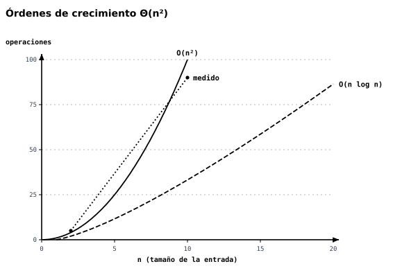
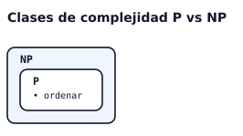

[Manual](../../README.md) › [Estructuras de datos y algoritmos](../README.md) › [Análisis de algoritmos](README.md)

# Complejidad (`complexity`)

Con la variante `growth` (por omisión) dibuja curvas de crecimiento para comparar órdenes;
con `blankLabels` salen rotuladas A, B, C… para asociarlas con su clase. Una curva con
`points` son mediciones, para clasificarlas. Con `classes`, dibuja conjuntos anidados de
clases de complejidad.

## Variantes

| `variant` | Qué dibuja |
| :--- | :--- |
| `growth` | Por omisión. Curvas de crecimiento. |
| `classes` | Conjuntos anidados de clases. |

## Campos

| Campo | Tipo | Valores y valor por defecto | Descripción |
| :--- | :--- | :--- | :--- |
| `type` | texto | `complexity` | Obligatorio. |
| `curves` | lista |  | Las curvas: `1`, `log n`, `sqrt n`, `n`, `n log n`, `n^2`, `n^3`, `2^n`, `n!` (también como `O(n²)`), o `{label, points}` para mediciones. |
| `variant` | texto |  | Variante, ver arriba. |
| `maxN` | número |  | El n máximo del eje horizontal. |
| `maxY` | número |  | El máximo del eje vertical; las curvas que se salen se cortan. |
| `xLabel` | texto |  | Rótulo del eje horizontal. |
| `yLabel` | texto |  | Rótulo del eje vertical. |
| `blankLabels` | sí/no |  | Rotula las curvas A, B, C… en el orden de `curves`. |
| `classes` | lista |  | En `classes`, la jerarquía, de la más chica a la más grande (por omisión los órdenes comunes; también `[P, NP, EXPTIME]`). |
| `items` | objeto |  | En `classes`, ejemplos dentro de cada clase: `{"O(n)": [búsqueda lineal]}`. |
| `blankClasses` | sí/no |  | Deja en blanco los nombres de las clases. |

Además, los campos comunes a todos los tipos: `title`, `subtitle`, `id`, `inkSaver` y `theme` (ver [Campos comunes](../../campos-comunes.md)).

## Modo ejercicio

Campos que dejan casilleros para completar: `blankLabels`, `blankClasses`.

## Ejemplos

### Órdenes de crecimiento Θ(n²)

```yaml
type: complexity
title: Órdenes de crecimiento Θ(n²)
curves:
  - "Θ(n²)"
  - "n log n"
  - label: medido
    points: [[2, 5], [10, 90]]
```

[](https://ingcom-unrn.github.io/dibu-web/#z=LchBCgIhFAbgvaf4mVWBwRS0yKuIi9JHCPoUfQ3NOdp0jo5Q-87UwLT8PpkrGfiSa6J7lFlJlLTM59ECMXUEgm_kY47EUvB9bvj92ip_axN1o4Adhn8OqxipXMGr0vlCySBTiKEsA9QSWbqBtQeNo9Ow-1HjNDqnfg)

[Abrir en el editor](https://ingcom-unrn.github.io/dibu-web/#z=LchBCgIhFAbgvaf4mVWBwRS0yKuIi9JHCPoUfQ3NOdp0jo5Q-87UwLT8PpkrGfiSa6J7lFlJlLTM59ECMXUEgm_kY47EUvB9bvj92ip_axN1o4Adhn8OqxipXMGr0vlCySBTiKEsA9QSWbqBtQeNo9Ow-1HjNDqnfg) para explorarlo y modificarlo.

### Clases de complejidad P vs NP

```yaml
type: complexity
title: Clases de complejidad P vs NP
variant: classes
classes: ["P", "NP"]
items:
  P: ["ordenar"]
inkSaver: false
```

[](https://ingcom-unrn.github.io/dibu-web/#z=LYsxCsMwEAT7e8Wi2i9Qm94IXIYUR3SGS2TZ6A4R_z4yuFqYnfHzkIj3vh1FfuonuXoZ5FHYxJDl_j6aOSOhG-ZEnZty9REObXh0b8QzpDAhzCm8SF02iwSki-8tS-V28fpduEuLWLmY0B8)

[Abrir en el editor](https://ingcom-unrn.github.io/dibu-web/#z=LYsxCsMwEAT7e8Wi2i9Qm94IXIYUR3SGS2TZ6A4R_z4yuFqYnfHzkIj3vh1FfuonuXoZ5FHYxJDl_j6aOSOhG-ZEnZty9REObXh0b8QzpDAhzCm8SF02iwSki-8tS-V28fpduEuLWLmY0B8) para explorarlo y modificarlo.

## Ver también

[`flowchart`](flowchart.md), [`cost_table`](cost_table.md), [`trace_table`](trace_table.md), [`dp_table`](dp_table.md), [`dijkstra`](dijkstra.md)
