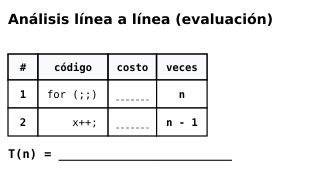

[Manual](../../README.md) › [Estructuras de datos y algoritmos](../README.md) › [Análisis de algoritmos](README.md)

# Tabla de costos (`cost_table`)

Dibuja el análisis línea por línea de un algoritmo: el código (con su sangría), el costo de
cada línea y cuántas veces se ejecuta, y el total.

## Campos

| Campo | Tipo | Valores y valor por defecto | Descripción |
| :--- | :--- | :--- | :--- |
| `type` | texto | `cost_table` | Obligatorio. |
| `lines` | lista |  | Las líneas: `[código, costo, veces]` o `{code, cost, times}`. |
| `total` | texto |  | El costo total, debajo. |
| `blankCosts` | sí/no |  | Deja los costos en blanco. |
| `blankTimes` | sí/no |  | Deja en blanco las veces. |
| `blankTotal` | sí/no |  | Deja el total en blanco. |

Además, los campos comunes a todos los tipos: `title`, `subtitle`, `id`, `inkSaver` y `theme` (ver [Campos comunes](../../campos-comunes.md)).

## Modo ejercicio

Campos que dejan casilleros para completar: `blankCosts`, `blankTimes`, `blankTotal`.

## Ejemplos

### Análisis línea a línea (evaluación)

```yaml
type: cost_table
title: Análisis línea a línea (evaluación)
lines:
  - ["for (;;)", "c1", "n"]
  - ["    x++;", "c2", "n - 1"]
total: 2n
blankCosts: true
blankTotal: true
```



## Ver también

[`complexity`](complexity.md), [`flowchart`](flowchart.md), [`trace_table`](trace_table.md), [`dp_table`](dp_table.md), [`dijkstra`](dijkstra.md)
