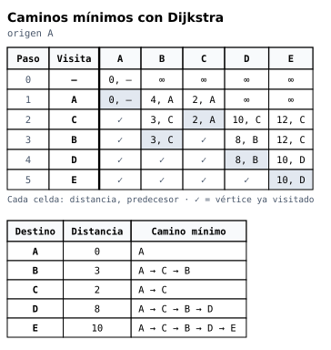

[Manual](../../README.md) › [Estructuras de datos y algoritmos](../README.md) › [Análisis de algoritmos](README.md)

# Dijkstra (`dijkstra`)

Ejecuta Dijkstra desde `source` y dibuja la tabla de iteraciones: en cada paso, el vértice
que se visita y la distancia y el predecesor de cada vértice (✓ si ya fue visitado). Debajo,
la distancia y el camino mínimo a cada destino.

## Qué calcula

- Las distancias y predecesores de cada iteración; los empates se rompen por el orden de los vértices.

## Campos

| Campo | Tipo | Valores y valor por defecto | Descripción |
| :--- | :--- | :--- | :--- |
| `type` | texto | `dijkstra` | Obligatorio. |
| `edges` | lista |  | Las aristas: `"A-B:4"` (no dirigida), `"A->B:4"` (dirigida) o `{from, to, w}`. |
| `source` | texto | por defecto `` | El vértice de origen (por omisión, el primero). |
| `vertices` | lista |  | El orden de los vértices, si no sale de las aristas. |
| `directed` | sí/no |  | Toma como dirigidas las aristas escritas con `-`. |
| `paths` | sí/no |  | Agrega la tabla de caminos mínimos (por omisión, sí). |
| `blank` | sí/no |  | Deja en blanco las iteraciones y los caminos. |

Además, los campos comunes a todos los tipos: `title`, `subtitle`, `id`, `inkSaver` y `theme` (ver [Campos comunes](../../campos-comunes.md)).

## Modo ejercicio

Campos que dejan casilleros para completar: `blank`.

## Ejemplos

### Caminos mínimos con Dijkstra

```yaml
type: dijkstra
title: Caminos mínimos con Dijkstra
source: A
edges: ["A-B:4", "A-C:2", "C-B:1", "B-D:5", "C-D:8", "C-E:10", "D-E:2"]
```

[](https://ingcom-unrn.github.io/dibu-web/#z=K6ksSLVSSMnMyi4uKUrkKsksyQHynRNzM_PyixVyD6_Ny8wFMpLz8xRcYIqK80uLkoGqHLlSU9JTi60UopUcdZ2sTJR0FIAMZysjEMMZKGIIYjjpuliZQkRcrCwgDFcrQwMQywXIMlKK5QIA)

[Abrir en el editor](https://ingcom-unrn.github.io/dibu-web/#z=K6ksSLVSSMnMyi4uKUrkKsksyQHynRNzM_PyixVyD6_Ny8wFMpLz8xRcYIqK80uLkoGqHLlSU9JTi60UopUcdZ2sTJR0FIAMZysjEMMZKGIIYjjpuliZQkRcrCwgDFcrQwMQywXIMlKK5QIA) para explorarlo y modificarlo.

## Notas

- Con pesos negativos es un error, porque Dijkstra no los admite.
- El grafo en sí no se dibuja; para eso alcanza con Mermaid o Graphviz.

## Ver también

[`complexity`](complexity.md), [`flowchart`](flowchart.md), [`cost_table`](cost_table.md), [`trace_table`](trace_table.md), [`dp_table`](dp_table.md)
