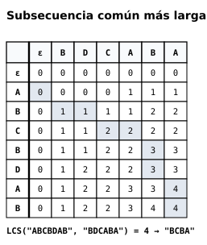
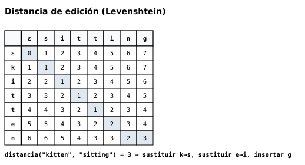

[Manual](../../README.md) › [Estructuras de datos y algoritmos](../README.md) › [Análisis de algoritmos](README.md)

# Tabla de programación dinámica (`dp_table`)

Llena la tabla de programación dinámica del problema elegido y resalta el camino de
reconstrucción de la solución. Debajo escribe el resultado: la subsecuencia, las operaciones
de edición, los objetos elegidos o las monedas.

## Qué calcula

- `lcs`: la longitud y una subsecuencia común más larga.
- `edit`: la distancia de Levenshtein y las operaciones (sustituir, insertar, borrar).
- `knapsack`: el valor máximo y los objetos elegidos.
- `coins`: la mínima cantidad de monedas y cuáles.

## Campos

| Campo | Tipo | Valores y valor por defecto | Descripción |
| :--- | :--- | :--- | :--- |
| `type` | texto | `dp_table` | Obligatorio. |
| `problem` | texto | `lcs`, `edit`, `knapsack`, `coins` · por defecto `lcs` | `lcs`, `edit`, `knapsack` o `coins`. |
| `a` | texto |  | En `lcs` y `edit`, el primer texto (hasta 24 caracteres). |
| `b` | texto |  | En `lcs` y `edit`, el segundo texto. |
| `weights` | lista |  | En `knapsack`, los pesos (de 1 a 15 objetos). |
| `values` | lista |  | En `knapsack`, los valores. |
| `capacity` | número |  | En `knapsack`, la capacidad de la mochila (de 1 a 40). |
| `coins` | lista |  | En `coins`, los valores de las monedas. |
| `amount` | número |  | En `coins`, el monto a formar (de 1 a 60). |
| `path` | sí/no |  | Resalta el camino de reconstrucción (por omisión, sí). |
| `blank` | sí/no |  | Deja la tabla en blanco (salvo la primera fila y columna) y el resultado. |

Además, los campos comunes a todos los tipos: `title`, `subtitle`, `id`, `inkSaver` y `theme` (ver [Campos comunes](../../campos-comunes.md)).

## Modo ejercicio

Campos que dejan casilleros para completar: `blank`.

## Ejemplos

### Subsecuencia común más larga

```yaml
type: dp_table
title: Subsecuencia común más larga
problem: lcs
a: ABCBDAB
b: BDCABA
```

[](https://ingcom-unrn.github.io/dibu-web/#z=Dcq5DcAgDADA3lN4DjoMG2SAyBAUIZlHPEXGyRppWSyUJ914alB41XOwkwAjDtk-puvBz5B9ZPQlrS9jWm9H4XYz1FZ2TgrFd2CFmgxZTeAUkjWaNPw)

[Abrir en el editor](https://ingcom-unrn.github.io/dibu-web/#z=Dcq5DcAgDADA3lN4DjoMG2SAyBAUIZlHPEXGyRppWSyUJ914alB41XOwkwAjDtk-puvBz5B9ZPQlrS9jWm9H4XYz1FZ2TgrFd2CFmgxZTeAUkjWaNPw) para explorarlo y modificarlo.

### Distancia de edición (Levenshtein)

```yaml
type: dp_table
title: Distancia de edición (Levenshtein)
problem: edit
a: kitten
b: sitting
```

[](https://ingcom-unrn.github.io/dibu-web/#z=FYuxDYAwDAR7T-ESVkhNyQ7IIRZYBBORFxJzMQKLEbo7nQ530cCpTJCYlWDIzQerEJ9NOClrstnex7kb9VKvK9S8p3Ie7djD30ESeDNAnWLg2sh8oQ8)

[Abrir en el editor](https://ingcom-unrn.github.io/dibu-web/#z=FYuxDYAwDAR7T-ESVkhNyQ7IIRZYBBORFxJzMQKLEbo7nQ530cCpTJCYlWDIzQerEJ9NOClrstnex7kb9VKvK9S8p3Ie7djD30ESeDNAnWLg2sh8oQ8) para explorarlo y modificarlo.

### Ejercicio: mochila 0/1

```yaml
type: dp_table
title: "Ejercicio: mochila 0/1"
problem: knapsack
weights: [1, 3, 4, 5]
values: [1, 4, 5, 7]
capacity: 7
blank: true
```

[](https://ingcom-unrn.github.io/dibu-web/#z=LcpBCsJADEDRfU4Ruh7QolLI3lNIkTQGG2faGaap0ttbweV_fN-KEj7K3XlICm6e9m6uL61iYplwyjJaYjwe2gZKzfs2EcaZy8IS4aP2HH0hvLUBTwHPAS89vDmt-sefBOx6EC4s5hthB0PiORJ6XRW-)

[Abrir en el editor](https://ingcom-unrn.github.io/dibu-web/#z=LcpBCsJADEDRfU4Ruh7QolLI3lNIkTQGG2faGaap0ttbweV_fN-KEj7K3XlICm6e9m6uL61iYplwyjJaYjwe2gZKzfs2EcaZy8IS4aP2HH0hvLUBTwHPAS89vDmt-sefBOx6EC4s5hthB0PiORJ6XRW-) para explorarlo y modificarlo.

## Ver también

[`complexity`](complexity.md), [`flowchart`](flowchart.md), [`cost_table`](cost_table.md), [`trace_table`](trace_table.md), [`dijkstra`](dijkstra.md)
