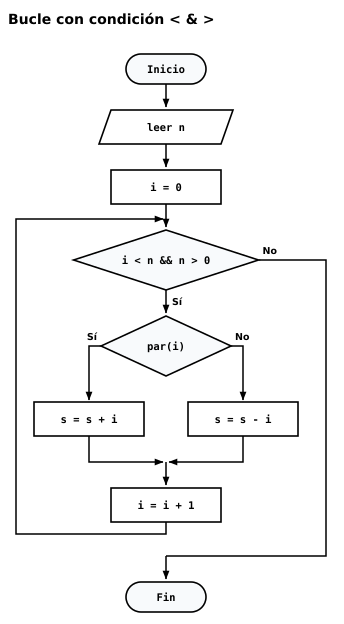
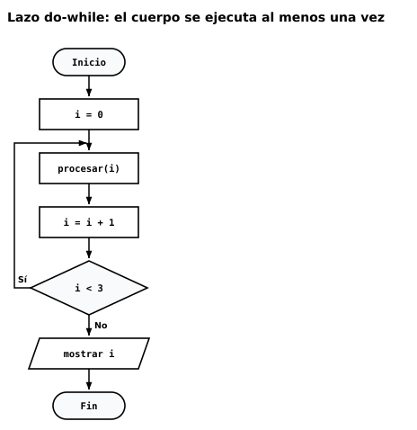
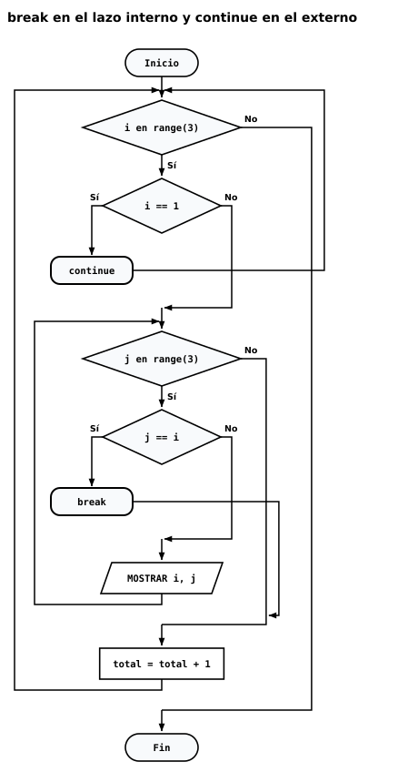
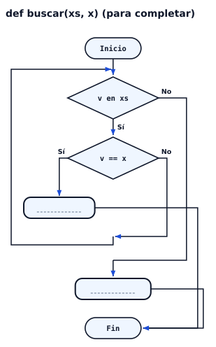
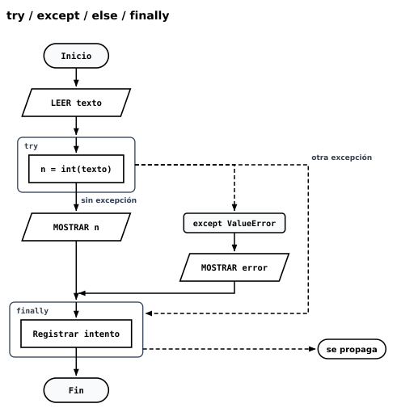
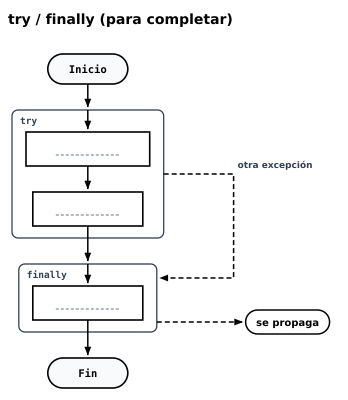

[Manual](../../README.md) › [Estructuras de datos y algoritmos](../README.md) › [Análisis de algoritmos](README.md)

# Diagrama de flujo (`flowchart`)

Arma el diagrama de flujo a partir de la estructura del algoritmo: pasos, entradas y salidas,
condicionales y ciclos anidados. Cada paso con `blank: true` sale vacío para completar.

Los saltos van a su destino por un carril a la derecha: `break` a la salida del lazo más
interno, `continue` a su condición y `return` al fin; después de un salto no hay arista hacia
el paso siguiente. Un `try` dibuja su región, los `except` a la derecha (a los que se llega con
flechas con guiones, las excepcionales), el `else` en el camino sin excepción y el `finally`,
al que llegan todos los caminos; con `propagate: true`, una excepción no capturada pasa por
el `finally` y se propaga.

## Campos

| Campo | Tipo | Valores y valor por defecto | Descripción |
| :--- | :--- | :--- | :--- |
| `type` | texto | `flowchart` | Obligatorio. |
| `steps` | lista |  | Los pasos: un texto, `{io}` (entrada o salida), `{step}`, `{if, then, else}`, `{while, do}`, `{for, do}`, `{doWhile, do}` (el cuerpo antes de la condición), `{break: true}`, `{continue: true}`, `{return: expresión}` o `{try, except, else, finally, propagate}`; cada uno con `blank`. |
| `start` | texto |  | Rótulo del inicio (por omisión `Inicio`); `false` lo quita. |
| `end` | texto |  | Rótulo del fin (por omisión `Fin`); `false` lo quita. |
| `blankValues` | sí/no |  | Deja en blanco el texto de todos los pasos. |

Además, los campos comunes a todos los tipos: `title`, `subtitle`, `id`, `inkSaver` y `theme` (ver [Campos comunes](../../campos-comunes.md)).

## Modo ejercicio

Campos que dejan casilleros para completar: `blankValues`.

## Ejemplos

### Bucle con condición < & >

```yaml
type: flowchart
title: "Bucle con condición < & >"
steps:
  - {io: "leer n"}
  - "i = 0"
  - while: "i < n && n > 0"
    do:
      - if: "par(i)"
        then: ["s = s + i"]
        else: ["s = s - i"]
      - "i = i + 1"
```



### Lazo do-while: el cuerpo se ejecuta al menos una vez

```yaml
type: flowchart
title: "Lazo do-while: el cuerpo se ejecuta al menos una vez"
steps:
  - "i = 0"
  - doWhile: "i < 3"
    do:
      - "procesar(i)"
      - "i = i + 1"
  - {io: "mostrar i"}
```



### break en el lazo interno y continue en el externo

```yaml
type: flowchart
title: break en el lazo interno y continue en el externo
steps:
  - for: "i en range(3)"
    do:
      - if: "i == 1"
        then:
          - continue: true
      - for: "j en range(3)"
        do:
          - if: "j == i"
            then:
              - break: true
          - io: "MOSTRAR i, j"
      - "total = total + 1"
```



### def buscar(xs, x) (para completar)

```yaml
type: flowchart
title: "def buscar(xs, x) (para completar)"
steps:
  - for: "v en xs"
    do:
      - if: "v == x"
        then:
          - {return: "True", blank: true}
  - {return: "False", blank: true}
inkSaver: false
```



### try / except / else / finally

```yaml
type: flowchart
title: try / except / else / finally
steps:
  - {io: "LEER texto"}
  - try:
      - step: "n = int(texto)"
    except:
      - matches: ValueError
        do:
          - io: "MOSTRAR error"
    else:
      - io: "MOSTRAR n"
    finally:
      - step: "Registrar intento"
    propagate: true
```



### try / finally (para completar)

```yaml
type: flowchart
title: try / finally (para completar)
blankValues: true
steps:
  - try:
      - step: "f = abrir(ruta)"
      - step: "procesar(f)"
    finally:
      - step: "f.close()"
    propagate: true
```



## Notas

- `break` y `continue` fuera de un lazo, y `return` sin el fin del diagrama (`end: false`), son errores.
- `try`: `except` es una lista de `{matches, do}` (`matches` es un tipo, una lista de tipos o nada); `else` necesita algún `except`, y un `try` necesita `except` o `finally`.
- Por ahora, un salto dentro de un `try` o un `try` dentro de otro no se dibujan.

## Ver también

[`complexity`](complexity.md), [`cost_table`](cost_table.md), [`trace_table`](trace_table.md), [`dp_table`](dp_table.md), [`dijkstra`](dijkstra.md)
