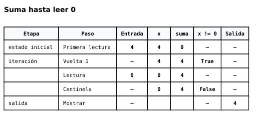
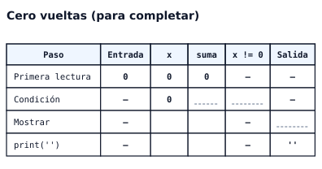
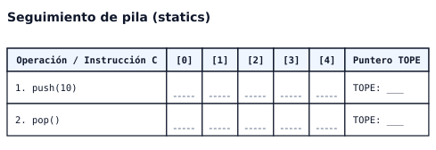

[Manual](../../README.md) › [Estructuras de datos y algoritmos](../README.md) › [Análisis de algoritmos](README.md)

# Tabla de traza (`trace_table`)

Dibuja una prueba de escritorio: columnas con las variables y una fila por paso. Las filas
que faltan hasta `rowCount` y los `null` quedan para completar. También dibuja las tablas de
traza de statics, con una secuencia de operaciones sobre una estructura de capacidad fija.

## Variantes

| `variant` | Qué dibuja |
| :--- | :--- |
| `stack` | Sólo cambia los rótulos por omisión, para trazas de una pila. |
| `program` | La prueba de escritorio de un programa: cada fila es `{step, stage, input, check, values, output, blanks}` y la tabla suma las columnas de etapa, paso, entrada, condición y salida que se usen. Una cadena vacía se ve como `''`, sin entrada o sin emisión como `—`, y `null` es un casillero para completar. |

## Campos

| Campo | Tipo | Valores y valor por defecto | Descripción |
| :--- | :--- | :--- | :--- |
| `type` | texto | `trace_table` | Obligatorio. |
| `columns` | lista |  | Las columnas (las variables). |
| `rows` | lista |  | Las filas; `null` o una fila corta quedan para completar. |
| `rowCount` | número |  | Cantidad total de filas; las que faltan quedan vacías. |
| `operations` | lista |  | Las operaciones de cada fila, en la primera columna (o la traza de statics). |
| `operationHeader` | texto |  | Encabezado de la columna de operaciones. |
| `capacity` | número |  | En la traza de statics, la capacidad de la estructura. |
| `pointerHeader` | texto |  | En la traza de statics, el encabezado de la columna del puntero. |
| `pointerLabel` | texto |  | En la traza de statics, el nombre del puntero. |
| `variant` | texto |  | Variante, ver arriba. |
| `blankValues` | sí/no |  | Deja los valores en blanco (en `program`, también la condición y la salida). |
| `condition` | texto |  | En `program`, el encabezado de la columna de la condición (por ejemplo `x != 0`). |
| `stepHeader` | texto |  | En `program`, el encabezado de la columna de pasos (por omisión `Paso`). |
| `inputHeader` | texto |  | En `program`, el encabezado de la entrada (por omisión `Entrada`). |
| `outputHeader` | texto |  | En `program`, el encabezado de la salida (por omisión `Salida`). |

Además, los campos comunes a todos los tipos: `title`, `subtitle`, `id`, `inkSaver` y `theme` (ver [Campos comunes](../../campos-comunes.md)).

## Modo ejercicio

En `program`, `blanks` en una fila oculta esas celdas (`[output]`, `[check]`, o el nombre de
una variable): la respuesta no queda en el SVG.

Campos que dejan casilleros para completar: `blankValues`.

## Ejemplos

### Suma hasta leer 0

```yaml
type: trace_table
variant: program
title: "Suma hasta leer 0"
condition: "x != 0"
columns: [x, suma]
rows:
  - {stage: initial, step: "Primera lectura", input: 4, values: [4, 0]}
  - {stage: iteration, step: "Vuelta 1", check: true, values: [4, 4]}
  - {stage: iteration, step: "Lectura", input: 0, values: [0, 4]}
  - {stage: iteration, step: "Centinela", check: false, values: [0, 4]}
  - {stage: output, step: "Mostrar", output: 4}
```



### Cero vueltas (para completar)

```yaml
type: trace_table
variant: program
title: "Cero vueltas (para completar)"
condition: "x != 0"
columns: [x, suma]
rows:
  - {step: "Primera lectura", input: 0, values: [0, 0]}
  - {step: "Condición", check: false, values: [0, null], blanks: [check]}
  - {step: "Mostrar", output: 0, blanks: [output]}
  - {step: "print('')", output: ""}
inkSaver: false
```



### Tabla de seguimiento de variables

```yaml
type: trace_table
title: Tabla de seguimiento de variables
columns: ["i", "suma"]
rows: [[0, 7], [1, null]]
rowCount: 4
```


### Seguimiento de pila (statics)

```yaml
type: trace_table
title: Seguimiento de pila (statics)
variant: stack
capacity: 5
pointerLabel: "TOPE: ___"
operations: ["1. push(10)", "2. pop()"]
inkSaver: false
```



## Notas

- En `program`, `stage` puede ser `initial` (estado inicial), `iteration` (iteración), `output` (salida) u otro texto; se escribe en la primera fila de cada tramo. Una fila sin `values` no muestra las variables.
- En `program` también valen las filas posicionales (una lista de valores).

## Ver también

[`complexity`](complexity.md), [`flowchart`](flowchart.md), [`cost_table`](cost_table.md), [`dp_table`](dp_table.md), [`dijkstra`](dijkstra.md)
