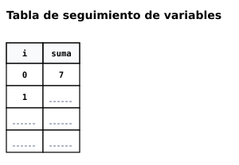

[Manual](../../README.md) › [Estructuras de datos y algoritmos](../README.md) › [Análisis de algoritmos](README.md)

# Tabla de traza (`trace_table`)

Dibuja una prueba de escritorio: columnas con las variables y una fila por paso. Las filas
que faltan hasta `rowCount` y los `null` quedan para completar. También dibuja las tablas de
traza de statics, con una secuencia de operaciones sobre una estructura de capacidad fija.

## Variantes

| `variant` | Qué dibuja |
| :--- | :--- |
| `stack` | Sólo cambia los rótulos por omisión, para trazas de una pila. |

## Campos

| Campo | Tipo | Valores y valor por defecto | Descripción |
| :--- | :--- | :--- | :--- |
| `type` | texto | `trace_table` | Obligatorio. |
| `columns` | lista |  | Las columnas (las variables). |
| `rows` | lista |  | Las filas; `null` o una fila corta quedan para completar. |
| `rowCount` | número |  | Cantidad total de filas; las que faltan quedan vacías. |
| `operations` | lista |  | Las operaciones de cada fila, en la primera columna (o la traza de statics). |
| `operationHeader` | texto |  | Encabezado de la columna de operaciones. |
| `capacity` | número |  | En la traza de statics, la capacidad de la estructura. |
| `pointerHeader` | texto |  | En la traza de statics, el encabezado de la columna del puntero. |
| `pointerLabel` | texto |  | En la traza de statics, el nombre del puntero. |
| `variant` | texto |  | Variante, ver arriba. |
| `blankValues` | sí/no |  | Deja los valores en blanco. |

Además, los campos comunes a todos los tipos: `title`, `subtitle`, `id`, `inkSaver` y `theme` (ver [Campos comunes](../../campos-comunes.md)).

## Modo ejercicio

Campos que dejan casilleros para completar: `blankValues`.

## Ejemplos

### Tabla de seguimiento de variables

```yaml
type: trace_table
title: Tabla de seguimiento de variables
columns: ["i", "suma"]
rows: [[0, 7], [1, null]]
rowCount: 4
```



### Seguimiento de pila (statics)

```yaml
type: trace_table
title: Seguimiento de pila (statics)
variant: stack
capacity: 5
pointerLabel: "TOPE: ___"
operations: ["1. push(10)", "2. pop()"]
inkSaver: false
```


## Ver también

[`complexity`](complexity.md), [`flowchart`](flowchart.md), [`cost_table`](cost_table.md), [`dp_table`](dp_table.md), [`dijkstra`](dijkstra.md)
