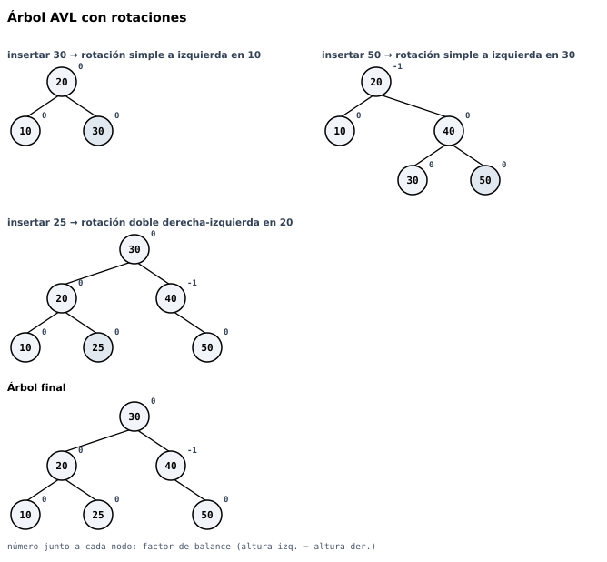

[Manual](../../README.md) › [Estructuras de datos y algoritmos](../README.md) › [Árboles y tablas](README.md)

# Árbol AVL (`avl`)

Inserta las claves en un AVL vacío, de a una, y elimina las de `delete`. Dibuja el árbol
final con el factor de balance de cada nodo y, con `steps`, el árbol después de cada operación
con el nombre de la rotación que la rebalanceó.

## Qué calcula

- Las rotaciones simples y dobles (izquierda-derecha, derecha-izquierda) de cada operación.
- El factor de balance (altura izquierda menos altura derecha) de cada nodo.

## Campos

| Campo | Tipo | Valores y valor por defecto | Descripción |
| :--- | :--- | :--- | :--- |
| `type` | texto | `avl` | Obligatorio. |
| `keys` | lista |  | Las claves a insertar, en orden (hasta 40). Las repetidas se ignoran. |
| `delete` | lista |  | Claves a eliminar después de las inserciones. |
| `steps` | texto | `none`, `rotations`, `all` · por defecto `none` | `none` (sólo el final), `rotations` (los pasos que rotan) o `all` (todos). |
| `balance` | sí/no |  | Muestra el factor de balance de cada nodo (por omisión, sí). |
| `blank` | sí/no |  | Deja en blanco el árbol final, para completar. |

Además, los campos comunes a todos los tipos: `title`, `subtitle`, `id`, `inkSaver` y `theme` (ver [Campos comunes](../../campos-comunes.md)).

## Modo ejercicio

Campos que dejan casilleros para completar: `blank`.

## Ejemplos

### Árbol AVL con rotaciones

```yaml
type: avl
title: Árbol AVL con rotaciones
keys: [10, 20, 30, 40, 50, 25]
steps: rotations
```



## Ver también

[`tree`](tree.md), [`heap`](heap.md), [`bplus_tree`](bplus_tree.md), [`hash_table`](hash_table.md)
