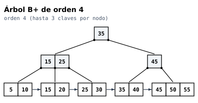

[Manual](../../README.md) › [Estructuras de datos y algoritmos](../README.md) › [Árboles y tablas](README.md)

# Árbol B+ (`bplus_tree`)

Inserta las claves en un árbol B+ y dibuja sus niveles: los nodos internos con las claves
separadoras y las hojas, con todas las claves y enlazadas entre sí. Con `steps`, muestra el
árbol después de cada inserción que divide un nodo.

## Qué calcula

- La división de una hoja (sube una copia de la primera clave de la derecha) y la de un nodo interno (sube la clave del medio).

## Campos

| Campo | Tipo | Valores y valor por defecto | Descripción |
| :--- | :--- | :--- | :--- |
| `type` | texto | `bplus_tree` | Obligatorio. |
| `keys` | lista |  | Las claves a insertar, en orden (hasta 60). |
| `order` | número |  | Orden del árbol, la cantidad máxima de hijos (por omisión 4). |
| `maxKeys` | número |  | Claves máximas por nodo, si no es `order − 1`. |
| `steps` | sí/no |  | Dibuja el árbol después de cada inserción que divide un nodo (hasta 12). |
| `blank` | sí/no |  | Deja en blanco las claves del árbol final. |

Además, los campos comunes a todos los tipos: `title`, `subtitle`, `id`, `inkSaver` y `theme` (ver [Campos comunes](../../campos-comunes.md)).

## Modo ejercicio

Campos que dejan casilleros para completar: `blank`.

## Ejemplos

### Árbol B+ de orden 4

```yaml
type: bplus_tree
title: Árbol B+ de orden 4
order: 4
keys: [5, 15, 25, 35, 45, 20, 30, 10, 40, 50, 55]
```

[](https://ingcom-unrn.github.io/dibu-web/#t=dHlwZTogYnBsdXNfdHJlZQp0aXRsZTogw4FyYm9sIEIrIGRlIG9yZGVuIDQKb3JkZXI6IDQKa2V5czogWzUsIDE1LCAyNSwgMzUsIDQ1LCAyMCwgMzAsIDEwLCA0MCwgNTAsIDU1XQo)

[Abrir en el editor](https://ingcom-unrn.github.io/dibu-web/#t=dHlwZTogYnBsdXNfdHJlZQp0aXRsZTogw4FyYm9sIEIrIGRlIG9yZGVuIDQKb3JkZXI6IDQKa2V5czogWzUsIDE1LCAyNSwgMzUsIDQ1LCAyMCwgMzAsIDEwLCA0MCwgNTAsIDU1XQo) para explorarlo y modificarlo.

## Ver también

[`tree`](tree.md), [`heap`](heap.md), [`avl`](avl.md), [`hash_table`](hash_table.md)
