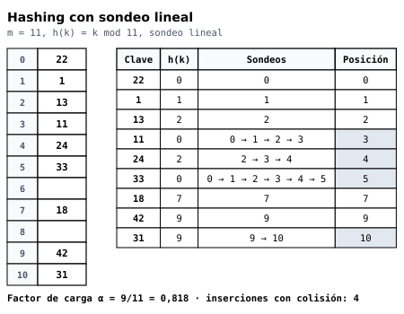
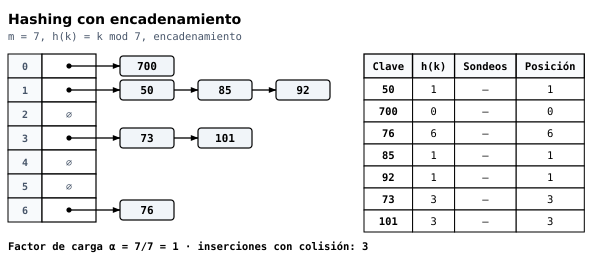

[Manual](../../README.md) › [Estructuras de datos y algoritmos](../README.md) › [Árboles y tablas](README.md)

# Tabla de hash (`hash_table`)

Inserta las claves en una tabla de `size` cubetas con h(k) = k mod m y dibuja la tabla
resultante junto al registro de cada inserción: su hash, la secuencia de sondeos y la
posición final. Las colisiones se resuelven por encadenamiento o con sondeo lineal,
cuadrático o doble hashing.

## Qué calcula

- El hash de cada clave (los textos, por la suma de sus caracteres o el polinomio de base 31).
- La secuencia de sondeos y la posición final, o «sin lugar» si la tabla está llena.
- El factor de carga α y la cantidad de inserciones con colisión.

## Campos

| Campo | Tipo | Valores y valor por defecto | Descripción |
| :--- | :--- | :--- | :--- |
| `type` | texto | `hash_table` | Obligatorio. |
| `size` | número |  | Cantidad de cubetas m (de 1 a 101). |
| `keys` | lista |  | Las claves, enteros o textos, en el orden en que se insertan. |
| `collision` | texto | `chaining`, `linear`, `quadratic`, `double` · por defecto `linear` | `chaining`, `linear`, `quadratic` o `double`. |
| `R` | número |  | En doble hashing, el R de h₂(k) = R − (k mod R); por omisión, el primo menor que m. |
| `stringHash` | texto | `sum`, `poly` · por defecto `sum` | Hash de los textos: `sum` (suma de códigos) o `poly` (base 31). |
| `blank` | sí/no |  | Deja en blanco la tabla y el registro, para completar. |

Además, los campos comunes a todos los tipos: `title`, `subtitle`, `id`, `inkSaver` y `theme` (ver [Campos comunes](../../campos-comunes.md)).

## Modo ejercicio

Campos que dejan casilleros para completar: `blank`.

## Ejemplos

### Hashing con sondeo lineal

```yaml
type: hash_table
title: Hashing con sondeo lineal
size: 11
keys: [22, 1, 13, 11, 24, 33, 18, 42, 31]
collision: linear
```

[](https://ingcom-unrn.github.io/dibu-web/#z=JYxRCsMwDEP_fQofID9J-lFygt1hlJG1ZjUzdpnz052-HgMJiSfQOA9quHffH6M_hWDwkCC3IKwvXE3RTTcyFFbqAs7f2HOGN53e8F5Kwhyq4cgyJay_PiecYqp5gdVE2Nm0_U8-cAE)

[Abrir en el editor](https://ingcom-unrn.github.io/dibu-web/#z=JYxRCsMwDEP_fQofID9J-lFygt1hlJG1ZjUzdpnz052-HgMJiSfQOA9quHffH6M_hWDwkCC3IKwvXE3RTTcyFFbqAs7f2HOGN53e8F5Kwhyq4cgyJay_PiecYqp5gdVE2Nm0_U8-cAE) para explorarlo y modificarlo.

### Hashing con encadenamiento

```yaml
type: hash_table
title: Hashing con encadenamiento
size: 7
keys: [50, 700, 76, 85, 92, 73, 101]
collision: chaining
```

[](https://ingcom-unrn.github.io/dibu-web/#z=FYxBDsIwDATvfoUfkEMKKqV5AX9AqHKDRawGBym-lNfXvYxWo9XY_uOEhXpZjNbKYGLVzcON6AdzU2TN9Galr7Bagy5_P0yw8d4TPscYcIonbgHvY8D54vsacIjDC3KrVbo0TZgLiXoTDg)

[Abrir en el editor](https://ingcom-unrn.github.io/dibu-web/#z=FYxBDsIwDATvfoUfkEMKKqV5AX9AqHKDRawGBym-lNfXvYxWo9XY_uOEhXpZjNbKYGLVzcON6AdzU2TN9Galr7Bagy5_P0yw8d4TPscYcIonbgHvY8D54vsacIjDC3KrVbo0TZgLiXoTDg) para explorarlo y modificarlo.

## Ver también

[`tree`](tree.md), [`heap`](heap.md), [`avl`](avl.md), [`bplus_tree`](bplus_tree.md)
