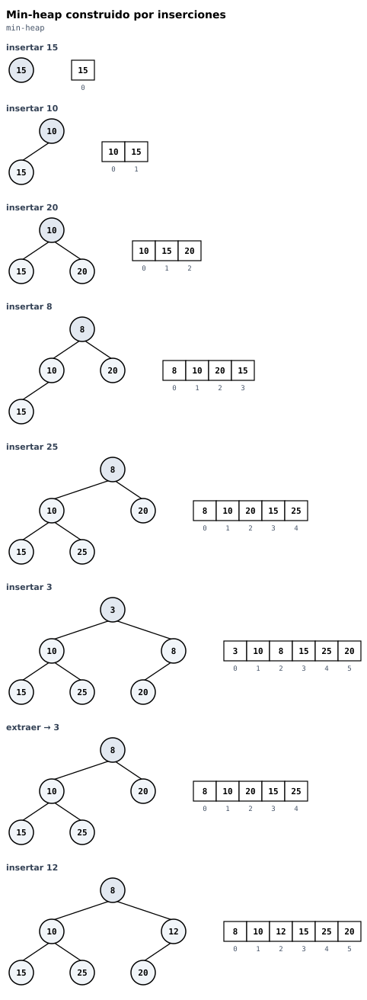
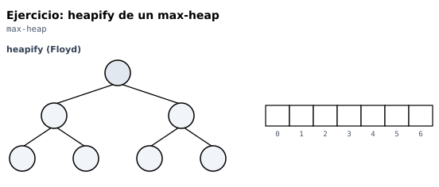

[Manual](../../README.md) › [Estructuras de datos y algoritmos](../README.md) › [Árboles y tablas](README.md)

# Montículo (heap) (`heap`)

Dibuja un montículo binario como árbol y como arreglo, con el índice de cada posición. Se
construye insertando los valores de a uno (con *sift-up*), con el algoritmo de Floyd
(*heapify*) o tal como se da, y después aplica las operaciones de `ops`. Con `steps` muestra
el estado después de cada paso.

## Qué calcula

- La reubicación de cada inserción (flotar) y de cada extracción (hundir).
- El heapify de Floyd, desde la mitad del arreglo hacia la raíz.

## Campos

| Campo | Tipo | Valores y valor por defecto | Descripción |
| :--- | :--- | :--- | :--- |
| `type` | texto | `heap` | Obligatorio. |
| `values` | lista |  | Los valores iniciales. |
| `kind` | texto | `min`, `max` · por defecto `min` | `min` (la raíz es el menor) o `max`. |
| `build` | texto | `none`, `insert`, `heapify` · por defecto `insert` | `insert` (de a uno), `heapify` (Floyd) o `none` (el arreglo tal como está). |
| `ops` | lista |  | Operaciones a aplicar después: `"insert 12"` y `"extract"`. |
| `steps` | sí/no |  | Dibuja el estado después de cada inserción y de cada operación (hasta 16). |
| `blank` | sí/no |  | Deja en blanco el estado final (árbol y arreglo), para completar. |

Además, los campos comunes a todos los tipos: `title`, `subtitle`, `id`, `inkSaver` y `theme` (ver [Campos comunes](../../campos-comunes.md)).

## Modo ejercicio

Campos que dejan casilleros para completar: `blank`.

## Ejemplos

### Min-heap construido por inserciones

```yaml
type: heap
title: Min-heap construido por inserciones
values: [15, 10, 20, 8, 25, 3]
ops: ["extract", "insert 12"]
steps: true
```

[](https://ingcom-unrn.github.io/dibu-web/#z=HYzBCsMwDEPv_gqTcwpLx2D0H_oFo4eQGmYocYjdsf39nB6E9BCS_Rot-KbcwNgOzyvXaTAWqWr95F2wSUeuSr2wVFL45OMkXfCVHhHTLeLsero53jeQNrpAX-u5WIgYrrFhmsMGajR6vyb4Aw)

[Abrir en el editor](https://ingcom-unrn.github.io/dibu-web/#z=HYzBCsMwDEPv_gqTcwpLx2D0H_oFo4eQGmYocYjdsf39nB6E9BCS_Rot-KbcwNgOzyvXaTAWqWr95F2wSUeuSr2wVFL45OMkXfCVHhHTLeLsero53jeQNrpAX-u5WIgYrrFhmsMGajR6vyb4Aw) para explorarlo y modificarlo.

### Ejercicio: heapify de un max-heap

```yaml
type: heap
title: "Ejercicio: heapify de un max-heap"
kind: max
build: heapify
values: [4, 10, 3, 5, 1, 8, 9]
blank: true
```

[](https://ingcom-unrn.github.io/dibu-web/#z=PYrBDoIwEAXv-xUvnJdEAybYu19hPLR0DQu1EmyJ_XshJtxmJpPKLAaD2JmSprBxdRtl6bXX97_rs8ALcsTLfuu9VDRp9GZ3clmDP0ZabcjyMbi3jPOJ0TAuGzE6xvVBLtg4GaQlC_0A)

[Abrir en el editor](https://ingcom-unrn.github.io/dibu-web/#z=PYrBDoIwEAXv-xUvnJdEAybYu19hPLR0DQu1EmyJ_XshJtxmJpPKLAaD2JmSprBxdRtl6bXX97_rs8ALcsTLfuu9VDRp9GZ3clmDP0ZabcjyMbi3jPOJ0TAuGzE6xvVBLtg4GaQlC_0A) para explorarlo y modificarlo.

## Ver también

[`tree`](tree.md), [`avl`](avl.md), [`bplus_tree`](bplus_tree.md), [`hash_table`](hash_table.md)
