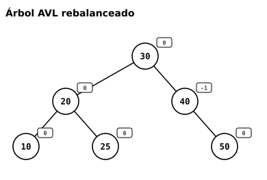
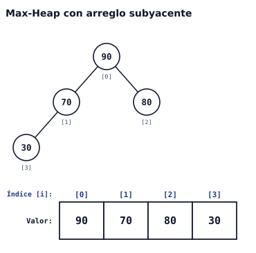

[Manual](../../README.md) › [Estructuras de datos y algoritmos](../README.md) › [Árboles y tablas](README.md)

# Árbol binario (`tree`)

Dibuja un árbol binario. Los nodos se dan por niveles (`values`), por una secuencia de
inserciones en un árbol de búsqueda (`insert`, que en la variante `avl` rebalancea) o como una
estructura anidada (`root`). El AVL muestra el factor de balance y el montículo, el índice de
cada nodo y el arreglo debajo.

## Variantes

| `variant` | Qué dibuja |
| :--- | :--- |
| `binary` | Por omisión. Un árbol binario cualquiera. |
| `bst` | Un árbol binario de búsqueda. |
| `avl` | Un AVL, con el factor de balance de cada nodo. |
| `heap` | Un montículo, con el arreglo que lo representa. |

## Campos

| Campo | Tipo | Valores y valor por defecto | Descripción |
| :--- | :--- | :--- | :--- |
| `type` | texto | `tree` | Obligatorio. |
| `values` | lista |  | Los nodos por niveles; `""` es una posición sin nodo. |
| `insert` | lista |  | Inserciones en un árbol de búsqueda, en orden; con `avl`, rebalancea. |
| `root` | objeto |  | Un árbol anidado: `value`, `left`, `right`. |
| `variant` | texto |  | Variante, ver arriba. |
| `nodeStyle` | texto |  | `struct` dibuja cada nodo como un struct con `*izq` y `*der`. |
| `nullLeaves` | sí/no |  | Dibuja los punteros a NULL de las hojas. |
| `highlight` | lista |  | Nodos resaltados, por su valor. |
| `showBalance` | sí/no |  | En el AVL, el factor de balance de cada nodo. |
| `showArray` | sí/no |  | En el montículo, el arreglo debajo. |
| `blankValues` | sí/no |  | Deja los valores en blanco. |
| `blankBalance` | sí/no |  | Deja en blanco los factores de balance. |

Además, los campos comunes a todos los tipos: `title`, `subtitle`, `id`, `inkSaver` y `theme` (ver [Campos comunes](../../campos-comunes.md)).

## Modo ejercicio

Campos que dejan casilleros para completar: `blankValues`, `blankBalance`.

## Ejemplos

### Árbol AVL rebalanceado

```yaml
type: tree
title: Árbol AVL rebalanceado
variant: avl
insert: [10, 20, 30, 40, 50, 25]
```

[](https://ingcom-unrn.github.io/dibu-web/#t=dHlwZTogdHJlZQp0aXRsZTogw4FyYm9sIEFWTCByZWJhbGFuY2VhZG8KdmFyaWFudDogYXZsCmluc2VydDogWzEwLCAyMCwgMzAsIDQwLCA1MCwgMjVdCg)

[Abrir en el editor](https://ingcom-unrn.github.io/dibu-web/#t=dHlwZTogdHJlZQp0aXRsZTogw4FyYm9sIEFWTCByZWJhbGFuY2VhZG8KdmFyaWFudDogYXZsCmluc2VydDogWzEwLCAyMCwgMzAsIDQwLCA1MCwgMjVdCg) para explorarlo y modificarlo.

### Max-Heap con arreglo subyacente

```yaml
type: tree
title: Max-Heap con arreglo subyacente
variant: heap
values: [90, 70, 80, 30]
showArray: true
inkSaver: false
```

[](https://ingcom-unrn.github.io/dibu-web/#t=dHlwZTogdHJlZQp0aXRsZTogTWF4LUhlYXAgY29uIGFycmVnbG8gc3VieWFjZW50ZQp2YXJpYW50OiBoZWFwCnZhbHVlczogWzkwLCA3MCwgODAsIDMwXQpzaG93QXJyYXk6IHRydWUKaW5rU2F2ZXI6IGZhbHNlCg)

[Abrir en el editor](https://ingcom-unrn.github.io/dibu-web/#t=dHlwZTogdHJlZQp0aXRsZTogTWF4LUhlYXAgY29uIGFycmVnbG8gc3VieWFjZW50ZQp2YXJpYW50OiBoZWFwCnZhbHVlczogWzkwLCA3MCwgODAsIDMwXQpzaG93QXJyYXk6IHRydWUKaW5rU2F2ZXI6IGZhbHNlCg) para explorarlo y modificarlo.

## Notas

- Para seguir las rotaciones de un AVL paso a paso, ver [`avl`](avl.md); para las operaciones de un montículo, [`heap`](heap.md).

## Ver también

[`heap`](heap.md), [`avl`](avl.md), [`bplus_tree`](bplus_tree.md), [`hash_table`](hash_table.md)
