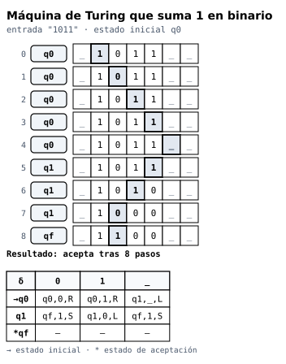

[Manual](../../README.md) › [Estructuras de datos y algoritmos](../README.md) › [Computabilidad](README.md)

# Máquina de Turing (`turing`)

Simula una máquina de Turing de una cinta sobre la entrada y dibuja cada configuración: el
paso, el estado y la cinta con el cabezal resaltado. Debajo, si acepta, rechaza o no se
detuvo, y la tabla de transiciones δ.

## Campos

| Campo | Tipo | Valores y valor por defecto | Descripción |
| :--- | :--- | :--- | :--- |
| `type` | texto | `turing` | Obligatorio. |
| `transitions` | lista |  | Las transiciones: `"q0,1 -> q1,X,R"` (estado, símbolo leído, estado nuevo, símbolo escrito, movimiento `R`, `L` o `S`), o un mapa `"q0,1": "q1,X,R"`. |
| `input` | texto |  | La entrada (hasta 40 símbolos). |
| `start` | texto |  | El estado inicial (por omisión `q0`). |
| `accept` | lista |  | Los estados de aceptación. |
| `blankSymbol` | texto |  | El símbolo blanco (por omisión `_`). |
| `maxSteps` | número |  | Pasos máximos de la simulación (de 1 a 200, por omisión 40). |
| `table` | sí/no |  | Agrega la tabla de transiciones (por omisión, sí). |
| `blank` | sí/no |  | Dibuja sólo la configuración inicial, para completar la traza. |

Además, los campos comunes a todos los tipos: `title`, `subtitle`, `id`, `inkSaver` y `theme` (ver [Campos comunes](../../campos-comunes.md)).

## Modo ejercicio

Campos que dejan casilleros para completar: `blankSymbol`, `blank`.

## Ejemplos

### Máquina de Turing que suma 1 en binario

```yaml
type: turing
title: Máquina de Turing que suma 1 en binario
input: "1011"
start: q0
accept: [qf]
transitions:
  - "q0,0 -> q0,0,R"
  - "q0,1 -> q0,1,R"
  - "q0,_ -> q1,_,L"
  - "q1,1 -> q1,0,L"
  - "q1,0 -> qf,1,S"
  - "q1,_ -> qf,1,S"
```

[](https://ingcom-unrn.github.io/dibu-web/#z=TcwxDsIwDAXQPaf4ypxK8ZqBE8ACbAhVoaQoEqRN4gwch7NwMUIp0Mn2-7b5PjoDLsmHi2DP1zptno9YfLA4O-ynBLE45HKzILiAUw2TH4QPY2EDSZpIisw21SlqYbvOjbU9xP4oONmQPfshZCOABjJqpdGs8K5qK39IM9IS2wlJtWr9RZo3qZ4v8POzr-e7P7ZLfAE)

[Abrir en el editor](https://ingcom-unrn.github.io/dibu-web/#z=TcwxDsIwDAXQPaf4ypxK8ZqBE8ACbAhVoaQoEqRN4gwch7NwMUIp0Mn2-7b5PjoDLsmHi2DP1zptno9YfLA4O-ynBLE45HKzILiAUw2TH4QPY2EDSZpIisw21SlqYbvOjbU9xP4oONmQPfshZCOABjJqpdGs8K5qK39IM9IS2wlJtWr9RZo3qZ4v8POzr-e7P7ZLfAE) para explorarlo y modificarlo.
