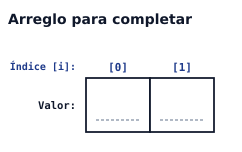

[Manual](../../README.md) › [Estructuras de datos y algoritmos](../README.md) › [Estructuras lineales](README.md)

# Arreglo (`array`)

Dibuja un arreglo como una fila de celdas contiguas, con el índice de cada una y,
opcionalmente, su dirección de memoria y su offset desde el comienzo. Los punteros o índices
que lo recorren se dibujan como flechas sobre la celda a la que apuntan.

## Qué calcula

- La dirección de cada celda a partir de `baseAddr` y del tamaño del elemento (`typeSize`).

## Campos

| Campo | Tipo | Valores y valor por defecto | Descripción |
| :--- | :--- | :--- | :--- |
| `type` | texto | `array` | Obligatorio. |
| `values` | lista |  | Los valores, en orden. Un valor vacío (`""`) deja la celda sin contenido. |
| `capacity` | número |  | Cantidad total de celdas; las que sobran después de `values` se dibujan vacías (el espacio reservado sin usar). |
| `pointers` | texto |  | Punteros o índices sobre el arreglo, como texto `"p:0, q:3"` (nombre y posición). |
| `showIndices` | sí/no |  | Muestra el índice de cada celda (por omisión, sí). |
| `showAddresses` | sí/no |  | Muestra la dirección de cada celda. |
| `showOffsets` | sí/no |  | Muestra el desplazamiento en bytes de cada celda respecto del comienzo. |
| `baseAddr` | número |  | Dirección de la primera celda, en hexadecimal (`0x1000`) o simbólica (`"@A"`). |
| `typeSize` | número |  | Tamaño de cada elemento en bytes (por omisión 4, un `int`). |
| `blankValues` | sí/no |  | Deja los valores en blanco, para completar. |
| `blankAddrs` | sí/no |  | Deja las direcciones en blanco, para calcularlas. |

Además, los campos comunes a todos los tipos: `title`, `subtitle`, `id`, `inkSaver` y `theme` (ver [Campos comunes](../../campos-comunes.md)).

## Modo ejercicio

Campos que dejan casilleros para completar: `blankValues`, `blankAddrs`.

## Ejemplos

### Arreglo v[0..2] con <p & q> → α·β

```yaml
type: array
title: "Arreglo v[0..2] con <p & q> → α·β"
values: [3, 1, 4]
pointers: "p:0, q:2"
showAddresses: true
showOffsets: true
```

![Arreglo v[0..2] con <p & q> → α·β](img/ks_cs_array_punteros_utf8.svg)

### Arreglo para completar

```yaml
type: array
title: Arreglo para completar
values: [41, 42]
blankValues: true
inkSaver: false
```



## Notas

- Para un arreglo de dos dimensiones, ver [`matrix`](matrix.md).

## Ver también

[`matrix`](matrix.md), [`linked_list`](linked_list.md), [`stack`](stack.md), [`queue`](queue.md)
