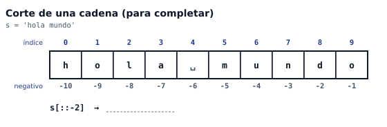
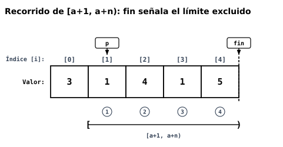
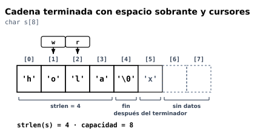
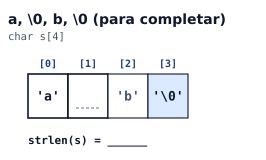

[Manual](../../README.md) › [Estructuras de datos y algoritmos](../README.md) › [Estructuras lineales](README.md)

# Arreglo (`array`)

Dibuja un arreglo como una fila de celdas contiguas, con el índice de cada una y,
opcionalmente, su dirección de memoria y su offset desde el comienzo. Los punteros o índices
que lo recorren se dibujan como flechas sobre la celda a la que apuntan; uno en la posición
`n` señala el límite excluido (`a + n`), en el borde derecho y sin una celda `a[n]`. `range`
marca un intervalo semiabierto `[start, stop)`. Con `variant: c_string`, un arreglo de `char`
con su terminador; con `variant: python_sequence`, una lista, tupla o cadena de Python, con
índices negativos, fronteras y un corte (`slice`).

## Qué calcula

- La dirección de cada celda a partir de `baseAddr` y del tamaño del elemento (`typeSize`).
- En `python_sequence`, las celdas que elige un corte, con las reglas de `slice.indices(n)`: los límites fuera de rango se ajustan, y el resultado se escribe como en Python (`[4, 1]`, `(4,)`, `'aloh'`).

## Variantes

| `variant` | Qué dibuja |
| :--- | :--- |
| `c_string` | Una cadena de C en un arreglo de `capacity` bytes: el primer `'\0'` fija la longitud (`strlen`), los bytes declarados después del terminador se ven atenuados y la capacidad sin datos declarados, punteada. Sin terminador dentro de la capacidad, lo dice y no muestra un `strlen`. `char s[4] = "hola"` (con `text` y `capacity: 4`) no lleva terminador, como en C. |
| `python_sequence` | Una secuencia de Python (`kind`): el índice positivo y, con `showNegativeIndices`, el negativo de cada elemento; con `showBoundaries`, las fronteras entre celdas (de `0` a `n`). Con `slice`, resalta las celdas elegidas, numera el orden de visita si el paso no es 1, marca el inicio y el fin (el límite excluido) y escribe el resultado. |

## Campos

| Campo | Tipo | Valores y valor por defecto | Descripción |
| :--- | :--- | :--- | :--- |
| `type` | texto | `array` | Obligatorio. |
| `values` | lista o texto |  | Los valores, en orden. Un valor vacío (`""`) deja la celda sin contenido. |
| `capacity` | número |  | Cantidad total de celdas; las que sobran después de `values` se dibujan vacías (el espacio reservado sin usar). |
| `pointers` | texto |  | Punteros o índices sobre el arreglo, como texto `"p:0, q:3"` (nombre y posición). La posición `n` (una más que la última celda) es el límite excluido: se marca en el borde, sin una celda. |
| `range` | objeto |  | Un intervalo semiabierto `{start, stop, label, order, blank}` debajo de las celdas: `[` en el inicio (incluido) y `)` en el fin (excluido), de `0` a `n`; `start` igual a `stop` es el intervalo vacío. `order: true` (o `reverse`) numera el orden de visita; `blank: true` lo deja para dibujar. |
| `showIndices` | sí/no |  | Muestra el índice de cada celda (por omisión, sí). |
| `showAddresses` | sí/no |  | Muestra la dirección de cada celda. |
| `showOffsets` | sí/no |  | Muestra el desplazamiento en bytes de cada celda respecto del comienzo. |
| `baseAddr` | número |  | Dirección de la primera celda, en hexadecimal (`0x1000`) o simbólica (`"@A"`). |
| `typeSize` | número |  | Tamaño de cada elemento en bytes (por omisión 4, un `int`). |
| `blankValues` | sí/no |  | Deja los valores en blanco, para completar. |
| `blankAddrs` | sí/no |  | Deja las direcciones en blanco, para calcularlas. |
| `variant` | texto |  | Variante, ver arriba. |
| `text` |  |  | En `c_string`, la cadena (ASCII); se le agrega el terminador si entra en `capacity`. |
| `bytes` | lista |  | En `c_string`, los bytes uno por uno: un carácter (`'a'`), `'\0'` o `0` (el terminador), `'\n'`, un número de 0 a 255, o `null` (una posición sin dato declarado). |
| `blank` | lista |  | En `c_string`, los índices de las celdas que se dejan en blanco, para completar. |
| `blankLength` | sí/no |  | En `c_string`, deja en blanco la longitud (`strlen`) y las bandas que la delatan. |
| `kind` | texto |  | En `python_sequence`: `list` (por omisión), `tuple` o `str`. En `str`, `values` es un texto y cada celda es un carácter; un espacio se ve como `␣`. |
| `name` | texto |  | En `python_sequence` y `c_string`, el nombre de la variable (por omisión `a`, `t` o `s`). |
| `showNegativeIndices` | sí/no |  | En `python_sequence`, el índice negativo de cada elemento. |
| `showBoundaries` | sí/no |  | En `python_sequence`, las fronteras entre celdas, de `0` a `n`. |
| `slice` | objeto |  | En `python_sequence`, un corte `{start, stop, step, blankSelection}`; cualquiera se puede omitir, y `{step: -1}` es `[::-1]`. El paso 0 es un error. Con `blankSelection: true` no se ve ninguna pista de la solución: ni las celdas elegidas, ni el inicio y el fin, ni el resultado. |

Además, los campos comunes a todos los tipos: `title`, `subtitle`, `id`, `inkSaver` y `theme` (ver [Campos comunes](../../campos-comunes.md)).

## Modo ejercicio

En `python_sequence`, `slice` con `blankSelection: true` deja el corte para resolver: se ve la
expresión (`a[-4:-1:2]`) y un casillero para el resultado.

Campos que dejan casilleros para completar: `blankValues`, `blankAddrs`, `blank`, `blankLength`.

## Ejemplos

### Arreglo v[0..2] con <p & q> → α·β

```yaml
type: array
title: "Arreglo v[0..2] con <p & q> → α·β"
values: [3, 1, 4]
pointers: "p:0, q:2"
showAddresses: true
showOffsets: true
```

[![Arreglo v[0..2] con <p & q> → α·β](img/ks_cs_array_punteros_utf8.svg)](https://ingcom-unrn.github.io/dibu-web/#t=dHlwZTogYXJyYXkKdGl0bGU6ICJBcnJlZ2xvIHZbMC4uMl0gY29uIDxwICYgcT4g4oaSIM6xwrfOsiIKdmFsdWVzOiBbMywgMSwgNF0KcG9pbnRlcnM6ICJwOjAsIHE6MiIKc2hvd0FkZHJlc3NlczogdHJ1ZQpzaG93T2Zmc2V0czogdHJ1ZQo)

[Abrir en el editor](https://ingcom-unrn.github.io/dibu-web/#t=dHlwZTogYXJyYXkKdGl0bGU6ICJBcnJlZ2xvIHZbMC4uMl0gY29uIDxwICYgcT4g4oaSIM6xwrfOsiIKdmFsdWVzOiBbMywgMSwgNF0KcG9pbnRlcnM6ICJwOjAsIHE6MiIKc2hvd0FkZHJlc3NlczogdHJ1ZQpzaG93T2Zmc2V0czogdHJ1ZQo) para explorarlo y modificarlo.

### Arreglo para completar

```yaml
type: array
title: Arreglo para completar
values: [41, 42]
blankValues: true
inkSaver: false
```

[](https://ingcom-unrn.github.io/dibu-web/#t=dHlwZTogYXJyYXkKdGl0bGU6IEFycmVnbG8gcGFyYSBjb21wbGV0YXIKdmFsdWVzOiBbNDEsIDQyXQpibGFua1ZhbHVlczogdHJ1ZQppbmtTYXZlcjogZmFsc2UK)

[Abrir en el editor](https://ingcom-unrn.github.io/dibu-web/#t=dHlwZTogYXJyYXkKdGl0bGU6IEFycmVnbG8gcGFyYSBjb21wbGV0YXIKdmFsdWVzOiBbNDEsIDQyXQpibGFua1ZhbHVlczogdHJ1ZQppbmtTYXZlcjogZmFsc2UK) para explorarlo y modificarlo.

### Corte con paso: a[-4:-1:2]

```yaml
type: array
title: "Corte con paso: a[-4:-1:2]"
variant: python_sequence
kind: list
values: [2, 4, 7, 1, 8]
showNegativeIndices: true
showBoundaries: true
slice: {start: -4, stop: -1, step: 2}
```

[![Corte con paso: a[-4:-1:2]](img/ks_cs_array_python_corte.svg)](https://ingcom-unrn.github.io/dibu-web/#t=dHlwZTogYXJyYXkKdGl0bGU6ICJDb3J0ZSBjb24gcGFzbzogYVstNDotMToyXSIKdmFyaWFudDogcHl0aG9uX3NlcXVlbmNlCmtpbmQ6IGxpc3QKdmFsdWVzOiBbMiwgNCwgNywgMSwgOF0Kc2hvd05lZ2F0aXZlSW5kaWNlczogdHJ1ZQpzaG93Qm91bmRhcmllczogdHJ1ZQpzbGljZToge3N0YXJ0OiAtNCwgc3RvcDogLTEsIHN0ZXA6IDJ9Cg)

[Abrir en el editor](https://ingcom-unrn.github.io/dibu-web/#t=dHlwZTogYXJyYXkKdGl0bGU6ICJDb3J0ZSBjb24gcGFzbzogYVstNDotMToyXSIKdmFyaWFudDogcHl0aG9uX3NlcXVlbmNlCmtpbmQ6IGxpc3QKdmFsdWVzOiBbMiwgNCwgNywgMSwgOF0Kc2hvd05lZ2F0aXZlSW5kaWNlczogdHJ1ZQpzaG93Qm91bmRhcmllczogdHJ1ZQpzbGljZToge3N0YXJ0OiAtNCwgc3RvcDogLTEsIHN0ZXA6IDJ9Cg) para explorarlo y modificarlo.

### Corte de una cadena (para completar)

```yaml
type: array
title: Corte de una cadena (para completar)
variant: python_sequence
kind: str
values: "hola mundo"
showNegativeIndices: true
slice: {step: -2, blankSelection: true}
inkSaver: false
```

[](https://ingcom-unrn.github.io/dibu-web/#t=dHlwZTogYXJyYXkKdGl0bGU6IENvcnRlIGRlIHVuYSBjYWRlbmEgKHBhcmEgY29tcGxldGFyKQp2YXJpYW50OiBweXRob25fc2VxdWVuY2UKa2luZDogc3RyCnZhbHVlczogImhvbGEgbXVuZG8iCnNob3dOZWdhdGl2ZUluZGljZXM6IHRydWUKc2xpY2U6IHtzdGVwOiAtMiwgYmxhbmtTZWxlY3Rpb246IHRydWV9Cmlua1NhdmVyOiBmYWxzZQo)

[Abrir en el editor](https://ingcom-unrn.github.io/dibu-web/#t=dHlwZTogYXJyYXkKdGl0bGU6IENvcnRlIGRlIHVuYSBjYWRlbmEgKHBhcmEgY29tcGxldGFyKQp2YXJpYW50OiBweXRob25fc2VxdWVuY2UKa2luZDogc3RyCnZhbHVlczogImhvbGEgbXVuZG8iCnNob3dOZWdhdGl2ZUluZGljZXM6IHRydWUKc2xpY2U6IHtzdGVwOiAtMiwgYmxhbmtTZWxlY3Rpb246IHRydWV9Cmlua1NhdmVyOiBmYWxzZQo) para explorarlo y modificarlo.

### Recorrido de [a+1, a+n): fin señala el límite excluido

```yaml
type: array
title: "Recorrido de [a+1, a+n): fin señala el límite excluido"
values: [3, 1, 4, 1, 5]
pointers: "p:1, fin:5"
range: {start: 1, stop: 5, label: "[a+1, a+n)", order: true}
```

[](https://ingcom-unrn.github.io/dibu-web/#t=dHlwZTogYXJyYXkKdGl0bGU6ICJSZWNvcnJpZG8gZGUgW2ErMSwgYStuKTogZmluIHNlw7FhbGEgZWwgbMOtbWl0ZSBleGNsdWlkbyIKdmFsdWVzOiBbMywgMSwgNCwgMSwgNV0KcG9pbnRlcnM6ICJwOjEsIGZpbjo1IgpyYW5nZToge3N0YXJ0OiAxLCBzdG9wOiA1LCBsYWJlbDogIlthKzEsIGErbikiLCBvcmRlcjogdHJ1ZX0K)

[Abrir en el editor](https://ingcom-unrn.github.io/dibu-web/#t=dHlwZTogYXJyYXkKdGl0bGU6ICJSZWNvcnJpZG8gZGUgW2ErMSwgYStuKTogZmluIHNlw7FhbGEgZWwgbMOtbWl0ZSBleGNsdWlkbyIKdmFsdWVzOiBbMywgMSwgNCwgMSwgNV0KcG9pbnRlcnM6ICJwOjEsIGZpbjo1IgpyYW5nZToge3N0YXJ0OiAxLCBzdG9wOiA1LCBsYWJlbDogIlthKzEsIGErbikiLCBvcmRlcjogdHJ1ZX0K) para explorarlo y modificarlo.

### Cadena terminada con espacio sobrante y cursores

```yaml
type: array
variant: c_string
title: "Cadena terminada con espacio sobrante y cursores"
name: s
bytes: ['h', 'o', 'l', 'a', '\0', 'x', null, null]
pointers: "w:1, r:2"
```

[](https://ingcom-unrn.github.io/dibu-web/#t=dHlwZTogYXJyYXkKdmFyaWFudDogY19zdHJpbmcKdGl0bGU6ICJDYWRlbmEgdGVybWluYWRhIGNvbiBlc3BhY2lvIHNvYnJhbnRlIHkgY3Vyc29yZXMiCm5hbWU6IHMKYnl0ZXM6IFsnaCcsICdvJywgJ2wnLCAnYScsICdcMCcsICd4JywgbnVsbCwgbnVsbF0KcG9pbnRlcnM6ICJ3OjEsIHI6MiIK)

[Abrir en el editor](https://ingcom-unrn.github.io/dibu-web/#t=dHlwZTogYXJyYXkKdmFyaWFudDogY19zdHJpbmcKdGl0bGU6ICJDYWRlbmEgdGVybWluYWRhIGNvbiBlc3BhY2lvIHNvYnJhbnRlIHkgY3Vyc29yZXMiCm5hbWU6IHMKYnl0ZXM6IFsnaCcsICdvJywgJ2wnLCAnYScsICdcMCcsICd4JywgbnVsbCwgbnVsbF0KcG9pbnRlcnM6ICJ3OjEsIHI6MiIK) para explorarlo y modificarlo.

### a, \0, b, \0 (para completar)

```yaml
type: array
variant: c_string
title: "a, \\0, b, \\0 (para completar)"
bytes: ['a', 0, 'b', 0]
blank: [1]
blankLength: true
inkSaver: false
```

[](https://ingcom-unrn.github.io/dibu-web/#t=dHlwZTogYXJyYXkKdmFyaWFudDogY19zdHJpbmcKdGl0bGU6ICJhLCBcXDAsIGIsIFxcMCAocGFyYSBjb21wbGV0YXIpIgpieXRlczogWydhJywgMCwgJ2InLCAwXQpibGFuazogWzFdCmJsYW5rTGVuZ3RoOiB0cnVlCmlua1NhdmVyOiBmYWxzZQo)

[Abrir en el editor](https://ingcom-unrn.github.io/dibu-web/#t=dHlwZTogYXJyYXkKdmFyaWFudDogY19zdHJpbmcKdGl0bGU6ICJhLCBcXDAsIGIsIFxcMCAocGFyYSBjb21wbGV0YXIpIgpieXRlczogWydhJywgMCwgJ2InLCAwXQpibGFuazogWzFdCmJsYW5rTGVuZ3RoOiB0cnVlCmlua1NhdmVyOiBmYWxzZQo) para explorarlo y modificarlo.

## Notas

- Para un arreglo de dos dimensiones, ver [`matrix`](matrix.md).
- En `python_sequence` no hay direcciones de memoria; hasta 16 elementos. En `c_string`, hasta 24 bytes.

## Ver también

[`matrix`](matrix.md), [`linked_list`](linked_list.md), [`stack`](stack.md), [`queue`](queue.md)
