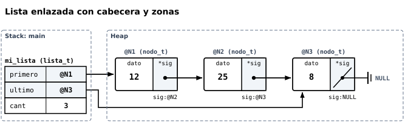
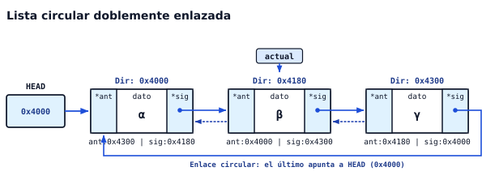

[Manual](../../README.md) › [Estructuras de datos y algoritmos](../README.md) › [Estructuras lineales](README.md)

# Lista enlazada (`linked_list`)

Dibuja los nodos de una lista enlazada con su valor y el puntero al siguiente (y al anterior,
en las dobles), la cabeza y los cursores que la recorren. Puede mostrar dónde vive cada cosa:
la cabeza o una estructura cabecera en el stack y los nodos en el heap.

## Variantes

| `variant` | Qué dibuja |
| :--- | :--- |
| `singly` | Por omisión. Cada nodo apunta al siguiente; el último, a NULL. |
| `doubly` | Cada nodo apunta al siguiente y al anterior. |
| `circular` | El último apunta al primero. |
| `circular_doubly` | Doble y circular. |

## Campos

| Campo | Tipo | Valores y valor por defecto | Descripción |
| :--- | :--- | :--- | :--- |
| `type` | texto | `linked_list` | Obligatorio. |
| `values` | lista |  | Los valores de los nodos, en orden (hasta 7). `[]` es la lista vacía. |
| `variant` | texto |  | Variante, ver arriba. |
| `addresses` | lista |  | La dirección de cada nodo (hexadecimal o simbólica, como `"@N1"`). |
| `headLabel` | texto |  | El rótulo de la cabeza (por omisión `HEAD`). |
| `pointers` | texto |  | Cursores sobre la lista, como `"ant:0, actual:1"`. |
| `drawArrows` | sí/no |  | Dibuja las flechas entre nodos (por omisión, sí). |
| `nodeType` | texto |  | Rotula cada nodo con su tipo, `@N1 (nodo_t)`. |
| `header` | objeto |  | Una estructura cabecera en lugar de la cabeza: `name`, `type` y `fields` (`"primero -> 0"`, `"cant = 3"`). |
| `zones` | objeto |  | Enmarca el stack y el heap; `true` o `{stack, heap}` con títulos propios. |
| `blankValues` | sí/no |  | Deja los valores en blanco. |
| `blankNextAddrs` | sí/no |  | Deja en blanco las direcciones de los punteros al siguiente. |

Además, los campos comunes a todos los tipos: `title`, `subtitle`, `id`, `inkSaver` y `theme` (ver [Campos comunes](../../campos-comunes.md)).

## Modo ejercicio

Campos que dejan casilleros para completar: `blankValues`, `blankNextAddrs`.

## Ejemplos

### Lista enlazada con cabecera y zonas

```yaml
type: linked_list
title: Lista enlazada con cabecera y zonas
values: [12, 25, 8]
addresses: ["@N1", "@N2", "@N3"]
nodeType: nodo_t
zones:
  stack: "Stack: main"
  heap: Heap
header:
  name: mi_lista
  type: lista_t
  fields:
    - "primero -> 0"
    - "ultimo -> 2"
    - "cant = 3"
```

[](https://ingcom-unrn.github.io/dibu-web/#t=dHlwZTogbGlua2VkX2xpc3QKdGl0bGU6IExpc3RhIGVubGF6YWRhIGNvbiBjYWJlY2VyYSB5IHpvbmFzCnZhbHVlczogWzEyLCAyNSwgOF0KYWRkcmVzc2VzOiBbIkBOMSIsICJATjIiLCAiQE4zIl0Kbm9kZVR5cGU6IG5vZG9fdAp6b25lczoKICBzdGFjazogIlN0YWNrOiBtYWluIgogIGhlYXA6IEhlYXAKaGVhZGVyOgogIG5hbWU6IG1pX2xpc3RhCiAgdHlwZTogbGlzdGFfdAogIGZpZWxkczoKICAgIC0gInByaW1lcm8gLT4gMCIKICAgIC0gInVsdGltbyAtPiAyIgogICAgLSAiY2FudCA9IDMiCg)

[Abrir en el editor](https://ingcom-unrn.github.io/dibu-web/#t=dHlwZTogbGlua2VkX2xpc3QKdGl0bGU6IExpc3RhIGVubGF6YWRhIGNvbiBjYWJlY2VyYSB5IHpvbmFzCnZhbHVlczogWzEyLCAyNSwgOF0KYWRkcmVzc2VzOiBbIkBOMSIsICJATjIiLCAiQE4zIl0Kbm9kZVR5cGU6IG5vZG9fdAp6b25lczoKICBzdGFjazogIlN0YWNrOiBtYWluIgogIGhlYXA6IEhlYXAKaGVhZGVyOgogIG5hbWU6IG1pX2xpc3RhCiAgdHlwZTogbGlzdGFfdAogIGZpZWxkczoKICAgIC0gInByaW1lcm8gLT4gMCIKICAgIC0gInVsdGltbyAtPiAyIgogICAgLSAiY2FudCA9IDMiCg) para explorarlo y modificarlo.

### Lista circular doblemente enlazada

```yaml
type: linked_list
title: Lista circular doblemente enlazada
variant: circular_doubly
values: ["α", "β", "γ"]
pointers: "actual:1"
inkSaver: false
```

[](https://ingcom-unrn.github.io/dibu-web/#t=dHlwZTogbGlua2VkX2xpc3QKdGl0bGU6IExpc3RhIGNpcmN1bGFyIGRvYmxlbWVudGUgZW5sYXphZGEKdmFyaWFudDogY2lyY3VsYXJfZG91Ymx5CnZhbHVlczogWyLOsSIsICLOsiIsICLOsyJdCnBvaW50ZXJzOiAiYWN0dWFsOjEiCmlua1NhdmVyOiBmYWxzZQo)

[Abrir en el editor](https://ingcom-unrn.github.io/dibu-web/#t=dHlwZTogbGlua2VkX2xpc3QKdGl0bGU6IExpc3RhIGNpcmN1bGFyIGRvYmxlbWVudGUgZW5sYXphZGEKdmFyaWFudDogY2lyY3VsYXJfZG91Ymx5CnZhbHVlczogWyLOsSIsICLOsiIsICLOsyJdCnBvaW50ZXJzOiAiYWN0dWFsOjEiCmlua1NhdmVyOiBmYWxzZQo) para explorarlo y modificarlo.

## Ver también

[`array`](array.md), [`matrix`](matrix.md), [`stack`](stack.md), [`queue`](queue.md)
