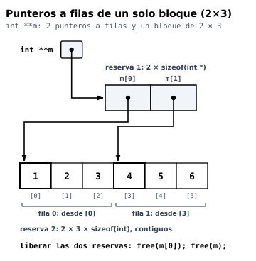
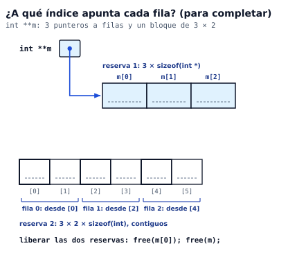
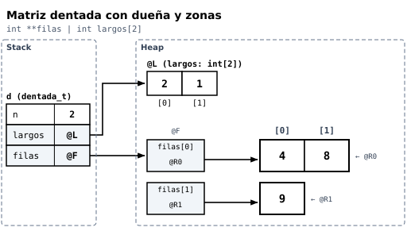
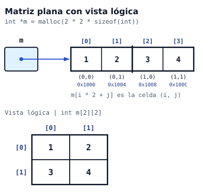
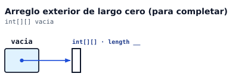

[Manual](../../README.md) › [Estructuras de datos y algoritmos](../README.md) › [Estructuras lineales](README.md)

# Matriz (`matrix`)

Dibuja una matriz y cómo está guardada en memoria. La estática muestra la declaración
(`int m[3][4]`) y, con `showAddresses`, la dirección de cada celda en orden de filas; la
dinámica, el puntero, el arreglo de punteros a filas y cada fila; la dentada, filas de distinto
largo con el arreglo de largos o un centinela; la plana, un único bloque contiguo con la cuenta
`m[i * C + j]`; la de Java, un arreglo de arreglos (`int[][]`) con cada fila como objeto aparte.

## Qué calcula

- La dirección de cada celda en orden de filas.
- En la plana, el índice lineal de cada `(i, j)`.
- En la dentada, el arreglo de largos a partir de las filas.

## Variantes

| `variant` | Qué dibuja |
| :--- | :--- |
| `static` | Por omisión. `int m[F][C]` en un bloque, con `showLinear` también fila por fila en memoria. |
| `dynamic` | Un `int **`: el puntero, el arreglo de punteros a filas y cada fila por separado; `null` es un puntero a NULL. |
| `jagged` | Dinámica con filas de distinto largo, con el arreglo de largos (`showLengths`) o un `sentinel` al final de cada fila. |
| `flat` | Un `int *` con `F * C` elementos contiguos: cada celda con su índice `[k]` y su `(i, j)`. |
| `row_pointers` | Un `int **` con una tabla de punteros a filas y un solo bloque de `F * C` datos: `m[i]` apunta al índice `i * C` del bloque (para 2×3, la fila 1 empieza en el 3). Son dos reservas y se liberan las dos (`free(m[0]); free(m);`). Para comparar con `dynamic`, que reserva cada fila por separado. |
| `java` | Un `int[][]` de Java: la variable refiere al arreglo exterior, que guarda una referencia por fila; cada fila es un objeto con su `length`. `null` es una referencia nula y `[]`, una fila de largo cero; `values: []` es un arreglo exterior vacío. |

## Campos

| Campo | Tipo | Valores y valor por defecto | Descripción |
| :--- | :--- | :--- | :--- |
| `type` | texto | `matrix` | Obligatorio. |
| `values` | lista |  | Lista de filas (o lista plana junto con `cols`). En la dinámica, `null` es una fila que es NULL; en la de Java, una referencia `null`, y `[]` una fila de largo cero. |
| `rows` | número |  | Cantidad de filas, si no salen de `values` (de 1 a 10). |
| `cols` | número |  | Cantidad de columnas (de 1 a 10). |
| `variant` | texto |  | Variante, ver arriba. |
| `name` | texto |  | Nombre de la variable (por omisión `m`). |
| `elementType` | texto |  | Tipo de los elementos, para la declaración (por omisión `int`). |
| `typeSize` | número |  | Tamaño de cada elemento en bytes. |
| `showIndices` | sí/no |  | Muestra los índices de filas y columnas. |
| `showAddresses` | sí/no |  | Muestra la dirección de cada celda. |
| `baseAddr` | texto |  | Dirección de la primera celda (o del bloque, en la plana). |
| `rowAddresses` | lista |  | En la dinámica, la dirección de cada fila. |
| `rowsBaseAddr` | número |  | En la dinámica, la dirección del arreglo de punteros a filas. |
| `highlight` | lista |  | Celdas resaltadas, como `"1,2; 0,0"` o `[[1, 2]]`. |
| `highlightRows` | lista |  | Filas resaltadas. |
| `highlightCols` | lista |  | Columnas resaltadas. |
| `blankValues` | sí/no |  | Deja los valores en blanco. |
| `blankAddrs` | sí/no |  | Deja las direcciones en blanco. |
| `blankPointers` | sí/no |  | En `row_pointers`, deja la tabla de punteros sin flechas, para deducir a qué índice apunta cada fila. |
| `showLinear` | sí/no |  | En la estática, dibuja además la matriz como está en memoria, una fila detrás de la otra. |
| `showLengths` | sí/no |  | En la dentada, el arreglo de largos (por omisión, sí). |
| `lengths` | lista |  | En la dentada, los largos, si no salen de las filas. |
| `lengthsName` | texto |  | Nombre del arreglo de largos. |
| `lengthsType` | texto |  | Tipo de los largos (por omisión `size_t`). |
| `lengthsAddr` | texto |  | Dirección del arreglo de largos. |
| `blankLengths` | sí/no |  | Deja los largos en blanco (en la de Java, cada `length`). |
| `sentinel` | texto |  | En la dentada, un valor centinela al final de cada fila, como `"'\\0'"` o `-1`. |
| `showCoords` | sí/no |  | En la plana, el `(i, j)` de cada celda (por omisión, sí). |
| `showFormula` | sí/no |  | En la plana, la fórmula `m[i * C + j]` (por omisión, sí). |
| `showLogical` | sí/no |  | En la plana, agrega la matriz como la piensa el programa. |
| `zones` | sí/no |  | Enmarca el stack y el heap; `true` usa esos títulos, o `{stack, heap}` con títulos propios. |
| `owner` | objeto |  | Una estructura dueña de la matriz en lugar del puntero: `name`, `type` y `fields` (`"filas -> rows"`, `"largos -> lengths"`). |

Además, los campos comunes a todos los tipos: `title`, `subtitle`, `id`, `inkSaver` y `theme` (ver [Campos comunes](../../campos-comunes.md)).

## Modo ejercicio

Campos que dejan casilleros para completar: `blankValues`, `blankAddrs`, `blankPointers`, `blankLengths`.

## Ejemplos

### Matriz estática row-major

```yaml
type: matrix
title: Matriz estática row-major
values: [[1, 2, 3], [4, 5, 6]]
baseAddr: "0x1000"
typeSize: 4
showAddresses: true
showLinear: true
highlight: [[0, 0], [1, 2]]
```

[](https://ingcom-unrn.github.io/dibu-web/#t=dHlwZTogbWF0cml4CnRpdGxlOiBNYXRyaXogZXN0w6F0aWNhIHJvdy1tYWpvcgp2YWx1ZXM6IFtbMSwgMiwgM10sIFs0LCA1LCA2XV0KYmFzZUFkZHI6ICIweDEwMDAiCnR5cGVTaXplOiA0CnNob3dBZGRyZXNzZXM6IHRydWUKc2hvd0xpbmVhcjogdHJ1ZQpoaWdobGlnaHQ6IFtbMCwgMF0sIFsxLCAyXV0K)

[Abrir en el editor](https://ingcom-unrn.github.io/dibu-web/#t=dHlwZTogbWF0cml4CnRpdGxlOiBNYXRyaXogZXN0w6F0aWNhIHJvdy1tYWpvcgp2YWx1ZXM6IFtbMSwgMiwgM10sIFs0LCA1LCA2XV0KYmFzZUFkZHI6ICIweDEwMDAiCnR5cGVTaXplOiA0CnNob3dBZGRyZXNzZXM6IHRydWUKc2hvd0xpbmVhcjogdHJ1ZQpoaWdobGlnaHQ6IFtbMCwgMF0sIFsxLCAyXV0K) para explorarlo y modificarlo.

### Punteros a filas de un solo bloque (2×3)

```yaml
type: matrix
variant: row_pointers
title: "Punteros a filas de un solo bloque (2×3)"
values: [[1, 2, 3], [4, 5, 6]]
```

[](https://ingcom-unrn.github.io/dibu-web/#t=dHlwZTogbWF0cml4CnZhcmlhbnQ6IHJvd19wb2ludGVycwp0aXRsZTogIlB1bnRlcm9zIGEgZmlsYXMgZGUgdW4gc29sbyBibG9xdWUgKDLDlzMpIgp2YWx1ZXM6IFtbMSwgMiwgM10sIFs0LCA1LCA2XV0K)

[Abrir en el editor](https://ingcom-unrn.github.io/dibu-web/#t=dHlwZTogbWF0cml4CnZhcmlhbnQ6IHJvd19wb2ludGVycwp0aXRsZTogIlB1bnRlcm9zIGEgZmlsYXMgZGUgdW4gc29sbyBibG9xdWUgKDLDlzMpIgp2YWx1ZXM6IFtbMSwgMiwgM10sIFs0LCA1LCA2XV0K) para explorarlo y modificarlo.

### ¿A qué índice apunta cada fila? (para completar)

```yaml
type: matrix
variant: row_pointers
title: "¿A qué índice apunta cada fila? (para completar)"
rows: 3
cols: 2
blankPointers: true
blankValues: true
inkSaver: false
```

[](https://ingcom-unrn.github.io/dibu-web/#t=dHlwZTogbWF0cml4CnZhcmlhbnQ6IHJvd19wb2ludGVycwp0aXRsZTogIsK_QSBxdcOpIMOtbmRpY2UgYXB1bnRhIGNhZGEgZmlsYT8gKHBhcmEgY29tcGxldGFyKSIKcm93czogMwpjb2xzOiAyCmJsYW5rUG9pbnRlcnM6IHRydWUKYmxhbmtWYWx1ZXM6IHRydWUKaW5rU2F2ZXI6IGZhbHNlCg)

[Abrir en el editor](https://ingcom-unrn.github.io/dibu-web/#t=dHlwZTogbWF0cml4CnZhcmlhbnQ6IHJvd19wb2ludGVycwp0aXRsZTogIsK_QSBxdcOpIMOtbmRpY2UgYXB1bnRhIGNhZGEgZmlsYT8gKHBhcmEgY29tcGxldGFyKSIKcm93czogMwpjb2xzOiAyCmJsYW5rUG9pbnRlcnM6IHRydWUKYmxhbmtWYWx1ZXM6IHRydWUKaW5rU2F2ZXI6IGZhbHNlCg) para explorarlo y modificarlo.

### Matriz dentada con dueña y zonas

```yaml
type: matrix
title: Matriz dentada con dueña y zonas
variant: jagged
name: filas
values: [[4, 8], [9]]
showAddresses: true
baseAddr: "@F"
rowAddresses: ["@R0", "@R1"]
lengthsType: int
lengthsAddr: "@L"
zones: true
owner:
  name: d
  type: dentada_t
  fields:
    - "n = 2"
    - "largos -> lengths"
    - "filas -> rows"
```

[](https://ingcom-unrn.github.io/dibu-web/#t=dHlwZTogbWF0cml4CnRpdGxlOiBNYXRyaXogZGVudGFkYSBjb24gZHVlw7FhIHkgem9uYXMKdmFyaWFudDogamFnZ2VkCm5hbWU6IGZpbGFzCnZhbHVlczogW1s0LCA4XSwgWzldXQpzaG93QWRkcmVzc2VzOiB0cnVlCmJhc2VBZGRyOiAiQEYiCnJvd0FkZHJlc3NlczogWyJAUjAiLCAiQFIxIl0KbGVuZ3Roc1R5cGU6IGludApsZW5ndGhzQWRkcjogIkBMIgp6b25lczogdHJ1ZQpvd25lcjoKICBuYW1lOiBkCiAgdHlwZTogZGVudGFkYV90CiAgZmllbGRzOgogICAgLSAibiA9IDIiCiAgICAtICJsYXJnb3MgLT4gbGVuZ3RocyIKICAgIC0gImZpbGFzIC0-IHJvd3MiCg)

[Abrir en el editor](https://ingcom-unrn.github.io/dibu-web/#t=dHlwZTogbWF0cml4CnRpdGxlOiBNYXRyaXogZGVudGFkYSBjb24gZHVlw7FhIHkgem9uYXMKdmFyaWFudDogamFnZ2VkCm5hbWU6IGZpbGFzCnZhbHVlczogW1s0LCA4XSwgWzldXQpzaG93QWRkcmVzc2VzOiB0cnVlCmJhc2VBZGRyOiAiQEYiCnJvd0FkZHJlc3NlczogWyJAUjAiLCAiQFIxIl0KbGVuZ3Roc1R5cGU6IGludApsZW5ndGhzQWRkcjogIkBMIgp6b25lczogdHJ1ZQpvd25lcjoKICBuYW1lOiBkCiAgdHlwZTogZGVudGFkYV90CiAgZmllbGRzOgogICAgLSAibiA9IDIiCiAgICAtICJsYXJnb3MgLT4gbGVuZ3RocyIKICAgIC0gImZpbGFzIC0-IHJvd3MiCg) para explorarlo y modificarlo.

### Matriz plana con vista lógica

```yaml
type: matrix
title: Matriz plana con vista lógica
variant: flat
values: [[1, 2], [3, 4]]
showLogical: true
showAddresses: true
inkSaver: false
```

[](https://ingcom-unrn.github.io/dibu-web/#t=dHlwZTogbWF0cml4CnRpdGxlOiBNYXRyaXogcGxhbmEgY29uIHZpc3RhIGzDs2dpY2EKdmFyaWFudDogZmxhdAp2YWx1ZXM6IFtbMSwgMl0sIFszLCA0XV0Kc2hvd0xvZ2ljYWw6IHRydWUKc2hvd0FkZHJlc3NlczogdHJ1ZQppbmtTYXZlcjogZmFsc2UK)

[Abrir en el editor](https://ingcom-unrn.github.io/dibu-web/#t=dHlwZTogbWF0cml4CnRpdGxlOiBNYXRyaXogcGxhbmEgY29uIHZpc3RhIGzDs2dpY2EKdmFyaWFudDogZmxhdAp2YWx1ZXM6IFtbMSwgMl0sIFszLCA0XV0Kc2hvd0xvZ2ljYWw6IHRydWUKc2hvd0FkZHJlc3NlczogdHJ1ZQppbmtTYXZlcjogZmFsc2UK) para explorarlo y modificarlo.

### Arreglo de arreglos en Java

```yaml
type: matrix
title: "Arreglo de arreglos en Java"
variant: java
name: matriz
values:
  - [1, 2, 3]
  - [4]
  - null
  - []
zones: true
```

[](https://ingcom-unrn.github.io/dibu-web/#t=dHlwZTogbWF0cml4CnRpdGxlOiAiQXJyZWdsbyBkZSBhcnJlZ2xvcyBlbiBKYXZhIgp2YXJpYW50OiBqYXZhCm5hbWU6IG1hdHJpegp2YWx1ZXM6CiAgLSBbMSwgMiwgM10KICAtIFs0XQogIC0gbnVsbAogIC0gW10Kem9uZXM6IHRydWUK)

[Abrir en el editor](https://ingcom-unrn.github.io/dibu-web/#t=dHlwZTogbWF0cml4CnRpdGxlOiAiQXJyZWdsbyBkZSBhcnJlZ2xvcyBlbiBKYXZhIgp2YXJpYW50OiBqYXZhCm5hbWU6IG1hdHJpegp2YWx1ZXM6CiAgLSBbMSwgMiwgM10KICAtIFs0XQogIC0gbnVsbAogIC0gW10Kem9uZXM6IHRydWUK) para explorarlo y modificarlo.

### Arreglo exterior de largo cero (para completar)

```yaml
type: matrix
title: Arreglo exterior de largo cero (para completar)
variant: java
name: vacia
values: []
blankLengths: true
inkSaver: false
```

[](https://ingcom-unrn.github.io/dibu-web/#t=dHlwZTogbWF0cml4CnRpdGxlOiBBcnJlZ2xvIGV4dGVyaW9yIGRlIGxhcmdvIGNlcm8gKHBhcmEgY29tcGxldGFyKQp2YXJpYW50OiBqYXZhCm5hbWU6IHZhY2lhCnZhbHVlczogW10KYmxhbmtMZW5ndGhzOiB0cnVlCmlua1NhdmVyOiBmYWxzZQo)

[Abrir en el editor](https://ingcom-unrn.github.io/dibu-web/#t=dHlwZTogbWF0cml4CnRpdGxlOiBBcnJlZ2xvIGV4dGVyaW9yIGRlIGxhcmdvIGNlcm8gKHBhcmEgY29tcGxldGFyKQp2YXJpYW50OiBqYXZhCm5hbWU6IHZhY2lhCnZhbHVlczogW10KYmxhbmtMZW5ndGhzOiB0cnVlCmlua1NhdmVyOiBmYWxzZQo) para explorarlo y modificarlo.

## Notas

- El máximo es 10 filas por 10 columnas; en la plana y en `row_pointers`, 24 celdas.
- Para una reserva parcial de filas (un `malloc` que falla a mitad de camino), ver [`object_heap`](../memoria/object_heap.md) con `variant: c` y un instante por paso.
- Las direcciones simbólicas (`"@F"`) van entre comillas en YAML.

## Ver también

[`array`](array.md), [`linked_list`](linked_list.md), [`stack`](stack.md), [`queue`](queue.md)
