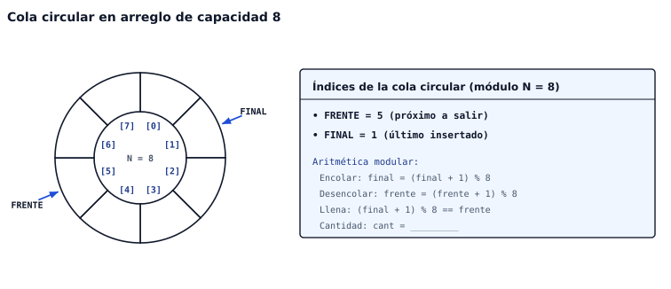

[Manual](../../README.md) › [Estructuras de datos y algoritmos](../README.md) › [Estructuras lineales](README.md)

# Cola (`queue`)

Dibuja una cola en arreglo con los índices de frente y final. La circular se dibuja como un
anillo y, con `showPanel`, con un panel que resume frente, final y cantidad.

## Variantes

| `variant` | Qué dibuja |
| :--- | :--- |
| `linear` | Por omisión. Un arreglo con frente y final. |
| `circular` | Un anillo de `capacity` lugares. |

## Campos

| Campo | Tipo | Valores y valor por defecto | Descripción |
| :--- | :--- | :--- | :--- |
| `type` | texto | `queue` | Obligatorio. |
| `values` | lista |  | Los valores en la cola, del frente al final. |
| `variant` | texto |  | Variante, ver arriba. |
| `capacity` | número |  | Cantidad de lugares. |
| `frontIndex` | número |  | Índice del frente. |
| `rearIndex` | número |  | Índice del final. |
| `showPanel` | sí/no |  | En la circular, un panel con frente, final y cantidad. |
| `blankValues` | sí/no |  | Deja los valores en blanco. |
| `blankPointers` | sí/no |  | Deja frente y final en blanco. |

Además, los campos comunes a todos los tipos: `title`, `subtitle`, `id`, `inkSaver` y `theme` (ver [Campos comunes](../../campos-comunes.md)).

## Modo ejercicio

Campos que dejan casilleros para completar: `blankValues`, `blankPointers`.

## Ejemplos

### Cola circular en arreglo de capacidad 8

```yaml
type: queue
title: Cola circular en arreglo de capacidad 8
variant: circular
capacity: 8
frontIndex: 5
rearIndex: 1
inkSaver: false
```

[](https://ingcom-unrn.github.io/dibu-web/#z=PcpBCsJADEbhfU6RK7gQSrauXHuCn5lUgkOmjZlib2_B4vLxvdwXFV6HDqW0bEfcegMXizIagtUZEfpsnatywYJiFZUn2hAGT_m_9NPc5dA5uufdq36ErxSKOONC5q8HNg3hGe2t9AU)

[Abrir en el editor](https://ingcom-unrn.github.io/dibu-web/#z=PcpBCsJADEbhfU6RK7gQSrauXHuCn5lUgkOmjZlib2_B4vLxvdwXFV6HDqW0bEfcegMXizIagtUZEfpsnatywYJiFZUn2hAGT_m_9NPc5dA5uufdq36ErxSKOONC5q8HNg3hGe2t9AU) para explorarlo y modificarlo.

## Ver también

[`array`](array.md), [`matrix`](matrix.md), [`linked_list`](linked_list.md), [`stack`](stack.md)
