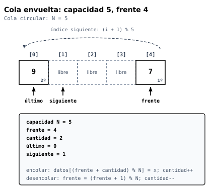
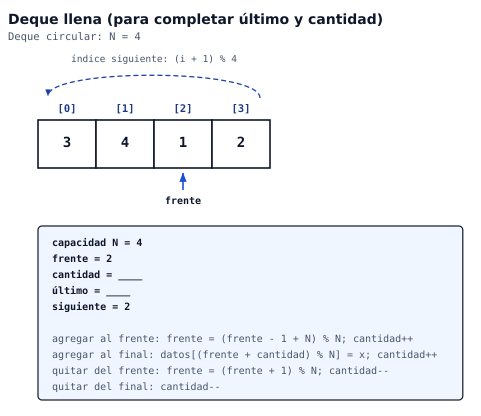

[Manual](../../README.md) › [Estructuras de datos y algoritmos](../README.md) › [Estructuras lineales](README.md)

# Cola (`queue`)

Dibuja una cola en arreglo con los índices de frente y final. La circular se dibuja como un
anillo y, con `showPanel`, con un panel que resume frente, final y cantidad. Las variantes
`ring` y `deque` usan otra convención: la capacidad, el índice del frente y los valores en
orden lógico; dibu ubica cada valor en su celda física, con la vuelta del índice.

## Qué calcula

- En `ring` y `deque`: la celda de cada valor, `(frente + k) % N`; la cantidad (el largo de `values`); el último ocupado, `(frente + cantidad - 1) % N`, y el siguiente para agregar al final, `(frente + cantidad) % N`, que en una cola llena coincide con el frente.

## Variantes

| `variant` | Qué dibuja |
| :--- | :--- |
| `linear` | Por omisión. Un arreglo con frente y final. |
| `circular` | Un anillo de `capacity` lugares, con `values` en orden físico (`values[i]` en la celda `i`) y `FINAL` como el último insertado. |
| `ring` | Una cola circular por frente y cantidad, con `values` en orden lógico, el orden de cada valor y un panel con frente, cantidad, último y siguiente, y encolar y desencolar. |
| `deque` | Como `ring`, con las operaciones de una deque (agregar y quitar en los dos extremos). |

## Campos

| Campo | Tipo | Valores y valor por defecto | Descripción |
| :--- | :--- | :--- | :--- |
| `type` | texto | `queue` | Obligatorio. |
| `values` | lista |  | Los valores en la cola, del frente al final. En `circular`, en orden físico; en `ring` y `deque`, en orden lógico (el primero va en `frontIndex`). |
| `variant` | texto |  | Variante, ver arriba. |
| `capacity` | número |  | Cantidad de lugares. |
| `frontIndex` | número |  | Índice del frente. |
| `rearIndex` | número |  | Índice del final. |
| `showPanel` | sí/no |  | En la circular, un panel con frente, final y cantidad. |
| `blankValues` | sí/no |  | Deja los valores en blanco. |
| `blankPointers` | sí/no |  | Deja frente y final en blanco. |
| `blank` | lista |  | En `ring` y `deque`, lo que se deja en blanco, por separado: `front`, `last`, `count`, `next`, `values` y `order`. |

Además, los campos comunes a todos los tipos: `title`, `subtitle`, `id`, `inkSaver` y `theme` (ver [Campos comunes](../../campos-comunes.md)).

## Modo ejercicio

Campos que dejan casilleros para completar: `blankValues`, `blankPointers`, `blank`.

## Ejemplos

### Cola circular en arreglo de capacidad 8

```yaml
type: queue
title: Cola circular en arreglo de capacidad 8
variant: circular
capacity: 8
frontIndex: 5
rearIndex: 1
inkSaver: false
```

[](https://ingcom-unrn.github.io/dibu-web/#t=dHlwZTogcXVldWUKdGl0bGU6IENvbGEgY2lyY3VsYXIgZW4gYXJyZWdsbyBkZSBjYXBhY2lkYWQgOAp2YXJpYW50OiBjaXJjdWxhcgpjYXBhY2l0eTogOApmcm9udEluZGV4OiA1CnJlYXJJbmRleDogMQppbmtTYXZlcjogZmFsc2UK)

[Abrir en el editor](https://ingcom-unrn.github.io/dibu-web/#t=dHlwZTogcXVldWUKdGl0bGU6IENvbGEgY2lyY3VsYXIgZW4gYXJyZWdsbyBkZSBjYXBhY2lkYWQgOAp2YXJpYW50OiBjaXJjdWxhcgpjYXBhY2l0eTogOApmcm9udEluZGV4OiA1CnJlYXJJbmRleDogMQppbmtTYXZlcjogZmFsc2UK) para explorarlo y modificarlo.

### Cola envuelta: capacidad 5, frente 4

```yaml
type: queue
variant: ring
title: "Cola envuelta: capacidad 5, frente 4"
capacity: 5
frontIndex: 4
values: [7, 9]
```

[](https://ingcom-unrn.github.io/dibu-web/#t=dHlwZTogcXVldWUKdmFyaWFudDogcmluZwp0aXRsZTogIkNvbGEgZW52dWVsdGE6IGNhcGFjaWRhZCA1LCBmcmVudGUgNCIKY2FwYWNpdHk6IDUKZnJvbnRJbmRleDogNAp2YWx1ZXM6IFs3LCA5XQo)

[Abrir en el editor](https://ingcom-unrn.github.io/dibu-web/#t=dHlwZTogcXVldWUKdmFyaWFudDogcmluZwp0aXRsZTogIkNvbGEgZW52dWVsdGE6IGNhcGFjaWRhZCA1LCBmcmVudGUgNCIKY2FwYWNpdHk6IDUKZnJvbnRJbmRleDogNAp2YWx1ZXM6IFs3LCA5XQo) para explorarlo y modificarlo.

### Deque llena (para completar último y cantidad)

```yaml
type: queue
variant: deque
title: "Deque llena (para completar último y cantidad)"
capacity: 4
frontIndex: 2
values: [1, 2, 3, 4]
blank: [last, count, order]
inkSaver: false
```

[](https://ingcom-unrn.github.io/dibu-web/#t=dHlwZTogcXVldWUKdmFyaWFudDogZGVxdWUKdGl0bGU6ICJEZXF1ZSBsbGVuYSAocGFyYSBjb21wbGV0YXIgw7psdGltbyB5IGNhbnRpZGFkKSIKY2FwYWNpdHk6IDQKZnJvbnRJbmRleDogMgp2YWx1ZXM6IFsxLCAyLCAzLCA0XQpibGFuazogW2xhc3QsIGNvdW50LCBvcmRlcl0KaW5rU2F2ZXI6IGZhbHNlCg)

[Abrir en el editor](https://ingcom-unrn.github.io/dibu-web/#t=dHlwZTogcXVldWUKdmFyaWFudDogZGVxdWUKdGl0bGU6ICJEZXF1ZSBsbGVuYSAocGFyYSBjb21wbGV0YXIgw7psdGltbyB5IGNhbnRpZGFkKSIKY2FwYWNpdHk6IDQKZnJvbnRJbmRleDogMgp2YWx1ZXM6IFsxLCAyLCAzLCA0XQpibGFuazogW2xhc3QsIGNvdW50LCBvcmRlcl0KaW5rU2F2ZXI6IGZhbHNlCg) para explorarlo y modificarlo.

## Ver también

[`array`](array.md), [`matrix`](matrix.md), [`linked_list`](linked_list.md), [`stack`](stack.md)
