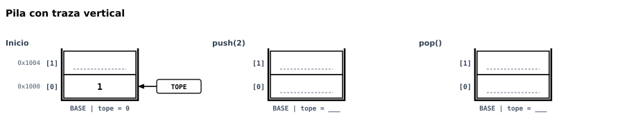

[Manual](../../README.md) › [Estructuras de datos y algoritmos](../README.md) › [Estructuras lineales](README.md)

# Pila (`stack`)

Dibuja una pila de abajo hacia arriba, con el tope marcado. Con `layout: vertical_multi`
muestra varios momentos de la misma pila uno al lado del otro, para seguir una secuencia de
apilar y desapilar.

## Campos

| Campo | Tipo | Valores y valor por defecto | Descripción |
| :--- | :--- | :--- | :--- |
| `type` | texto | `stack` | Obligatorio. |
| `values` | lista |  | Los valores desde la base hasta el tope. Con `vertical_multi`, una lista de estados. |
| `capacity` | número |  | Cantidad de lugares de la pila; los libres se dibujan vacíos. |
| `topIndex` | número |  | Índice del tope, si no es el último valor. |
| `topLabel` | texto |  | Rótulo del tope (por omisión `tope`). |
| `label` | texto |  | Rótulo de la pila. |
| `layout` | texto |  | `vertical_multi` dibuja varios estados uno al lado del otro. |
| `traceLabels` | lista |  | Con `vertical_multi`, el rótulo de cada estado (por ejemplo, la operación). |
| `showAddresses` | sí/no |  | Muestra la dirección de cada lugar. |
| `baseAddr` | número |  | Dirección de la base. |
| `typeSize` | número |  | Tamaño de cada elemento en bytes. |
| `blankValues` | sí/no |  | Deja los valores en blanco. |
| `blankPointers` | sí/no |  | Deja el tope en blanco. |

Además, los campos comunes a todos los tipos: `title`, `subtitle`, `id`, `inkSaver` y `theme` (ver [Campos comunes](../../campos-comunes.md)).

## Modo ejercicio

Campos que dejan casilleros para completar: `blankValues`, `blankPointers`.

## Ejemplos

### Pila con traza vertical

```yaml
type: stack
title: Pila con traza vertical
layout: vertical_multi
values: [1]
traceLabels: ["Inicio", "push(2)", "pop()"]
```



## Ver también

[`array`](array.md), [`matrix`](matrix.md), [`linked_list`](linked_list.md), [`queue`](queue.md)
