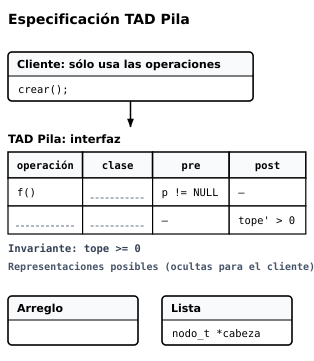

[Manual](../../README.md) › [Estructuras de datos y algoritmos](../README.md) › [Memoria, tipos y recursión](README.md)

# Tipo abstracto de datos (`adt`)

Dibuja un tipo abstracto de datos: el cliente, la tabla de operaciones con su clase
(constructor, modificador, observador…), su precondición y su poscondición, el invariante y
las representaciones posibles con sus campos.

## Campos

| Campo | Tipo | Valores y valor por defecto | Descripción |
| :--- | :--- | :--- | :--- |
| `type` | texto | `adt` | Obligatorio. |
| `name` | texto |  | Nombre del TAD. |
| `operations` | lista |  | Las operaciones: texto (la firma) o `{signature, kind, pre, post, blank}`. |
| `invariant` | texto |  | El invariante de la representación. |
| `representations` | lista |  | Las representaciones posibles, cada una `{name, fields}`. |
| `client` | lista |  | Código cliente que usa el TAD. |
| `blankOperations` | sí/no |  | Deja las operaciones en blanco. |
| `blankKinds` | sí/no |  | Deja en blanco la clase de cada operación. |

Además, los campos comunes a todos los tipos: `title`, `subtitle`, `id`, `inkSaver` y `theme` (ver [Campos comunes](../../campos-comunes.md)).

## Modo ejercicio

Campos que dejan casilleros para completar: `blankOperations`, `blankKinds`.

## Ejemplos

### Especificación TAD Pila

```yaml
type: adt
title: Especificación TAD Pila
name: Pila
blankKinds: true
operations:
  - {signature: "f()", kind: observador, pre: "p != NULL"}
  - {signature: "g()", post: "tope' > 0", blank: true}
client: ["crear();"]
invariant: "tope >= 0"
representations:
  - Arreglo
  - {name: Lista, fields: ["nodo_t *cabeza"]}
```

[](https://ingcom-unrn.github.io/dibu-web/#t=dHlwZTogYWR0CnRpdGxlOiBFc3BlY2lmaWNhY2nDs24gVEFEIFBpbGEKbmFtZTogUGlsYQpibGFua0tpbmRzOiB0cnVlCm9wZXJhdGlvbnM6CiAgLSB7c2lnbmF0dXJlOiAiZigpIiwga2luZDogb2JzZXJ2YWRvciwgcHJlOiAicCAhPSBOVUxMIn0KICAtIHtzaWduYXR1cmU6ICJnKCkiLCBwb3N0OiAidG9wZScgPiAwIiwgYmxhbms6IHRydWV9CmNsaWVudDogWyJjcmVhcigpOyJdCmludmFyaWFudDogInRvcGUgPj0gMCIKcmVwcmVzZW50YXRpb25zOgogIC0gQXJyZWdsbwogIC0ge25hbWU6IExpc3RhLCBmaWVsZHM6IFsibm9kb190ICpjYWJlemEiXX0K)

[Abrir en el editor](https://ingcom-unrn.github.io/dibu-web/#t=dHlwZTogYWR0CnRpdGxlOiBFc3BlY2lmaWNhY2nDs24gVEFEIFBpbGEKbmFtZTogUGlsYQpibGFua0tpbmRzOiB0cnVlCm9wZXJhdGlvbnM6CiAgLSB7c2lnbmF0dXJlOiAiZigpIiwga2luZDogb2JzZXJ2YWRvciwgcHJlOiAicCAhPSBOVUxMIn0KICAtIHtzaWduYXR1cmU6ICJnKCkiLCBwb3N0OiAidG9wZScgPiAwIiwgYmxhbms6IHRydWV9CmNsaWVudDogWyJjcmVhcigpOyJdCmludmFyaWFudDogInRvcGUgPj0gMCIKcmVwcmVzZW50YXRpb25zOgogIC0gQXJyZWdsbwogIC0ge25hbWU6IExpc3RhLCBmaWVsZHM6IFsibm9kb190ICpjYWJlemEiXX0K) para explorarlo y modificarlo.

## Ver también

[`call_stack`](call_stack.md), [`call_tree`](call_tree.md), [`scopes`](scopes.md), [`struct`](struct.md), [`byte_layout`](byte_layout.md), [`object_heap`](object_heap.md)
