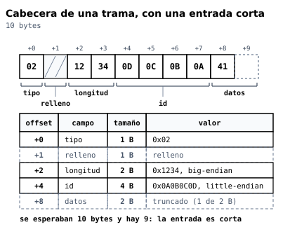
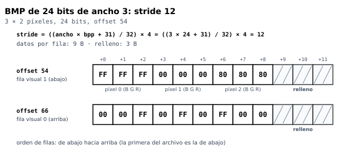
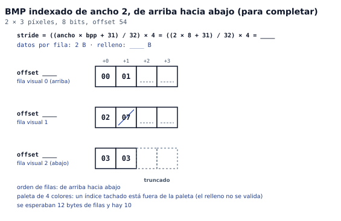

[Manual](../../README.md) › [Estructuras de datos y algoritmos](../README.md) › [Memoria, tipos y recursión](README.md)

# Disposición de octetos (`byte_layout`)

Dibuja un búfer octeto por octeto. Con la variante `fields` (por omisión), los campos de una
cabecera o una trama: cada uno con su offset, su ancho y sus bytes, que dibu calcula a partir
del valor y del orden de bytes, el relleno entre campos y, con `length`, lo que falta de una
entrada corta. Con `bmp_rows`, las filas de píxeles de un BMP: el stride, los bytes de datos y
de relleno de cada fila, el offset en el archivo y a qué fila visual corresponde.

## Qué calcula

- Los bytes de cada campo a partir de `value` y `endian`: `0x1234` es `12 34` en orden de red y `34 12` en little-endian. Un valor que no entra en `size` bytes es un error, sin dibujar un rango imposible.
- El offset de cada campo y el relleno que deja un `offset` explícito.
- En `bmp_rows`, el stride (`((ancho × bpp + 31) / 32) × 4`), el relleno de cada fila y el offset de cada una según el orden de filas; los píxeles de 24 bits se escriben en el orden del archivo (B G R: un rojo es `00 00 FF`).

## Variantes

| `variant` | Qué dibuja |
| :--- | :--- |
| `fields` | Por omisión. Los campos de un formato binario, con una tabla de offset, campo, tamaño y valor. |
| `bmp_rows` | Las filas de píxeles de un BMP de 24 u 8 bits. |

## Campos

| Campo | Tipo | Valores y valor por defecto | Descripción |
| :--- | :--- | :--- | :--- |
| `type` | texto | `byte_layout` | Obligatorio. |
| `fields` | lista |  | Los campos, en orden: `{name, size, value, endian}` (de 1 a 8 bytes; `value` en decimal o `"0x1234"`, negativo en complemento a dos), `{name, bytes}` (los octetos tal cual) o `{padding: n}`. `offset` ubica un campo más adelante, con relleno en el medio; `blank: true` deja sus bytes en blanco. Hasta 12 campos y 32 bytes. |
| `endian` |  |  | `little` (por omisión) o `big` (orden de red), para todos los campos; cada campo puede llevar el suyo. |
| `length` | número |  | Los bytes que llegaron, si son menos que los de los campos; el resto se dibuja como truncado. |
| `variant` | texto |  | Variante, ver arriba. |
| `width` | número |  | En `bmp_rows`, el ancho en píxeles (de 1 a 8). |
| `height` | número |  | En `bmp_rows`, el alto en píxeles (de 1 a 6). |
| `bitsPerPixel` | número |  | En `bmp_rows`, 24 (por omisión) u 8 (indexado, con paleta). |
| `offset` | número |  | En `bmp_rows`, el offset de los píxeles en el archivo (por omisión 54). |
| `order` | texto |  | En `bmp_rows`, `bottom_up` (por omisión: la primera fila del archivo es la de abajo) o `top_down`. |
| `pixels` | lista |  | En `bmp_rows`, las filas visuales, la de arriba primero: en 24 bits, colores `"RRGGBB"` o `[r, g, b]`; en 8 bits, índices de la paleta. Sin `pixels`, los datos quedan para completar. |
| `paletteSize` | número |  | En `bmp_rows` de 8 bits, la cantidad de colores; un índice fuera de la paleta se tacha (el relleno no se valida). |
| `available` | número |  | En `bmp_rows`, los bytes de filas que hay; el resto se dibuja como truncado. |
| `blank` | lista |  | Lo que se deja en blanco: en `fields`, `fields` (los nombres), `offsets`, `bytes` y `values`; en `bmp_rows`, `stride`, `offsets`, `bytes` y `padding`. |

Además, los campos comunes a todos los tipos: `title`, `subtitle`, `id`, `inkSaver` y `theme` (ver [Campos comunes](../../campos-comunes.md)).

## Modo ejercicio

Campos que dejan casilleros para completar: `blank`.

## Ejemplos

### Cabecera de una trama, con una entrada corta

```yaml
type: byte_layout
title: "Cabecera de una trama, con una entrada corta"
fields:
  - {name: tipo, size: 1, value: 2}
  - {padding: 1}
  - {name: longitud, size: 2, value: "0x1234", endian: big}
  - {name: id, size: 4, value: "0x0A0B0C0D"}
  - {name: datos, bytes: [0x41, 0x42]}
length: 9
```

[](https://ingcom-unrn.github.io/dibu-web/#t=dHlwZTogYnl0ZV9sYXlvdXQKdGl0bGU6ICJDYWJlY2VyYSBkZSB1bmEgdHJhbWEsIGNvbiB1bmEgZW50cmFkYSBjb3J0YSIKZmllbGRzOgogIC0ge25hbWU6IHRpcG8sIHNpemU6IDEsIHZhbHVlOiAyfQogIC0ge3BhZGRpbmc6IDF9CiAgLSB7bmFtZTogbG9uZ2l0dWQsIHNpemU6IDIsIHZhbHVlOiAiMHgxMjM0IiwgZW5kaWFuOiBiaWd9CiAgLSB7bmFtZTogaWQsIHNpemU6IDQsIHZhbHVlOiAiMHgwQTBCMEMwRCJ9CiAgLSB7bmFtZTogZGF0b3MsIGJ5dGVzOiBbMHg0MSwgMHg0Ml19Cmxlbmd0aDogOQo)

[Abrir en el editor](https://ingcom-unrn.github.io/dibu-web/#t=dHlwZTogYnl0ZV9sYXlvdXQKdGl0bGU6ICJDYWJlY2VyYSBkZSB1bmEgdHJhbWEsIGNvbiB1bmEgZW50cmFkYSBjb3J0YSIKZmllbGRzOgogIC0ge25hbWU6IHRpcG8sIHNpemU6IDEsIHZhbHVlOiAyfQogIC0ge3BhZGRpbmc6IDF9CiAgLSB7bmFtZTogbG9uZ2l0dWQsIHNpemU6IDIsIHZhbHVlOiAiMHgxMjM0IiwgZW5kaWFuOiBiaWd9CiAgLSB7bmFtZTogaWQsIHNpemU6IDQsIHZhbHVlOiAiMHgwQTBCMEMwRCJ9CiAgLSB7bmFtZTogZGF0b3MsIGJ5dGVzOiBbMHg0MSwgMHg0Ml19Cmxlbmd0aDogOQo) para explorarlo y modificarlo.

### BMP de 24 bits de ancho 3: stride 12

```yaml
type: byte_layout
variant: bmp_rows
title: "BMP de 24 bits de ancho 3: stride 12"
width: 3
height: 2
pixels: [["FF0000", "00FF00", "0000FF"], ["FFFFFF", "000000", "808080"]]
```

[](https://ingcom-unrn.github.io/dibu-web/#t=dHlwZTogYnl0ZV9sYXlvdXQKdmFyaWFudDogYm1wX3Jvd3MKdGl0bGU6ICJCTVAgZGUgMjQgYml0cyBkZSBhbmNobyAzOiBzdHJpZGUgMTIiCndpZHRoOiAzCmhlaWdodDogMgpwaXhlbHM6IFtbIkZGMDAwMCIsICIwMEZGMDAiLCAiMDAwMEZGIl0sIFsiRkZGRkZGIiwgIjAwMDAwMCIsICI4MDgwODAiXV0K)

[Abrir en el editor](https://ingcom-unrn.github.io/dibu-web/#t=dHlwZTogYnl0ZV9sYXlvdXQKdmFyaWFudDogYm1wX3Jvd3MKdGl0bGU6ICJCTVAgZGUgMjQgYml0cyBkZSBhbmNobyAzOiBzdHJpZGUgMTIiCndpZHRoOiAzCmhlaWdodDogMgpwaXhlbHM6IFtbIkZGMDAwMCIsICIwMEZGMDAiLCAiMDAwMEZGIl0sIFsiRkZGRkZGIiwgIjAwMDAwMCIsICI4MDgwODAiXV0K) para explorarlo y modificarlo.

### BMP indexado de ancho 2, de arriba hacia abajo (para completar)

```yaml
type: byte_layout
variant: bmp_rows
title: "BMP indexado de ancho 2, de arriba hacia abajo (para completar)"
bitsPerPixel: 8
width: 2
height: 3
offset: 54
order: top_down
paletteSize: 4
pixels: [[0, 1], [2, 7], [3, 3]]
available: 10
blank: [stride, offsets, padding]
inkSaver: false
```

[](https://ingcom-unrn.github.io/dibu-web/#t=dHlwZTogYnl0ZV9sYXlvdXQKdmFyaWFudDogYm1wX3Jvd3MKdGl0bGU6ICJCTVAgaW5kZXhhZG8gZGUgYW5jaG8gMiwgZGUgYXJyaWJhIGhhY2lhIGFiYWpvIChwYXJhIGNvbXBsZXRhcikiCmJpdHNQZXJQaXhlbDogOAp3aWR0aDogMgpoZWlnaHQ6IDMKb2Zmc2V0OiA1NApvcmRlcjogdG9wX2Rvd24KcGFsZXR0ZVNpemU6IDQKcGl4ZWxzOiBbWzAsIDFdLCBbMiwgN10sIFszLCAzXV0KYXZhaWxhYmxlOiAxMApibGFuazogW3N0cmlkZSwgb2Zmc2V0cywgcGFkZGluZ10KaW5rU2F2ZXI6IGZhbHNlCg)

[Abrir en el editor](https://ingcom-unrn.github.io/dibu-web/#t=dHlwZTogYnl0ZV9sYXlvdXQKdmFyaWFudDogYm1wX3Jvd3MKdGl0bGU6ICJCTVAgaW5kZXhhZG8gZGUgYW5jaG8gMiwgZGUgYXJyaWJhIGhhY2lhIGFiYWpvIChwYXJhIGNvbXBsZXRhcikiCmJpdHNQZXJQaXhlbDogOAp3aWR0aDogMgpoZWlnaHQ6IDMKb2Zmc2V0OiA1NApvcmRlcjogdG9wX2Rvd24KcGFsZXR0ZVNpemU6IDQKcGl4ZWxzOiBbWzAsIDFdLCBbMiwgN10sIFszLCAzXV0KYXZhaWxhYmxlOiAxMApibGFuazogW3N0cmlkZSwgb2Zmc2V0cywgcGFkZGluZ10KaW5rU2F2ZXI6IGZhbHNlCg) para explorarlo y modificarlo.

## Notas

- Las clases de octeto se distinguen también en monocromo: el dato con borde lleno, el relleno rayado y el truncado punteado, cada uno con su rótulo.
- El tamaño de un archivo y el layout en memoria de un `struct` son cosas distintas: para el segundo, ver [`struct`](struct.md).

## Ver también

[`call_stack`](call_stack.md), [`call_tree`](call_tree.md), [`scopes`](scopes.md), [`struct`](struct.md), [`object_heap`](object_heap.md), [`adt`](adt.md)
