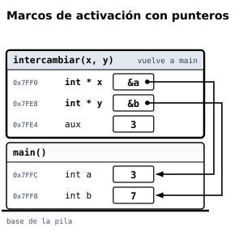
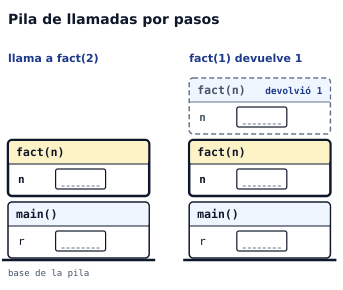

[Manual](../../README.md) › [Estructuras de datos y algoritmos](../README.md) › [Memoria, tipos y recursión](README.md)

# Pila de llamadas (`call_stack`)

Dibuja los marcos de activación desde `main` (abajo) hasta el tope, que se resalta. Los
parámetros van en negrita y figuran en el título del marco. Con `steps`, la pila aparece en
varios momentos alineados en la base; un marco con `popped: true` y `returns` es el que acaba
de retornar y se dibuja punteado.

## Qué calcula

- Las direcciones de las variables, desde `baseAddr` hacia abajo, según el tamaño de cada una.

## Campos

| Campo | Tipo | Valores y valor por defecto | Descripción |
| :--- | :--- | :--- | :--- |
| `type` | texto | `call_stack` | Obligatorio. |
| `frames` | lista |  | Los marcos, de `main` al tope. Cada uno con `function`, `params`, `vars`, `returnTo`, `returns` y `popped`. Las variables van como `{x: 5}`, `"x = 5"` o `{name, value, type, addr, size, blank}`. |
| `steps` | lista |  | La pila en varios momentos: cada paso con `label` y `frames` (hasta 8 pasos). |
| `pointers` | texto |  | Flechas entre variables, como `"1.p -> 0.x"`: el marco por su índice desde `main` o por el nombre de la función. |
| `showAddresses` | sí/no |  | Muestra la dirección de cada variable. |
| `baseAddr` | número |  | Dirección de la primera variable de `main` (por omisión `0x7FFC`); las siguientes bajan. |
| `typeSize` | número |  | Tamaño de una variable que no es puntero (por omisión 4); los punteros ocupan 8. |
| `showTypes` | sí/no |  | Muestra el tipo de cada variable. |
| `blankValues` | sí/no |  | Deja los valores en blanco. |
| `blankAddrs` | sí/no |  | Deja las direcciones en blanco. |

Además, los campos comunes a todos los tipos: `title`, `subtitle`, `id`, `inkSaver` y `theme` (ver [Campos comunes](../../campos-comunes.md)).

## Modo ejercicio

Campos que dejan casilleros para completar: `blankValues`, `blankAddrs`.

## Ejemplos

### Marcos de activación con punteros

```yaml
type: call_stack
title: Marcos de activación con punteros
showAddresses: true
showTypes: true
frames:
  - function: main
    vars:
      - {name: a, value: 3, type: int}
      - {name: b, value: 7, type: int}
  - function: intercambiar
    returnTo: main
    params:
      - {name: x, value: "&a", type: "int *"}
      - {name: y, value: "&b", type: "int *"}
    vars: ["aux = 3"]
pointers: "1.x -> 0.a; intercambiar.y -> main.b"
```



### Pila de llamadas por pasos

```yaml
type: call_stack
title: Pila de llamadas por pasos
blankValues: true
steps:
  - label: "llama a fact(2)"
    frames:
      - {function: main, vars: {r: "?"}}
      - {function: fact, params: {n: 2}}
  - label: "fact(1) devuelve 1"
    frames:
      - {function: main, vars: {r: "?"}}
      - {function: fact, params: {n: 2}}
      - {function: fact, params: {n: 1}, returns: 1, popped: true}
inkSaver: false
```



## Notas

- Hasta 10 marcos.
- El árbol de las llamadas recursivas es [`call_tree`](call_tree.md).

## Ver también

[`call_tree`](call_tree.md), [`struct`](struct.md), [`adt`](adt.md)
