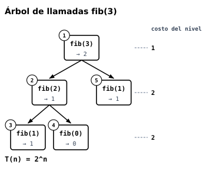
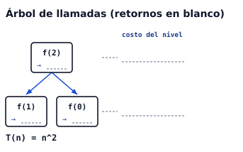

[Manual](../../README.md) › [Estructuras de datos y algoritmos](../README.md) › [Memoria, tipos y recursión](README.md)

# Árbol de llamadas (`call_tree`)

Dibuja el árbol de llamadas de una función recursiva con lo que devuelve cada una. Sirve para
seguir la ejecución (`showOrder` numera el orden), para mostrar subproblemas repetidos
(`highlight`) y para resolver una recurrencia sumando el costo de cada nivel.

## Campos

| Campo | Tipo | Valores y valor por defecto | Descripción |
| :--- | :--- | :--- | :--- |
| `type` | texto | `call_tree` | Obligatorio. |
| `root` | objeto |  | La llamada inicial: `call`, `returns`, `children` (las llamadas que hace) y `blank`. Hasta 40 llamadas. |
| `showOrder` | sí/no |  | Numera las llamadas en el orden en que se hacen. |
| `highlight` | lista |  | Llamadas resaltadas, por su texto (por ejemplo `["fib(1)"]`). |
| `levelCosts` | lista |  | El costo de cada nivel, al costado. |
| `total` | texto |  | El costo total, debajo. |
| `blankReturns` | sí/no |  | Deja en blanco lo que devuelve cada llamada. |
| `blankCalls` | sí/no |  | Deja en blanco las llamadas. |
| `blankLevelCosts` | sí/no |  | Deja en blanco los costos por nivel. |
| `blankTotal` | sí/no |  | Deja en blanco el total. |

Además, los campos comunes a todos los tipos: `title`, `subtitle`, `id`, `inkSaver` y `theme` (ver [Campos comunes](../../campos-comunes.md)).

## Modo ejercicio

Campos que dejan casilleros para completar: `blankReturns`, `blankCalls`, `blankLevelCosts`, `blankTotal`.

## Ejemplos

### Árbol de llamadas fib(3)

```yaml
type: call_tree
title: Árbol de llamadas fib(3)
showOrder: true
levelCosts: ["1", "2", "2"]
total: "2^n"
root:
  call: "fib(3)"
  returns: 2
  children:
    - call: "fib(2)"
      returns: 1
      children:
        - {call: "fib(1)", returns: 1}
        - {call: "fib(0)", returns: 0}
    - {call: "fib(1)", returns: 1}
```



### Árbol de llamadas (retornos en blanco)

```yaml
type: call_tree
title: Árbol de llamadas (retornos en blanco)
blankReturns: true
blankLevelCosts: true
levelCosts: ["n", "2n"]
total: "n^2"
root:
  call: "f(2)"
  returns: 2
  children:
    - {call: "f(1)", returns: 1}
    - {call: "f(0)", returns: 0}
inkSaver: false
```



## Ver también

[`call_stack`](call_stack.md), [`struct`](struct.md), [`adt`](adt.md)
