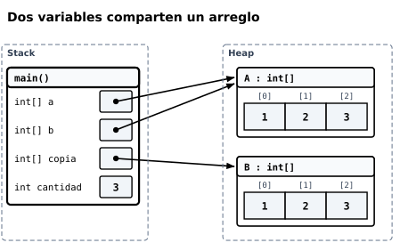
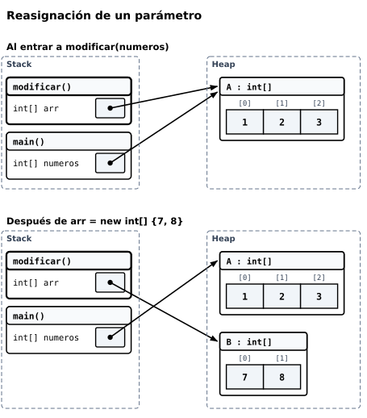
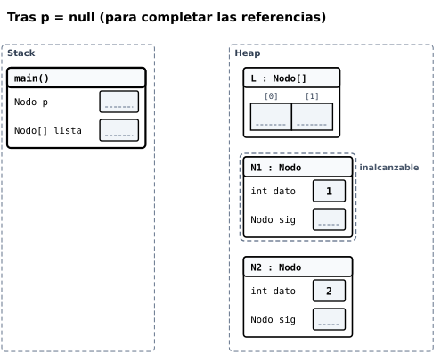
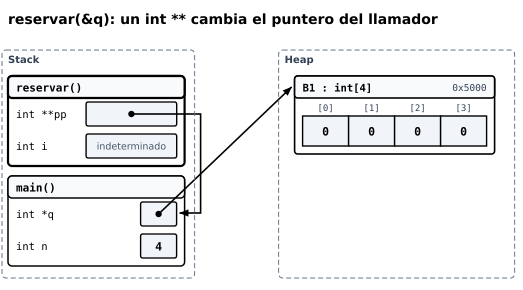
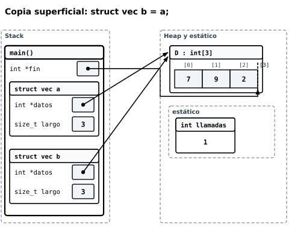
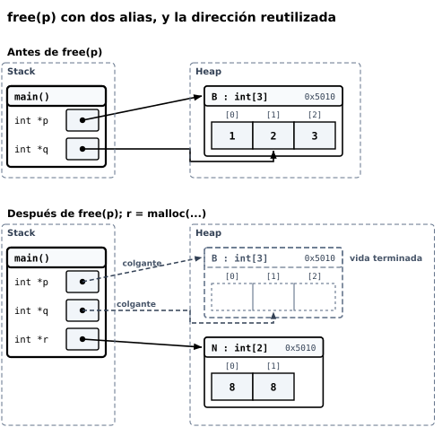
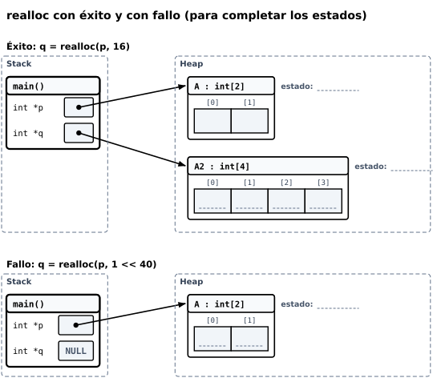
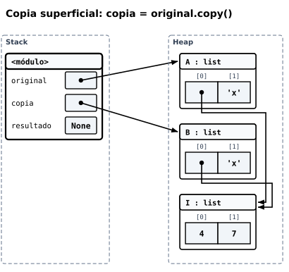

[Manual](../../README.md) › [Estructuras de datos y algoritmos](../README.md) › [Memoria, tipos y recursión](README.md)

# Stack y heap (objetos) (`object_heap`)

Dibuja los marcos activos en el stack (del tope, arriba, a `main`) y los objetos en el heap,
con una flecha por cada referencia. Cada objeto tiene un ID: dos referencias al mismo ID llegan
a la misma caja, y dos objetos con el mismo contenido son cajas distintas. Las referencias
entre objetos (y a sí mismos) rodean el heap por la derecha. Con `snapshots`, el estado en
varios instantes, para mostrar copia, mutación y reasignación de referencias: un ID que sigue
en el instante siguiente queda en el mismo lugar, así se ve cuál flecha cambió. En C, los
punteros llegan también a variables, campos y celdas, y un bloque liberado queda visible con
la vida terminada.

## Qué calcula

- Qué objetos son alcanzables desde el stack, siguiendo las referencias; los demás se marcan como inalcanzables (en C, como fugas).
- En C, qué punteros quedan colgantes: los que apuntan a un objeto con la vida terminada.

## Campos

| Campo | Tipo | Valores y valor por defecto | Descripción |
| :--- | :--- | :--- | :--- |
| `type` | texto | `object_heap` | Obligatorio. |
| `frames` | lista |  | Los marcos, de `main` al tope. Cada uno con `function` y `params` y `vars`: listas de `{name, type, value}` o `{name, type, ref}` (`ref: null` es una referencia nula), o `{x: 3}` para valores. |
| `objects` | lista |  | Los objetos del heap. Cada uno con `id`, `type` y uno de `fields` (como las variables), `elements` (las celdas de un arreglo: valores sueltos, `{value}` o `{ref}`) o `value` (el contenido, como un `String`). `group` los agrupa, como el String Pool. |
| `snapshots` | lista |  | Varios instantes (hasta 6), cada uno con `label`, `frames` y `objects`. Un mismo ID en dos instantes es el mismo objeto. |
| `direction` |  |  | Con `snapshots`, `column` (por omisión) los apila y `row` los pone lado a lado. |
| `variant` | texto |  | `java` (por omisión), `python` o `c`. En Python, los nombres se agrupan por ámbito (`<módulo>`, las funciones activas), una referencia nula es `None` (un valor rotulado, no una flecha sin destino) y los valores se escriben como en Python (`'texto'`, `True`). En C, ver abajo. |
| `zones` |  |  | Los títulos del stack y del heap (`{stack, heap}`); `false` quita los recuadros. |
| `markUnreachable` |  |  | Marca los objetos inalcanzables desde el stack (por omisión, sí). |
| `blankValues` | sí/no |  | Deja los valores en blanco. |
| `blankRefs` | sí/no |  | Deja las referencias en blanco, sin flechas, para dibujarlas. |
| `blankStates` | sí/no |  | En C, oculta los estados: sin «vida terminada», «fuga» ni «colgante», y sin guiones en las flechas; cada objeto fuera del stack lleva un renglón «estado:» para completar. Un bloque terminado igual se dibuja sin valores; para que eso no lo delate, combinar con `blankValues`. |

Además, los campos comunes a todos los tipos: `title`, `subtitle`, `id`, `inkSaver` y `theme` (ver [Campos comunes](../../campos-comunes.md)).

## Modo ejercicio

Con `blankRefs`, las cajas de las referencias quedan vacías y sin flechas, para que se dibujen;
con `blankValues`, los valores. Cada variable, campo o celda acepta además `blank: true`. En
C, `blankStates` oculta por separado los estados (vida terminada, fuga, colgante), con la misma
geometría que la versión resuelta.

Campos que dejan casilleros para completar: `blankValues`, `blankRefs`, `blankStates`.

## Ejemplos

### Dos variables comparten un arreglo

```yaml
type: object_heap
title: Dos variables comparten un arreglo
frames:
  - function: main
    vars:
      - {name: a, type: "int[]", ref: A}
      - {name: b, type: "int[]", ref: A}
      - {name: copia, type: "int[]", ref: B}
      - {name: cantidad, type: int, value: 3}
objects:
  - id: A
    type: "int[]"
    elements: [{value: 1}, {value: 2}, {value: 3}]
  - id: B
    type: "int[]"
    elements: [1, 2, 3]
```

[](https://ingcom-unrn.github.io/dibu-web/#t=dHlwZTogb2JqZWN0X2hlYXAKdGl0bGU6IERvcyB2YXJpYWJsZXMgY29tcGFydGVuIHVuIGFycmVnbG8KZnJhbWVzOgogIC0gZnVuY3Rpb246IG1haW4KICAgIHZhcnM6CiAgICAgIC0ge25hbWU6IGEsIHR5cGU6ICJpbnRbXSIsIHJlZjogQX0KICAgICAgLSB7bmFtZTogYiwgdHlwZTogImludFtdIiwgcmVmOiBBfQogICAgICAtIHtuYW1lOiBjb3BpYSwgdHlwZTogImludFtdIiwgcmVmOiBCfQogICAgICAtIHtuYW1lOiBjYW50aWRhZCwgdHlwZTogaW50LCB2YWx1ZTogM30Kb2JqZWN0czoKICAtIGlkOiBBCiAgICB0eXBlOiAiaW50W10iCiAgICBlbGVtZW50czogW3t2YWx1ZTogMX0sIHt2YWx1ZTogMn0sIHt2YWx1ZTogM31dCiAgLSBpZDogQgogICAgdHlwZTogImludFtdIgogICAgZWxlbWVudHM6IFsxLCAyLCAzXQo)

[Abrir en el editor](https://ingcom-unrn.github.io/dibu-web/#t=dHlwZTogb2JqZWN0X2hlYXAKdGl0bGU6IERvcyB2YXJpYWJsZXMgY29tcGFydGVuIHVuIGFycmVnbG8KZnJhbWVzOgogIC0gZnVuY3Rpb246IG1haW4KICAgIHZhcnM6CiAgICAgIC0ge25hbWU6IGEsIHR5cGU6ICJpbnRbXSIsIHJlZjogQX0KICAgICAgLSB7bmFtZTogYiwgdHlwZTogImludFtdIiwgcmVmOiBBfQogICAgICAtIHtuYW1lOiBjb3BpYSwgdHlwZTogImludFtdIiwgcmVmOiBCfQogICAgICAtIHtuYW1lOiBjYW50aWRhZCwgdHlwZTogaW50LCB2YWx1ZTogM30Kb2JqZWN0czoKICAtIGlkOiBBCiAgICB0eXBlOiAiaW50W10iCiAgICBlbGVtZW50czogW3t2YWx1ZTogMX0sIHt2YWx1ZTogMn0sIHt2YWx1ZTogM31dCiAgLSBpZDogQgogICAgdHlwZTogImludFtdIgogICAgZWxlbWVudHM6IFsxLCAyLCAzXQo) para explorarlo y modificarlo.

### Instanciación, this y String Pool

```yaml
type: object_heap
title: "Instanciación, this y String Pool"
frames:
  - function: main
    vars:
      - {name: juan, type: Persona, ref: P1}
      - {name: maria, type: Persona, ref: P2}
  - function: saludar
    params:
      - {name: this, type: Persona, ref: P1}
objects:
  - id: P1
    type: Persona
    fields:
      - {name: nombre, type: String, ref: S1}
      - {name: edad, type: int, value: 30}
  - id: P2
    type: Persona
    fields:
      - {name: nombre, type: String, ref: S1}
      - {name: edad, type: int, value: 25}
  - {id: S1, type: String, value: "Hola", group: String Pool}
inkSaver: false
```

[](https://ingcom-unrn.github.io/dibu-web/#t=dHlwZTogb2JqZWN0X2hlYXAKdGl0bGU6ICJJbnN0YW5jaWFjacOzbiwgdGhpcyB5IFN0cmluZyBQb29sIgpmcmFtZXM6CiAgLSBmdW5jdGlvbjogbWFpbgogICAgdmFyczoKICAgICAgLSB7bmFtZToganVhbiwgdHlwZTogUGVyc29uYSwgcmVmOiBQMX0KICAgICAgLSB7bmFtZTogbWFyaWEsIHR5cGU6IFBlcnNvbmEsIHJlZjogUDJ9CiAgLSBmdW5jdGlvbjogc2FsdWRhcgogICAgcGFyYW1zOgogICAgICAtIHtuYW1lOiB0aGlzLCB0eXBlOiBQZXJzb25hLCByZWY6IFAxfQpvYmplY3RzOgogIC0gaWQ6IFAxCiAgICB0eXBlOiBQZXJzb25hCiAgICBmaWVsZHM6CiAgICAgIC0ge25hbWU6IG5vbWJyZSwgdHlwZTogU3RyaW5nLCByZWY6IFMxfQogICAgICAtIHtuYW1lOiBlZGFkLCB0eXBlOiBpbnQsIHZhbHVlOiAzMH0KICAtIGlkOiBQMgogICAgdHlwZTogUGVyc29uYQogICAgZmllbGRzOgogICAgICAtIHtuYW1lOiBub21icmUsIHR5cGU6IFN0cmluZywgcmVmOiBTMX0KICAgICAgLSB7bmFtZTogZWRhZCwgdHlwZTogaW50LCB2YWx1ZTogMjV9CiAgLSB7aWQ6IFMxLCB0eXBlOiBTdHJpbmcsIHZhbHVlOiAiSG9sYSIsIGdyb3VwOiBTdHJpbmcgUG9vbH0KaW5rU2F2ZXI6IGZhbHNlCg)

[Abrir en el editor](https://ingcom-unrn.github.io/dibu-web/#t=dHlwZTogb2JqZWN0X2hlYXAKdGl0bGU6ICJJbnN0YW5jaWFjacOzbiwgdGhpcyB5IFN0cmluZyBQb29sIgpmcmFtZXM6CiAgLSBmdW5jdGlvbjogbWFpbgogICAgdmFyczoKICAgICAgLSB7bmFtZToganVhbiwgdHlwZTogUGVyc29uYSwgcmVmOiBQMX0KICAgICAgLSB7bmFtZTogbWFyaWEsIHR5cGU6IFBlcnNvbmEsIHJlZjogUDJ9CiAgLSBmdW5jdGlvbjogc2FsdWRhcgogICAgcGFyYW1zOgogICAgICAtIHtuYW1lOiB0aGlzLCB0eXBlOiBQZXJzb25hLCByZWY6IFAxfQpvYmplY3RzOgogIC0gaWQ6IFAxCiAgICB0eXBlOiBQZXJzb25hCiAgICBmaWVsZHM6CiAgICAgIC0ge25hbWU6IG5vbWJyZSwgdHlwZTogU3RyaW5nLCByZWY6IFMxfQogICAgICAtIHtuYW1lOiBlZGFkLCB0eXBlOiBpbnQsIHZhbHVlOiAzMH0KICAtIGlkOiBQMgogICAgdHlwZTogUGVyc29uYQogICAgZmllbGRzOgogICAgICAtIHtuYW1lOiBub21icmUsIHR5cGU6IFN0cmluZywgcmVmOiBTMX0KICAgICAgLSB7bmFtZTogZWRhZCwgdHlwZTogaW50LCB2YWx1ZTogMjV9CiAgLSB7aWQ6IFMxLCB0eXBlOiBTdHJpbmcsIHZhbHVlOiAiSG9sYSIsIGdyb3VwOiBTdHJpbmcgUG9vbH0KaW5rU2F2ZXI6IGZhbHNlCg) para explorarlo y modificarlo.

### Reasignación de un parámetro

```yaml
type: object_heap
title: Reasignación de un parámetro
snapshots:
  - label: "Al entrar a modificar(numeros)"
    frames:
      - function: main
        vars: [{name: numeros, type: "int[]", ref: A}]
      - function: modificar
        params: [{name: arr, type: "int[]", ref: A}]
    objects:
      - {id: A, type: "int[]", elements: [1, 2, 3]}
  - label: "Después de arr = new int[] {7, 8}"
    frames:
      - function: main
        vars: [{name: numeros, type: "int[]", ref: A}]
      - function: modificar
        params: [{name: arr, type: "int[]", ref: B}]
    objects:
      - {id: A, type: "int[]", elements: [1, 2, 3]}
      - {id: B, type: "int[]", elements: [7, 8]}
```

[](https://ingcom-unrn.github.io/dibu-web/#t=dHlwZTogb2JqZWN0X2hlYXAKdGl0bGU6IFJlYXNpZ25hY2nDs24gZGUgdW4gcGFyw6FtZXRybwpzbmFwc2hvdHM6CiAgLSBsYWJlbDogIkFsIGVudHJhciBhIG1vZGlmaWNhcihudW1lcm9zKSIKICAgIGZyYW1lczoKICAgICAgLSBmdW5jdGlvbjogbWFpbgogICAgICAgIHZhcnM6IFt7bmFtZTogbnVtZXJvcywgdHlwZTogImludFtdIiwgcmVmOiBBfV0KICAgICAgLSBmdW5jdGlvbjogbW9kaWZpY2FyCiAgICAgICAgcGFyYW1zOiBbe25hbWU6IGFyciwgdHlwZTogImludFtdIiwgcmVmOiBBfV0KICAgIG9iamVjdHM6CiAgICAgIC0ge2lkOiBBLCB0eXBlOiAiaW50W10iLCBlbGVtZW50czogWzEsIDIsIDNdfQogIC0gbGFiZWw6ICJEZXNwdcOpcyBkZSBhcnIgPSBuZXcgaW50W10gezcsIDh9IgogICAgZnJhbWVzOgogICAgICAtIGZ1bmN0aW9uOiBtYWluCiAgICAgICAgdmFyczogW3tuYW1lOiBudW1lcm9zLCB0eXBlOiAiaW50W10iLCByZWY6IEF9XQogICAgICAtIGZ1bmN0aW9uOiBtb2RpZmljYXIKICAgICAgICBwYXJhbXM6IFt7bmFtZTogYXJyLCB0eXBlOiAiaW50W10iLCByZWY6IEJ9XQogICAgb2JqZWN0czoKICAgICAgLSB7aWQ6IEEsIHR5cGU6ICJpbnRbXSIsIGVsZW1lbnRzOiBbMSwgMiwgM119CiAgICAgIC0ge2lkOiBCLCB0eXBlOiAiaW50W10iLCBlbGVtZW50czogWzcsIDhdfQo)

[Abrir en el editor](https://ingcom-unrn.github.io/dibu-web/#t=dHlwZTogb2JqZWN0X2hlYXAKdGl0bGU6IFJlYXNpZ25hY2nDs24gZGUgdW4gcGFyw6FtZXRybwpzbmFwc2hvdHM6CiAgLSBsYWJlbDogIkFsIGVudHJhciBhIG1vZGlmaWNhcihudW1lcm9zKSIKICAgIGZyYW1lczoKICAgICAgLSBmdW5jdGlvbjogbWFpbgogICAgICAgIHZhcnM6IFt7bmFtZTogbnVtZXJvcywgdHlwZTogImludFtdIiwgcmVmOiBBfV0KICAgICAgLSBmdW5jdGlvbjogbW9kaWZpY2FyCiAgICAgICAgcGFyYW1zOiBbe25hbWU6IGFyciwgdHlwZTogImludFtdIiwgcmVmOiBBfV0KICAgIG9iamVjdHM6CiAgICAgIC0ge2lkOiBBLCB0eXBlOiAiaW50W10iLCBlbGVtZW50czogWzEsIDIsIDNdfQogIC0gbGFiZWw6ICJEZXNwdcOpcyBkZSBhcnIgPSBuZXcgaW50W10gezcsIDh9IgogICAgZnJhbWVzOgogICAgICAtIGZ1bmN0aW9uOiBtYWluCiAgICAgICAgdmFyczogW3tuYW1lOiBudW1lcm9zLCB0eXBlOiAiaW50W10iLCByZWY6IEF9XQogICAgICAtIGZ1bmN0aW9uOiBtb2RpZmljYXIKICAgICAgICBwYXJhbXM6IFt7bmFtZTogYXJyLCB0eXBlOiAiaW50W10iLCByZWY6IEJ9XQogICAgb2JqZWN0czoKICAgICAgLSB7aWQ6IEEsIHR5cGU6ICJpbnRbXSIsIGVsZW1lbnRzOiBbMSwgMiwgM119CiAgICAgIC0ge2lkOiBCLCB0eXBlOiAiaW50W10iLCBlbGVtZW50czogWzcsIDhdfQo) para explorarlo y modificarlo.

### Tras p = null (para completar las referencias)

```yaml
type: object_heap
title: "Tras p = null (para completar las referencias)"
frames:
  - function: main
    vars: [{name: p, type: Nodo, ref: null}, {name: lista, type: "Nodo[]", ref: L}]
objects:
  - id: L
    type: "Nodo[]"
    elements: [{ref: N2}, {ref: null}]
  - id: N1
    type: Nodo
    fields: [{name: dato, type: int, value: 1}, {name: sig, type: Nodo, ref: N2}]
  - id: N2
    type: Nodo
    fields: [{name: dato, type: int, value: 2}, {name: sig, type: Nodo, ref: N2}]
blankRefs: true
```

[](https://ingcom-unrn.github.io/dibu-web/#t=dHlwZTogb2JqZWN0X2hlYXAKdGl0bGU6ICJUcmFzIHAgPSBudWxsIChwYXJhIGNvbXBsZXRhciBsYXMgcmVmZXJlbmNpYXMpIgpmcmFtZXM6CiAgLSBmdW5jdGlvbjogbWFpbgogICAgdmFyczogW3tuYW1lOiBwLCB0eXBlOiBOb2RvLCByZWY6IG51bGx9LCB7bmFtZTogbGlzdGEsIHR5cGU6ICJOb2RvW10iLCByZWY6IEx9XQpvYmplY3RzOgogIC0gaWQ6IEwKICAgIHR5cGU6ICJOb2RvW10iCiAgICBlbGVtZW50czogW3tyZWY6IE4yfSwge3JlZjogbnVsbH1dCiAgLSBpZDogTjEKICAgIHR5cGU6IE5vZG8KICAgIGZpZWxkczogW3tuYW1lOiBkYXRvLCB0eXBlOiBpbnQsIHZhbHVlOiAxfSwge25hbWU6IHNpZywgdHlwZTogTm9kbywgcmVmOiBOMn1dCiAgLSBpZDogTjIKICAgIHR5cGU6IE5vZG8KICAgIGZpZWxkczogW3tuYW1lOiBkYXRvLCB0eXBlOiBpbnQsIHZhbHVlOiAyfSwge25hbWU6IHNpZywgdHlwZTogTm9kbywgcmVmOiBOMn1dCmJsYW5rUmVmczogdHJ1ZQo)

[Abrir en el editor](https://ingcom-unrn.github.io/dibu-web/#t=dHlwZTogb2JqZWN0X2hlYXAKdGl0bGU6ICJUcmFzIHAgPSBudWxsIChwYXJhIGNvbXBsZXRhciBsYXMgcmVmZXJlbmNpYXMpIgpmcmFtZXM6CiAgLSBmdW5jdGlvbjogbWFpbgogICAgdmFyczogW3tuYW1lOiBwLCB0eXBlOiBOb2RvLCByZWY6IG51bGx9LCB7bmFtZTogbGlzdGEsIHR5cGU6ICJOb2RvW10iLCByZWY6IEx9XQpvYmplY3RzOgogIC0gaWQ6IEwKICAgIHR5cGU6ICJOb2RvW10iCiAgICBlbGVtZW50czogW3tyZWY6IE4yfSwge3JlZjogbnVsbH1dCiAgLSBpZDogTjEKICAgIHR5cGU6IE5vZG8KICAgIGZpZWxkczogW3tuYW1lOiBkYXRvLCB0eXBlOiBpbnQsIHZhbHVlOiAxfSwge25hbWU6IHNpZywgdHlwZTogTm9kbywgcmVmOiBOMn1dCiAgLSBpZDogTjIKICAgIHR5cGU6IE5vZG8KICAgIGZpZWxkczogW3tuYW1lOiBkYXRvLCB0eXBlOiBpbnQsIHZhbHVlOiAyfSwge25hbWU6IHNpZywgdHlwZTogTm9kbywgcmVmOiBOMn1dCmJsYW5rUmVmczogdHJ1ZQo) para explorarlo y modificarlo.

### reservar(&q): un int ** cambia el puntero del llamador

```yaml
type: object_heap
variant: c
title: "reservar(&q): un int ** cambia el puntero del llamador"
frames:
  - function: main
    vars:
      - {name: q, type: "int *", id: q, ref: B1}
      - {name: n, type: int, value: 4}
  - function: reservar
    params:
      - {name: pp, type: "int **", ref: q}
      - {name: i, type: int, indeterminate: true}
objects:
  - {id: B1, type: "int[4]", address: "0x5000", elements: [0, 0, 0, 0]}
```

[](https://ingcom-unrn.github.io/dibu-web/#t=dHlwZTogb2JqZWN0X2hlYXAKdmFyaWFudDogYwp0aXRsZTogInJlc2VydmFyKCZxKTogdW4gaW50ICoqIGNhbWJpYSBlbCBwdW50ZXJvIGRlbCBsbGFtYWRvciIKZnJhbWVzOgogIC0gZnVuY3Rpb246IG1haW4KICAgIHZhcnM6CiAgICAgIC0ge25hbWU6IHEsIHR5cGU6ICJpbnQgKiIsIGlkOiBxLCByZWY6IEIxfQogICAgICAtIHtuYW1lOiBuLCB0eXBlOiBpbnQsIHZhbHVlOiA0fQogIC0gZnVuY3Rpb246IHJlc2VydmFyCiAgICBwYXJhbXM6CiAgICAgIC0ge25hbWU6IHBwLCB0eXBlOiAiaW50ICoqIiwgcmVmOiBxfQogICAgICAtIHtuYW1lOiBpLCB0eXBlOiBpbnQsIGluZGV0ZXJtaW5hdGU6IHRydWV9Cm9iamVjdHM6CiAgLSB7aWQ6IEIxLCB0eXBlOiAiaW50WzRdIiwgYWRkcmVzczogIjB4NTAwMCIsIGVsZW1lbnRzOiBbMCwgMCwgMCwgMF19Cg)

[Abrir en el editor](https://ingcom-unrn.github.io/dibu-web/#t=dHlwZTogb2JqZWN0X2hlYXAKdmFyaWFudDogYwp0aXRsZTogInJlc2VydmFyKCZxKTogdW4gaW50ICoqIGNhbWJpYSBlbCBwdW50ZXJvIGRlbCBsbGFtYWRvciIKZnJhbWVzOgogIC0gZnVuY3Rpb246IG1haW4KICAgIHZhcnM6CiAgICAgIC0ge25hbWU6IHEsIHR5cGU6ICJpbnQgKiIsIGlkOiBxLCByZWY6IEIxfQogICAgICAtIHtuYW1lOiBuLCB0eXBlOiBpbnQsIHZhbHVlOiA0fQogIC0gZnVuY3Rpb246IHJlc2VydmFyCiAgICBwYXJhbXM6CiAgICAgIC0ge25hbWU6IHBwLCB0eXBlOiAiaW50ICoqIiwgcmVmOiBxfQogICAgICAtIHtuYW1lOiBpLCB0eXBlOiBpbnQsIGluZGV0ZXJtaW5hdGU6IHRydWV9Cm9iamVjdHM6CiAgLSB7aWQ6IEIxLCB0eXBlOiAiaW50WzRdIiwgYWRkcmVzczogIjB4NTAwMCIsIGVsZW1lbnRzOiBbMCwgMCwgMCwgMF19Cg) para explorarlo y modificarlo.

### Copia superficial: struct vec b = a;

```yaml
type: object_heap
variant: c
title: "Copia superficial: struct vec b = a;"
frames:
  - function: main
    vars: [{name: fin, type: "int *", ref: "D[3]"}]
objects:
  - id: a
    type: struct vec
    storage: auto
    frame: main
    fields: [{name: datos, type: "int *", ref: D}, {name: largo, type: size_t, value: 3}]
  - id: b
    type: struct vec
    storage: auto
    frame: main
    fields: [{name: datos, type: "int *", ref: D}, {name: largo, type: size_t, value: 3}]
  - {id: D, type: "int[3]", elements: [7, 9, 2]}
  - {id: llamadas, type: int, storage: static, value: 1}
```

[](https://ingcom-unrn.github.io/dibu-web/#t=dHlwZTogb2JqZWN0X2hlYXAKdmFyaWFudDogYwp0aXRsZTogIkNvcGlhIHN1cGVyZmljaWFsOiBzdHJ1Y3QgdmVjIGIgPSBhOyIKZnJhbWVzOgogIC0gZnVuY3Rpb246IG1haW4KICAgIHZhcnM6IFt7bmFtZTogZmluLCB0eXBlOiAiaW50ICoiLCByZWY6ICJEWzNdIn1dCm9iamVjdHM6CiAgLSBpZDogYQogICAgdHlwZTogc3RydWN0IHZlYwogICAgc3RvcmFnZTogYXV0bwogICAgZnJhbWU6IG1haW4KICAgIGZpZWxkczogW3tuYW1lOiBkYXRvcywgdHlwZTogImludCAqIiwgcmVmOiBEfSwge25hbWU6IGxhcmdvLCB0eXBlOiBzaXplX3QsIHZhbHVlOiAzfV0KICAtIGlkOiBiCiAgICB0eXBlOiBzdHJ1Y3QgdmVjCiAgICBzdG9yYWdlOiBhdXRvCiAgICBmcmFtZTogbWFpbgogICAgZmllbGRzOiBbe25hbWU6IGRhdG9zLCB0eXBlOiAiaW50ICoiLCByZWY6IER9LCB7bmFtZTogbGFyZ28sIHR5cGU6IHNpemVfdCwgdmFsdWU6IDN9XQogIC0ge2lkOiBELCB0eXBlOiAiaW50WzNdIiwgZWxlbWVudHM6IFs3LCA5LCAyXX0KICAtIHtpZDogbGxhbWFkYXMsIHR5cGU6IGludCwgc3RvcmFnZTogc3RhdGljLCB2YWx1ZTogMX0K)

[Abrir en el editor](https://ingcom-unrn.github.io/dibu-web/#t=dHlwZTogb2JqZWN0X2hlYXAKdmFyaWFudDogYwp0aXRsZTogIkNvcGlhIHN1cGVyZmljaWFsOiBzdHJ1Y3QgdmVjIGIgPSBhOyIKZnJhbWVzOgogIC0gZnVuY3Rpb246IG1haW4KICAgIHZhcnM6IFt7bmFtZTogZmluLCB0eXBlOiAiaW50ICoiLCByZWY6ICJEWzNdIn1dCm9iamVjdHM6CiAgLSBpZDogYQogICAgdHlwZTogc3RydWN0IHZlYwogICAgc3RvcmFnZTogYXV0bwogICAgZnJhbWU6IG1haW4KICAgIGZpZWxkczogW3tuYW1lOiBkYXRvcywgdHlwZTogImludCAqIiwgcmVmOiBEfSwge25hbWU6IGxhcmdvLCB0eXBlOiBzaXplX3QsIHZhbHVlOiAzfV0KICAtIGlkOiBiCiAgICB0eXBlOiBzdHJ1Y3QgdmVjCiAgICBzdG9yYWdlOiBhdXRvCiAgICBmcmFtZTogbWFpbgogICAgZmllbGRzOiBbe25hbWU6IGRhdG9zLCB0eXBlOiAiaW50ICoiLCByZWY6IER9LCB7bmFtZTogbGFyZ28sIHR5cGU6IHNpemVfdCwgdmFsdWU6IDN9XQogIC0ge2lkOiBELCB0eXBlOiAiaW50WzNdIiwgZWxlbWVudHM6IFs3LCA5LCAyXX0KICAtIHtpZDogbGxhbWFkYXMsIHR5cGU6IGludCwgc3RvcmFnZTogc3RhdGljLCB2YWx1ZTogMX0K) para explorarlo y modificarlo.

### free(p) con dos alias, y la dirección reutilizada

```yaml
type: object_heap
variant: c
title: "free(p) con dos alias, y la dirección reutilizada"
snapshots:
  - label: "Antes de free(p)"
    frames:
      - function: main
        vars: [{name: p, type: "int *", ref: B}, {name: q, type: "int *", ref: "B[1]"}]
    objects:
      - {id: B, type: "int[3]", address: "0x5010", elements: [1, 2, 3]}
  - label: "Después de free(p); r = malloc(...)"
    frames:
      - function: main
        vars: [{name: p, type: "int *", ref: B}, {name: q, type: "int *", ref: "B[1]"}, {name: r, type: "int *", ref: N}]
    objects:
      - {id: B, type: "int[3]", address: "0x5010", ended: true, elements: [1, 2, 3]}
      - {id: N, type: "int[2]", address: "0x5010", elements: [8, 8]}
```

[](https://ingcom-unrn.github.io/dibu-web/#t=dHlwZTogb2JqZWN0X2hlYXAKdmFyaWFudDogYwp0aXRsZTogImZyZWUocCkgY29uIGRvcyBhbGlhcywgeSBsYSBkaXJlY2Npw7NuIHJldXRpbGl6YWRhIgpzbmFwc2hvdHM6CiAgLSBsYWJlbDogIkFudGVzIGRlIGZyZWUocCkiCiAgICBmcmFtZXM6CiAgICAgIC0gZnVuY3Rpb246IG1haW4KICAgICAgICB2YXJzOiBbe25hbWU6IHAsIHR5cGU6ICJpbnQgKiIsIHJlZjogQn0sIHtuYW1lOiBxLCB0eXBlOiAiaW50ICoiLCByZWY6ICJCWzFdIn1dCiAgICBvYmplY3RzOgogICAgICAtIHtpZDogQiwgdHlwZTogImludFszXSIsIGFkZHJlc3M6ICIweDUwMTAiLCBlbGVtZW50czogWzEsIDIsIDNdfQogIC0gbGFiZWw6ICJEZXNwdcOpcyBkZSBmcmVlKHApOyByID0gbWFsbG9jKC4uLikiCiAgICBmcmFtZXM6CiAgICAgIC0gZnVuY3Rpb246IG1haW4KICAgICAgICB2YXJzOiBbe25hbWU6IHAsIHR5cGU6ICJpbnQgKiIsIHJlZjogQn0sIHtuYW1lOiBxLCB0eXBlOiAiaW50ICoiLCByZWY6ICJCWzFdIn0sIHtuYW1lOiByLCB0eXBlOiAiaW50ICoiLCByZWY6IE59XQogICAgb2JqZWN0czoKICAgICAgLSB7aWQ6IEIsIHR5cGU6ICJpbnRbM10iLCBhZGRyZXNzOiAiMHg1MDEwIiwgZW5kZWQ6IHRydWUsIGVsZW1lbnRzOiBbMSwgMiwgM119CiAgICAgIC0ge2lkOiBOLCB0eXBlOiAiaW50WzJdIiwgYWRkcmVzczogIjB4NTAxMCIsIGVsZW1lbnRzOiBbOCwgOF19Cg)

[Abrir en el editor](https://ingcom-unrn.github.io/dibu-web/#t=dHlwZTogb2JqZWN0X2hlYXAKdmFyaWFudDogYwp0aXRsZTogImZyZWUocCkgY29uIGRvcyBhbGlhcywgeSBsYSBkaXJlY2Npw7NuIHJldXRpbGl6YWRhIgpzbmFwc2hvdHM6CiAgLSBsYWJlbDogIkFudGVzIGRlIGZyZWUocCkiCiAgICBmcmFtZXM6CiAgICAgIC0gZnVuY3Rpb246IG1haW4KICAgICAgICB2YXJzOiBbe25hbWU6IHAsIHR5cGU6ICJpbnQgKiIsIHJlZjogQn0sIHtuYW1lOiBxLCB0eXBlOiAiaW50ICoiLCByZWY6ICJCWzFdIn1dCiAgICBvYmplY3RzOgogICAgICAtIHtpZDogQiwgdHlwZTogImludFszXSIsIGFkZHJlc3M6ICIweDUwMTAiLCBlbGVtZW50czogWzEsIDIsIDNdfQogIC0gbGFiZWw6ICJEZXNwdcOpcyBkZSBmcmVlKHApOyByID0gbWFsbG9jKC4uLikiCiAgICBmcmFtZXM6CiAgICAgIC0gZnVuY3Rpb246IG1haW4KICAgICAgICB2YXJzOiBbe25hbWU6IHAsIHR5cGU6ICJpbnQgKiIsIHJlZjogQn0sIHtuYW1lOiBxLCB0eXBlOiAiaW50ICoiLCByZWY6ICJCWzFdIn0sIHtuYW1lOiByLCB0eXBlOiAiaW50ICoiLCByZWY6IE59XQogICAgb2JqZWN0czoKICAgICAgLSB7aWQ6IEIsIHR5cGU6ICJpbnRbM10iLCBhZGRyZXNzOiAiMHg1MDEwIiwgZW5kZWQ6IHRydWUsIGVsZW1lbnRzOiBbMSwgMiwgM119CiAgICAgIC0ge2lkOiBOLCB0eXBlOiAiaW50WzJdIiwgYWRkcmVzczogIjB4NTAxMCIsIGVsZW1lbnRzOiBbOCwgOF19Cg) para explorarlo y modificarlo.

### realloc con éxito y con fallo (para completar los estados)

```yaml
type: object_heap
variant: c
title: "realloc con éxito y con fallo (para completar los estados)"
blankStates: true
blankValues: true
snapshots:
  - label: "Éxito: q = realloc(p, 16)"
    frames:
      - function: main
        vars: [{name: p, type: "int *", ref: A}, {name: q, type: "int *", ref: A2}]
    objects:
      - {id: A, type: "int[2]", ended: true, elements: [1, 2]}
      - {id: A2, type: "int[4]", elements: [1, 2, {indeterminate: true}, {indeterminate: true}]}
  - label: "Fallo: q = realloc(p, 1 << 40)"
    frames:
      - function: main
        vars: [{name: p, type: "int *", ref: A}, {name: q, type: "int *", ref: null}]
    objects:
      - {id: A, type: "int[2]", elements: [1, 2]}
```

[](https://ingcom-unrn.github.io/dibu-web/#t=dHlwZTogb2JqZWN0X2hlYXAKdmFyaWFudDogYwp0aXRsZTogInJlYWxsb2MgY29uIMOpeGl0byB5IGNvbiBmYWxsbyAocGFyYSBjb21wbGV0YXIgbG9zIGVzdGFkb3MpIgpibGFua1N0YXRlczogdHJ1ZQpibGFua1ZhbHVlczogdHJ1ZQpzbmFwc2hvdHM6CiAgLSBsYWJlbDogIsOJeGl0bzogcSA9IHJlYWxsb2MocCwgMTYpIgogICAgZnJhbWVzOgogICAgICAtIGZ1bmN0aW9uOiBtYWluCiAgICAgICAgdmFyczogW3tuYW1lOiBwLCB0eXBlOiAiaW50ICoiLCByZWY6IEF9LCB7bmFtZTogcSwgdHlwZTogImludCAqIiwgcmVmOiBBMn1dCiAgICBvYmplY3RzOgogICAgICAtIHtpZDogQSwgdHlwZTogImludFsyXSIsIGVuZGVkOiB0cnVlLCBlbGVtZW50czogWzEsIDJdfQogICAgICAtIHtpZDogQTIsIHR5cGU6ICJpbnRbNF0iLCBlbGVtZW50czogWzEsIDIsIHtpbmRldGVybWluYXRlOiB0cnVlfSwge2luZGV0ZXJtaW5hdGU6IHRydWV9XX0KICAtIGxhYmVsOiAiRmFsbG86IHEgPSByZWFsbG9jKHAsIDEgPDwgNDApIgogICAgZnJhbWVzOgogICAgICAtIGZ1bmN0aW9uOiBtYWluCiAgICAgICAgdmFyczogW3tuYW1lOiBwLCB0eXBlOiAiaW50ICoiLCByZWY6IEF9LCB7bmFtZTogcSwgdHlwZTogImludCAqIiwgcmVmOiBudWxsfV0KICAgIG9iamVjdHM6CiAgICAgIC0ge2lkOiBBLCB0eXBlOiAiaW50WzJdIiwgZWxlbWVudHM6IFsxLCAyXX0K)

[Abrir en el editor](https://ingcom-unrn.github.io/dibu-web/#t=dHlwZTogb2JqZWN0X2hlYXAKdmFyaWFudDogYwp0aXRsZTogInJlYWxsb2MgY29uIMOpeGl0byB5IGNvbiBmYWxsbyAocGFyYSBjb21wbGV0YXIgbG9zIGVzdGFkb3MpIgpibGFua1N0YXRlczogdHJ1ZQpibGFua1ZhbHVlczogdHJ1ZQpzbmFwc2hvdHM6CiAgLSBsYWJlbDogIsOJeGl0bzogcSA9IHJlYWxsb2MocCwgMTYpIgogICAgZnJhbWVzOgogICAgICAtIGZ1bmN0aW9uOiBtYWluCiAgICAgICAgdmFyczogW3tuYW1lOiBwLCB0eXBlOiAiaW50ICoiLCByZWY6IEF9LCB7bmFtZTogcSwgdHlwZTogImludCAqIiwgcmVmOiBBMn1dCiAgICBvYmplY3RzOgogICAgICAtIHtpZDogQSwgdHlwZTogImludFsyXSIsIGVuZGVkOiB0cnVlLCBlbGVtZW50czogWzEsIDJdfQogICAgICAtIHtpZDogQTIsIHR5cGU6ICJpbnRbNF0iLCBlbGVtZW50czogWzEsIDIsIHtpbmRldGVybWluYXRlOiB0cnVlfSwge2luZGV0ZXJtaW5hdGU6IHRydWV9XX0KICAtIGxhYmVsOiAiRmFsbG86IHEgPSByZWFsbG9jKHAsIDEgPDwgNDApIgogICAgZnJhbWVzOgogICAgICAtIGZ1bmN0aW9uOiBtYWluCiAgICAgICAgdmFyczogW3tuYW1lOiBwLCB0eXBlOiAiaW50ICoiLCByZWY6IEF9LCB7bmFtZTogcSwgdHlwZTogImludCAqIiwgcmVmOiBudWxsfV0KICAgIG9iamVjdHM6CiAgICAgIC0ge2lkOiBBLCB0eXBlOiAiaW50WzJdIiwgZWxlbWVudHM6IFsxLCAyXX0K) para explorarlo y modificarlo.

### Copia superficial: copia = original.copy()

```yaml
type: object_heap
variant: python
title: "Copia superficial: copia = original.copy()"
frames:
  - function: "<módulo>"
    vars:
      - {name: original, ref: A}
      - {name: copia, ref: B}
      - {name: resultado, value: null}
objects:
  - id: A
    type: list
    elements: [{ref: I}, "x"]
  - id: B
    type: list
    elements: [{ref: I}, "x"]
  - id: I
    type: list
    elements: [{value: 4}, {value: 7}]
```

[](https://ingcom-unrn.github.io/dibu-web/#t=dHlwZTogb2JqZWN0X2hlYXAKdmFyaWFudDogcHl0aG9uCnRpdGxlOiAiQ29waWEgc3VwZXJmaWNpYWw6IGNvcGlhID0gb3JpZ2luYWwuY29weSgpIgpmcmFtZXM6CiAgLSBmdW5jdGlvbjogIjxtw7NkdWxvPiIKICAgIHZhcnM6CiAgICAgIC0ge25hbWU6IG9yaWdpbmFsLCByZWY6IEF9CiAgICAgIC0ge25hbWU6IGNvcGlhLCByZWY6IEJ9CiAgICAgIC0ge25hbWU6IHJlc3VsdGFkbywgdmFsdWU6IG51bGx9Cm9iamVjdHM6CiAgLSBpZDogQQogICAgdHlwZTogbGlzdAogICAgZWxlbWVudHM6IFt7cmVmOiBJfSwgIngiXQogIC0gaWQ6IEIKICAgIHR5cGU6IGxpc3QKICAgIGVsZW1lbnRzOiBbe3JlZjogSX0sICJ4Il0KICAtIGlkOiBJCiAgICB0eXBlOiBsaXN0CiAgICBlbGVtZW50czogW3t2YWx1ZTogNH0sIHt2YWx1ZTogN31dCg)

[Abrir en el editor](https://ingcom-unrn.github.io/dibu-web/#t=dHlwZTogb2JqZWN0X2hlYXAKdmFyaWFudDogcHl0aG9uCnRpdGxlOiAiQ29waWEgc3VwZXJmaWNpYWw6IGNvcGlhID0gb3JpZ2luYWwuY29weSgpIgpmcmFtZXM6CiAgLSBmdW5jdGlvbjogIjxtw7NkdWxvPiIKICAgIHZhcnM6CiAgICAgIC0ge25hbWU6IG9yaWdpbmFsLCByZWY6IEF9CiAgICAgIC0ge25hbWU6IGNvcGlhLCByZWY6IEJ9CiAgICAgIC0ge25hbWU6IHJlc3VsdGFkbywgdmFsdWU6IG51bGx9Cm9iamVjdHM6CiAgLSBpZDogQQogICAgdHlwZTogbGlzdAogICAgZWxlbWVudHM6IFt7cmVmOiBJfSwgIngiXQogIC0gaWQ6IEIKICAgIHR5cGU6IGxpc3QKICAgIGVsZW1lbnRzOiBbe3JlZjogSX0sICJ4Il0KICAtIGlkOiBJCiAgICB0eXBlOiBsaXN0CiAgICBlbGVtZW50czogW3t2YWx1ZTogNH0sIHt2YWx1ZTogN31dCg) para explorarlo y modificarlo.

### def agregar(lista): lista.append(9); lista = [0] (para completar)

```yaml
type: object_heap
variant: python
title: "def agregar(lista): lista.append(9); lista = [0] (para completar)"
blankRefs: true
snapshots:
  - label: "Después de lista.append(9)"
    frames:
      - function: "<módulo>"
        vars: [{name: lista, ref: A}]
      - function: agregar
        params: [{name: lista, ref: A}]
    objects:
      - {id: A, type: list, elements: [1, 2, 9]}
  - label: "Después de lista = [0]"
    frames:
      - function: "<módulo>"
        vars: [{name: lista, ref: A}]
      - function: agregar
        params: [{name: lista, ref: B}]
    objects:
      - {id: A, type: list, elements: [1, 2, 9]}
      - {id: B, type: list, elements: [0]}
```

[![def agregar(lista): lista.append(9); lista = [0] (para completar)](img/ks_cs_object_heap_python_parametro_blank.svg)](https://ingcom-unrn.github.io/dibu-web/#t=dHlwZTogb2JqZWN0X2hlYXAKdmFyaWFudDogcHl0aG9uCnRpdGxlOiAiZGVmIGFncmVnYXIobGlzdGEpOiBsaXN0YS5hcHBlbmQoOSk7IGxpc3RhID0gWzBdIChwYXJhIGNvbXBsZXRhcikiCmJsYW5rUmVmczogdHJ1ZQpzbmFwc2hvdHM6CiAgLSBsYWJlbDogIkRlc3B1w6lzIGRlIGxpc3RhLmFwcGVuZCg5KSIKICAgIGZyYW1lczoKICAgICAgLSBmdW5jdGlvbjogIjxtw7NkdWxvPiIKICAgICAgICB2YXJzOiBbe25hbWU6IGxpc3RhLCByZWY6IEF9XQogICAgICAtIGZ1bmN0aW9uOiBhZ3JlZ2FyCiAgICAgICAgcGFyYW1zOiBbe25hbWU6IGxpc3RhLCByZWY6IEF9XQogICAgb2JqZWN0czoKICAgICAgLSB7aWQ6IEEsIHR5cGU6IGxpc3QsIGVsZW1lbnRzOiBbMSwgMiwgOV19CiAgLSBsYWJlbDogIkRlc3B1w6lzIGRlIGxpc3RhID0gWzBdIgogICAgZnJhbWVzOgogICAgICAtIGZ1bmN0aW9uOiAiPG3Ds2R1bG8-IgogICAgICAgIHZhcnM6IFt7bmFtZTogbGlzdGEsIHJlZjogQX1dCiAgICAgIC0gZnVuY3Rpb246IGFncmVnYXIKICAgICAgICBwYXJhbXM6IFt7bmFtZTogbGlzdGEsIHJlZjogQn1dCiAgICBvYmplY3RzOgogICAgICAtIHtpZDogQSwgdHlwZTogbGlzdCwgZWxlbWVudHM6IFsxLCAyLCA5XX0KICAgICAgLSB7aWQ6IEIsIHR5cGU6IGxpc3QsIGVsZW1lbnRzOiBbMF19Cg)

[Abrir en el editor](https://ingcom-unrn.github.io/dibu-web/#t=dHlwZTogb2JqZWN0X2hlYXAKdmFyaWFudDogcHl0aG9uCnRpdGxlOiAiZGVmIGFncmVnYXIobGlzdGEpOiBsaXN0YS5hcHBlbmQoOSk7IGxpc3RhID0gWzBdIChwYXJhIGNvbXBsZXRhcikiCmJsYW5rUmVmczogdHJ1ZQpzbmFwc2hvdHM6CiAgLSBsYWJlbDogIkRlc3B1w6lzIGRlIGxpc3RhLmFwcGVuZCg5KSIKICAgIGZyYW1lczoKICAgICAgLSBmdW5jdGlvbjogIjxtw7NkdWxvPiIKICAgICAgICB2YXJzOiBbe25hbWU6IGxpc3RhLCByZWY6IEF9XQogICAgICAtIGZ1bmN0aW9uOiBhZ3JlZ2FyCiAgICAgICAgcGFyYW1zOiBbe25hbWU6IGxpc3RhLCByZWY6IEF9XQogICAgb2JqZWN0czoKICAgICAgLSB7aWQ6IEEsIHR5cGU6IGxpc3QsIGVsZW1lbnRzOiBbMSwgMiwgOV19CiAgLSBsYWJlbDogIkRlc3B1w6lzIGRlIGxpc3RhID0gWzBdIgogICAgZnJhbWVzOgogICAgICAtIGZ1bmN0aW9uOiAiPG3Ds2R1bG8-IgogICAgICAgIHZhcnM6IFt7bmFtZTogbGlzdGEsIHJlZjogQX1dCiAgICAgIC0gZnVuY3Rpb246IGFncmVnYXIKICAgICAgICBwYXJhbXM6IFt7bmFtZTogbGlzdGEsIHJlZjogQn1dCiAgICBvYmplY3RzOgogICAgICAtIHtpZDogQSwgdHlwZTogbGlzdCwgZWxlbWVudHM6IFsxLCAyLCA5XX0KICAgICAgLSB7aWQ6IEIsIHR5cGU6IGxpc3QsIGVsZW1lbnRzOiBbMF19Cg) para explorarlo y modificarlo.

## Notas

- En C: Una variable con `id` es un destino: `{name: pp, type: "int **", ref: q}` apunta a la variable `q` del llamador, para un parámetro `T **`.
- En C: Un destino puede ser un objeto (`B`), un campo (`B.sig`) o una celda (`A[2]`); `A[n]`, con `n` celdas, es el límite excluido, que se marca en el borde sin una celda.
- En C: `storage` dice dónde vive un objeto: `heap` (por omisión), `static` (en un recuadro «estático») o `auto`, con `frame` (la función o su índice, 0 es `main`): un local agregado, como un `struct` o un arreglo, dentro de su marco.
- En C: `ended: true` es un objeto con la vida terminada (un bloque liberado, un local de una función que retornó): queda visible, con el rótulo «vida terminada» y sin valores legibles. Los punteros que llegan a él son colgantes: con guiones y rotulados. Un `auto` de un marco que no está en `frames` va en un marco «(terminó)» y tiene que llevar `ended`.
- En C: `indeterminate: true` en una variable es un valor indeterminado (sin inicializar); `ref: null` es `NULL`.
- En C: `address` es una dirección simbólica. Dos objetos vivos no comparten una dirección, pero uno terminado y el que reutiliza su dirección sí: siguen siendo dos objetos, cada uno con su ID.
- Hasta 8 marcos, 16 objetos y 12 variables, campos o celdas por marco u objeto.
- Una referencia a un ID que no está en `objects`, un ID repetido o `value` junto con `ref` son errores.
- Para la pila de llamadas de C, con direcciones, ver [`call_stack`](call_stack.md); para la matriz de Java, [`matrix`](../lineales/matrix.md) con `variant: java`.

## Ver también

[`call_stack`](call_stack.md), [`call_tree`](call_tree.md), [`struct`](struct.md), [`byte_layout`](byte_layout.md), [`adt`](adt.md)
