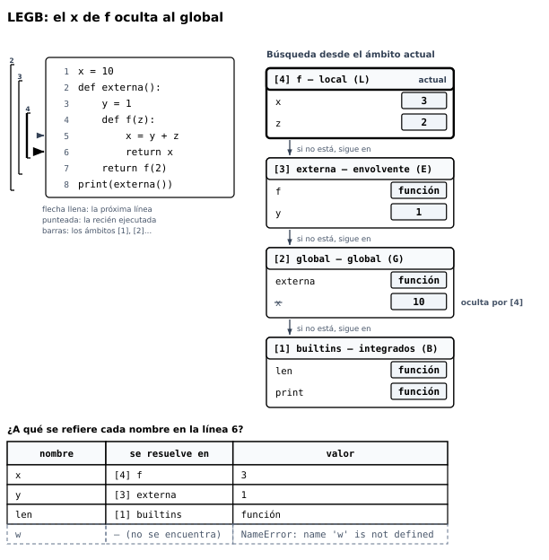
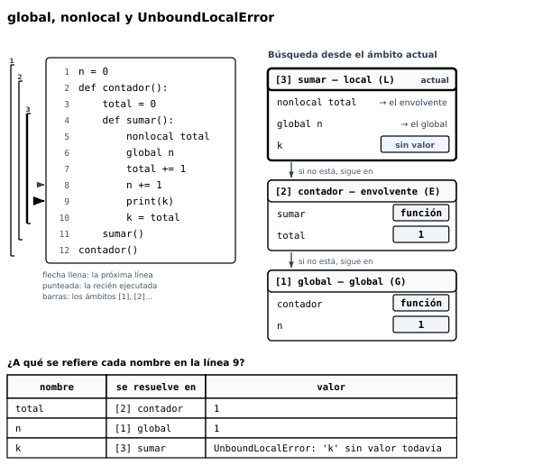
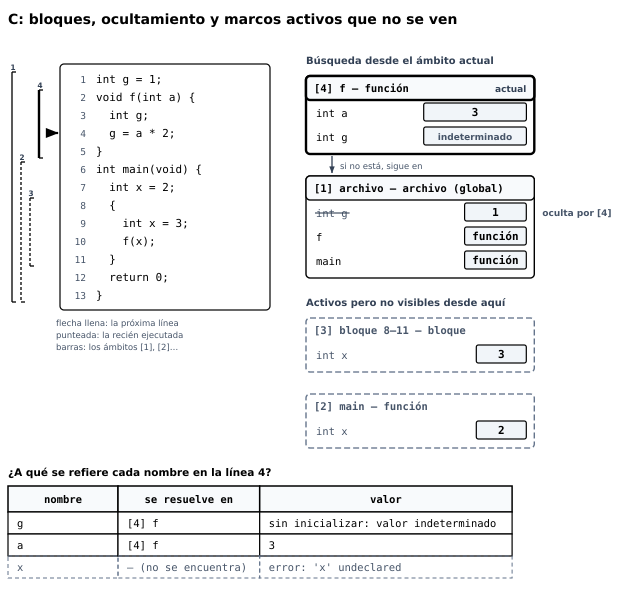
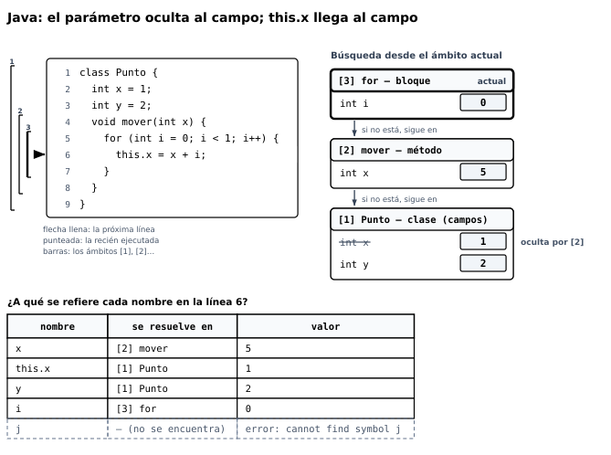
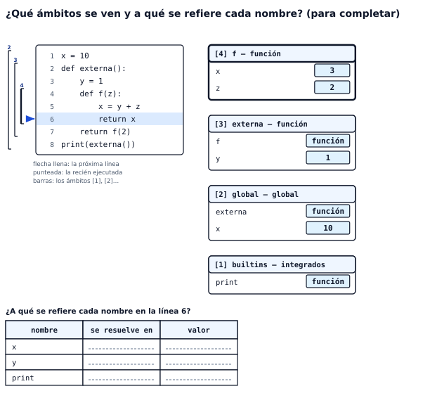

[Manual](../../README.md) › [Estructuras de datos y algoritmos](../README.md) › [Memoria, tipos y recursión](README.md)

# Ámbitos y visibilidad (`scopes`)

Dibuja el código con la próxima línea a ejecutar (flecha llena) y la recién ejecutada
(punteada), una barra por cada ámbito sobre las líneas que abarca y, al lado, cada ámbito con
sus nombres y valores. Arriba va la cadena de búsqueda desde el ámbito actual, del más cercano
al más lejano; debajo, los ámbitos activos que no se ven desde ahí, como el marco de quien
llamó. Con `lookup`, una tabla dice a qué ámbito se refiere cada nombre y con qué valor, o el
error que daría el compilador o el intérprete.

## Qué calcula

- La cadena de búsqueda desde el ámbito actual (`current`, por omisión el último): el ámbito y sus padres. En Python, el cuerpo de una clase no es envolvente para los métodos y se saltea (en Java, los campos sí se ven).
- Qué nombres quedan ocultos por otro del mismo nombre en un ámbito más cercano (tachados, con «oculta por [n]»), y qué ámbitos activos quedan fuera de la cadena (punteados).
- Dónde se resuelve cada nombre de `lookup`: en Python, con LEGB, `global` y `nonlocal`; en Java, `this.x` llega al campo aunque un parámetro lo oculte.
- Los errores: `NameError` y `UnboundLocalError` en Python, `undeclared` y el valor indeterminado de una variable sin inicializar en C, `cannot find symbol` y `might not have been initialized` en Java, y `no binding for nonlocal`.

## Variantes

| `variant` | Qué dibuja |
| :--- | :--- |
| `python` | Por omisión. Ámbitos integrados (B), global (G), envolventes (E) y local (L), con `global` y `nonlocal`. |
| `c` | Archivo (global), funciones y bloques; una variable sin inicializar tiene un valor indeterminado. |
| `java` | Clase (los campos), métodos y bloques, con `this.x`. |

## Campos

| Campo | Tipo | Valores y valor por defecto | Descripción |
| :--- | :--- | :--- | :--- |
| `type` | texto | `scopes` | Obligatorio. |
| `code` | texto |  | El código, hasta 40 líneas. La sangría se conserva. |
| `line` | número |  | La próxima línea a ejecutar (desde 1); tiene que estar dentro del ámbito actual. |
| `prev` | número |  | La línea recién ejecutada. |
| `scopes` | lista |  | Los ámbitos, del más externo al actual (hasta 10). Cada uno con `name` (único: `f#1`, `f#2` para dos llamadas), `kind` (`builtins`, `global`/`module`/`file`, `function`/`method`, `class` o `block`; por omisión el primero es global y los demás funciones), `parent` (el nombre de un ámbito anterior; por omisión el anterior de la lista, `false` para ninguno), `lines` (`[desde, hasta]`) y `vars`. |
| `vars` | lista |  | Los nombres de un ámbito (hasta 12): un mapa `{x: 1}` (se ordena alfabéticamente), o una lista de nombres sueltos o de `{name, type, value}`, en el orden dado. Además: `unbound: true` (o `indeterminate: true`) para uno declarado y todavía sin valor, `declare: global` o `declare: nonlocal` en Python (sin valor propio: el valor está en el otro ámbito) y `blank: true`. |
| `current` |  |  | El ámbito actual, por su nombre (por omisión el último de la lista). |
| `lookup` | lista |  | Los nombres a resolver desde el ámbito actual (hasta 12), como lista o separados por comas. |
| `variant` | texto |  | Variante, ver arriba. |
| `blankValues` | sí/no |  | Deja los valores en blanco. |
| `blankVisibility` | sí/no |  | Oculta la visibilidad: sin cadena de búsqueda, sin «oculta por», sin rótulos local o envolvente, y los ámbitos van del último de la lista al primero. |
| `blankLookup` | sí/no |  | Deja en blanco dónde se resuelve cada nombre de `lookup` y su valor. |

Además, los campos comunes a todos los tipos: `title`, `subtitle`, `id`, `inkSaver` y `theme` (ver [Campos comunes](../../campos-comunes.md)).

## Modo ejercicio

Con `blankVisibility` y `blankLookup`, quedan el código, la línea y los ámbitos con sus
nombres: el ejercicio es armar la cadena de búsqueda, marcar qué nombres quedan ocultos y
completar la tabla. Con `blankValues`, además, los valores.

Campos que dejan casilleros para completar: `blankValues`, `blankVisibility`, `blankLookup`.

## Ejemplos

### LEGB: el x de f oculta al global

```yaml
type: scopes
variant: python
title: "LEGB: el x de f oculta al global"
code: |
  x = 10
  def externa():
      y = 1
      def f(z):
          x = y + z
          return x
      return f(2)
  print(externa())
line: 6
prev: 5
scopes:
  - {name: builtins, kind: builtins, parent: false, vars: {print: "función", len: "función"}}
  - {name: global, kind: global, parent: builtins, lines: [1, 8], vars: {x: 10, externa: "función"}}
  - {name: externa, kind: function, lines: [2, 7], vars: {y: 1, f: "función"}}
  - {name: f, kind: function, lines: [4, 6], vars: {z: 2, x: 3}}
lookup: [x, y, len, w]
```

[](https://ingcom-unrn.github.io/dibu-web/#t=dHlwZTogc2NvcGVzCnZhcmlhbnQ6IHB5dGhvbgp0aXRsZTogIkxFR0I6IGVsIHggZGUgZiBvY3VsdGEgYWwgZ2xvYmFsIgpjb2RlOiB8CiAgeCA9IDEwCiAgZGVmIGV4dGVybmEoKToKICAgICAgeSA9IDEKICAgICAgZGVmIGYoeik6CiAgICAgICAgICB4ID0geSArIHoKICAgICAgICAgIHJldHVybiB4CiAgICAgIHJldHVybiBmKDIpCiAgcHJpbnQoZXh0ZXJuYSgpKQpsaW5lOiA2CnByZXY6IDUKc2NvcGVzOgogIC0ge25hbWU6IGJ1aWx0aW5zLCBraW5kOiBidWlsdGlucywgcGFyZW50OiBmYWxzZSwgdmFyczoge3ByaW50OiAiZnVuY2nDs24iLCBsZW46ICJmdW5jacOzbiJ9fQogIC0ge25hbWU6IGdsb2JhbCwga2luZDogZ2xvYmFsLCBwYXJlbnQ6IGJ1aWx0aW5zLCBsaW5lczogWzEsIDhdLCB2YXJzOiB7eDogMTAsIGV4dGVybmE6ICJmdW5jacOzbiJ9fQogIC0ge25hbWU6IGV4dGVybmEsIGtpbmQ6IGZ1bmN0aW9uLCBsaW5lczogWzIsIDddLCB2YXJzOiB7eTogMSwgZjogImZ1bmNpw7NuIn19CiAgLSB7bmFtZTogZiwga2luZDogZnVuY3Rpb24sIGxpbmVzOiBbNCwgNl0sIHZhcnM6IHt6OiAyLCB4OiAzfX0KbG9va3VwOiBbeCwgeSwgbGVuLCB3XQo)

[Abrir en el editor](https://ingcom-unrn.github.io/dibu-web/#t=dHlwZTogc2NvcGVzCnZhcmlhbnQ6IHB5dGhvbgp0aXRsZTogIkxFR0I6IGVsIHggZGUgZiBvY3VsdGEgYWwgZ2xvYmFsIgpjb2RlOiB8CiAgeCA9IDEwCiAgZGVmIGV4dGVybmEoKToKICAgICAgeSA9IDEKICAgICAgZGVmIGYoeik6CiAgICAgICAgICB4ID0geSArIHoKICAgICAgICAgIHJldHVybiB4CiAgICAgIHJldHVybiBmKDIpCiAgcHJpbnQoZXh0ZXJuYSgpKQpsaW5lOiA2CnByZXY6IDUKc2NvcGVzOgogIC0ge25hbWU6IGJ1aWx0aW5zLCBraW5kOiBidWlsdGlucywgcGFyZW50OiBmYWxzZSwgdmFyczoge3ByaW50OiAiZnVuY2nDs24iLCBsZW46ICJmdW5jacOzbiJ9fQogIC0ge25hbWU6IGdsb2JhbCwga2luZDogZ2xvYmFsLCBwYXJlbnQ6IGJ1aWx0aW5zLCBsaW5lczogWzEsIDhdLCB2YXJzOiB7eDogMTAsIGV4dGVybmE6ICJmdW5jacOzbiJ9fQogIC0ge25hbWU6IGV4dGVybmEsIGtpbmQ6IGZ1bmN0aW9uLCBsaW5lczogWzIsIDddLCB2YXJzOiB7eTogMSwgZjogImZ1bmNpw7NuIn19CiAgLSB7bmFtZTogZiwga2luZDogZnVuY3Rpb24sIGxpbmVzOiBbNCwgNl0sIHZhcnM6IHt6OiAyLCB4OiAzfX0KbG9va3VwOiBbeCwgeSwgbGVuLCB3XQo) para explorarlo y modificarlo.

### global, nonlocal y UnboundLocalError

```yaml
type: scopes
variant: python
title: "global, nonlocal y UnboundLocalError"
code: |
  n = 0
  def contador():
      total = 0
      def sumar():
          nonlocal total
          global n
          total += 1
          n += 1
          print(k)
          k = total
      sumar()
  contador()
line: 9
prev: 8
scopes:
  - {name: global, kind: global, lines: [1, 12], vars: {n: 1, contador: "función"}}
  - {name: contador, kind: function, lines: [2, 11], vars: {total: 1, sumar: "función"}}
  - name: sumar
    kind: function
    lines: [4, 10]
    vars:
      - {name: total, declare: nonlocal}
      - {name: n, declare: global}
      - {name: k, unbound: true}
lookup: [total, n, k]
```

[](https://ingcom-unrn.github.io/dibu-web/#t=dHlwZTogc2NvcGVzCnZhcmlhbnQ6IHB5dGhvbgp0aXRsZTogImdsb2JhbCwgbm9ubG9jYWwgeSBVbmJvdW5kTG9jYWxFcnJvciIKY29kZTogfAogIG4gPSAwCiAgZGVmIGNvbnRhZG9yKCk6CiAgICAgIHRvdGFsID0gMAogICAgICBkZWYgc3VtYXIoKToKICAgICAgICAgIG5vbmxvY2FsIHRvdGFsCiAgICAgICAgICBnbG9iYWwgbgogICAgICAgICAgdG90YWwgKz0gMQogICAgICAgICAgbiArPSAxCiAgICAgICAgICBwcmludChrKQogICAgICAgICAgayA9IHRvdGFsCiAgICAgIHN1bWFyKCkKICBjb250YWRvcigpCmxpbmU6IDkKcHJldjogOApzY29wZXM6CiAgLSB7bmFtZTogZ2xvYmFsLCBraW5kOiBnbG9iYWwsIGxpbmVzOiBbMSwgMTJdLCB2YXJzOiB7bjogMSwgY29udGFkb3I6ICJmdW5jacOzbiJ9fQogIC0ge25hbWU6IGNvbnRhZG9yLCBraW5kOiBmdW5jdGlvbiwgbGluZXM6IFsyLCAxMV0sIHZhcnM6IHt0b3RhbDogMSwgc3VtYXI6ICJmdW5jacOzbiJ9fQogIC0gbmFtZTogc3VtYXIKICAgIGtpbmQ6IGZ1bmN0aW9uCiAgICBsaW5lczogWzQsIDEwXQogICAgdmFyczoKICAgICAgLSB7bmFtZTogdG90YWwsIGRlY2xhcmU6IG5vbmxvY2FsfQogICAgICAtIHtuYW1lOiBuLCBkZWNsYXJlOiBnbG9iYWx9CiAgICAgIC0ge25hbWU6IGssIHVuYm91bmQ6IHRydWV9Cmxvb2t1cDogW3RvdGFsLCBuLCBrXQo)

[Abrir en el editor](https://ingcom-unrn.github.io/dibu-web/#t=dHlwZTogc2NvcGVzCnZhcmlhbnQ6IHB5dGhvbgp0aXRsZTogImdsb2JhbCwgbm9ubG9jYWwgeSBVbmJvdW5kTG9jYWxFcnJvciIKY29kZTogfAogIG4gPSAwCiAgZGVmIGNvbnRhZG9yKCk6CiAgICAgIHRvdGFsID0gMAogICAgICBkZWYgc3VtYXIoKToKICAgICAgICAgIG5vbmxvY2FsIHRvdGFsCiAgICAgICAgICBnbG9iYWwgbgogICAgICAgICAgdG90YWwgKz0gMQogICAgICAgICAgbiArPSAxCiAgICAgICAgICBwcmludChrKQogICAgICAgICAgayA9IHRvdGFsCiAgICAgIHN1bWFyKCkKICBjb250YWRvcigpCmxpbmU6IDkKcHJldjogOApzY29wZXM6CiAgLSB7bmFtZTogZ2xvYmFsLCBraW5kOiBnbG9iYWwsIGxpbmVzOiBbMSwgMTJdLCB2YXJzOiB7bjogMSwgY29udGFkb3I6ICJmdW5jacOzbiJ9fQogIC0ge25hbWU6IGNvbnRhZG9yLCBraW5kOiBmdW5jdGlvbiwgbGluZXM6IFsyLCAxMV0sIHZhcnM6IHt0b3RhbDogMSwgc3VtYXI6ICJmdW5jacOzbiJ9fQogIC0gbmFtZTogc3VtYXIKICAgIGtpbmQ6IGZ1bmN0aW9uCiAgICBsaW5lczogWzQsIDEwXQogICAgdmFyczoKICAgICAgLSB7bmFtZTogdG90YWwsIGRlY2xhcmU6IG5vbmxvY2FsfQogICAgICAtIHtuYW1lOiBuLCBkZWNsYXJlOiBnbG9iYWx9CiAgICAgIC0ge25hbWU6IGssIHVuYm91bmQ6IHRydWV9Cmxvb2t1cDogW3RvdGFsLCBuLCBrXQo) para explorarlo y modificarlo.

### C: bloques, ocultamiento y marcos activos que no se ven

```yaml
type: scopes
variant: c
title: "C: bloques, ocultamiento y marcos activos que no se ven"
code: |
  int g = 1;
  void f(int a) {
    int g;
    g = a * 2;
  }
  int main(void) {
    int x = 2;
    {
      int x = 3;
      f(x);
    }
    return 0;
  }
line: 4
scopes:
  - {name: archivo, kind: file, lines: [1, 13], vars: [{name: g, type: int, value: 1}, {name: f, value: "función"}, {name: main, value: "función"}]}
  - {name: main, kind: function, parent: archivo, lines: [6, 13], vars: [{name: x, type: int, value: 2}]}
  - {name: "bloque 8–11", kind: block, parent: main, lines: [8, 11], vars: [{name: x, type: int, value: 3}]}
  - {name: f, kind: function, parent: archivo, lines: [2, 5], vars: [{name: a, type: int, value: 3}, {name: g, type: int, indeterminate: true}]}
lookup: [g, a, x]
```

[](https://ingcom-unrn.github.io/dibu-web/#t=dHlwZTogc2NvcGVzCnZhcmlhbnQ6IGMKdGl0bGU6ICJDOiBibG9xdWVzLCBvY3VsdGFtaWVudG8geSBtYXJjb3MgYWN0aXZvcyBxdWUgbm8gc2UgdmVuIgpjb2RlOiB8CiAgaW50IGcgPSAxOwogIHZvaWQgZihpbnQgYSkgewogICAgaW50IGc7CiAgICBnID0gYSAqIDI7CiAgfQogIGludCBtYWluKHZvaWQpIHsKICAgIGludCB4ID0gMjsKICAgIHsKICAgICAgaW50IHggPSAzOwogICAgICBmKHgpOwogICAgfQogICAgcmV0dXJuIDA7CiAgfQpsaW5lOiA0CnNjb3BlczoKICAtIHtuYW1lOiBhcmNoaXZvLCBraW5kOiBmaWxlLCBsaW5lczogWzEsIDEzXSwgdmFyczogW3tuYW1lOiBnLCB0eXBlOiBpbnQsIHZhbHVlOiAxfSwge25hbWU6IGYsIHZhbHVlOiAiZnVuY2nDs24ifSwge25hbWU6IG1haW4sIHZhbHVlOiAiZnVuY2nDs24ifV19CiAgLSB7bmFtZTogbWFpbiwga2luZDogZnVuY3Rpb24sIHBhcmVudDogYXJjaGl2bywgbGluZXM6IFs2LCAxM10sIHZhcnM6IFt7bmFtZTogeCwgdHlwZTogaW50LCB2YWx1ZTogMn1dfQogIC0ge25hbWU6ICJibG9xdWUgOOKAkzExIiwga2luZDogYmxvY2ssIHBhcmVudDogbWFpbiwgbGluZXM6IFs4LCAxMV0sIHZhcnM6IFt7bmFtZTogeCwgdHlwZTogaW50LCB2YWx1ZTogM31dfQogIC0ge25hbWU6IGYsIGtpbmQ6IGZ1bmN0aW9uLCBwYXJlbnQ6IGFyY2hpdm8sIGxpbmVzOiBbMiwgNV0sIHZhcnM6IFt7bmFtZTogYSwgdHlwZTogaW50LCB2YWx1ZTogM30sIHtuYW1lOiBnLCB0eXBlOiBpbnQsIGluZGV0ZXJtaW5hdGU6IHRydWV9XX0KbG9va3VwOiBbZywgYSwgeF0K)

[Abrir en el editor](https://ingcom-unrn.github.io/dibu-web/#t=dHlwZTogc2NvcGVzCnZhcmlhbnQ6IGMKdGl0bGU6ICJDOiBibG9xdWVzLCBvY3VsdGFtaWVudG8geSBtYXJjb3MgYWN0aXZvcyBxdWUgbm8gc2UgdmVuIgpjb2RlOiB8CiAgaW50IGcgPSAxOwogIHZvaWQgZihpbnQgYSkgewogICAgaW50IGc7CiAgICBnID0gYSAqIDI7CiAgfQogIGludCBtYWluKHZvaWQpIHsKICAgIGludCB4ID0gMjsKICAgIHsKICAgICAgaW50IHggPSAzOwogICAgICBmKHgpOwogICAgfQogICAgcmV0dXJuIDA7CiAgfQpsaW5lOiA0CnNjb3BlczoKICAtIHtuYW1lOiBhcmNoaXZvLCBraW5kOiBmaWxlLCBsaW5lczogWzEsIDEzXSwgdmFyczogW3tuYW1lOiBnLCB0eXBlOiBpbnQsIHZhbHVlOiAxfSwge25hbWU6IGYsIHZhbHVlOiAiZnVuY2nDs24ifSwge25hbWU6IG1haW4sIHZhbHVlOiAiZnVuY2nDs24ifV19CiAgLSB7bmFtZTogbWFpbiwga2luZDogZnVuY3Rpb24sIHBhcmVudDogYXJjaGl2bywgbGluZXM6IFs2LCAxM10sIHZhcnM6IFt7bmFtZTogeCwgdHlwZTogaW50LCB2YWx1ZTogMn1dfQogIC0ge25hbWU6ICJibG9xdWUgOOKAkzExIiwga2luZDogYmxvY2ssIHBhcmVudDogbWFpbiwgbGluZXM6IFs4LCAxMV0sIHZhcnM6IFt7bmFtZTogeCwgdHlwZTogaW50LCB2YWx1ZTogM31dfQogIC0ge25hbWU6IGYsIGtpbmQ6IGZ1bmN0aW9uLCBwYXJlbnQ6IGFyY2hpdm8sIGxpbmVzOiBbMiwgNV0sIHZhcnM6IFt7bmFtZTogYSwgdHlwZTogaW50LCB2YWx1ZTogM30sIHtuYW1lOiBnLCB0eXBlOiBpbnQsIGluZGV0ZXJtaW5hdGU6IHRydWV9XX0KbG9va3VwOiBbZywgYSwgeF0K) para explorarlo y modificarlo.

### Java: el parámetro oculta al campo; this.x llega al campo

```yaml
type: scopes
variant: java
title: "Java: el parámetro oculta al campo; this.x llega al campo"
code: |
  class Punto {
    int x = 1;
    int y = 2;
    void mover(int x) {
      for (int i = 0; i < 1; i++) {
        this.x = x + i;
      }
    }
  }
line: 6
scopes:
  - {name: Punto, kind: class, lines: [1, 9], vars: [{name: x, type: int, value: 1}, {name: y, type: int, value: 2}]}
  - {name: mover, kind: method, lines: [4, 8], vars: [{name: x, type: int, value: 5}]}
  - {name: for, kind: block, lines: [5, 7], vars: [{name: i, type: int, value: 0}]}
lookup: [x, this.x, y, i, j]
```

[](https://ingcom-unrn.github.io/dibu-web/#t=dHlwZTogc2NvcGVzCnZhcmlhbnQ6IGphdmEKdGl0bGU6ICJKYXZhOiBlbCBwYXLDoW1ldHJvIG9jdWx0YSBhbCBjYW1wbzsgdGhpcy54IGxsZWdhIGFsIGNhbXBvIgpjb2RlOiB8CiAgY2xhc3MgUHVudG8gewogICAgaW50IHggPSAxOwogICAgaW50IHkgPSAyOwogICAgdm9pZCBtb3ZlcihpbnQgeCkgewogICAgICBmb3IgKGludCBpID0gMDsgaSA8IDE7IGkrKykgewogICAgICAgIHRoaXMueCA9IHggKyBpOwogICAgICB9CiAgICB9CiAgfQpsaW5lOiA2CnNjb3BlczoKICAtIHtuYW1lOiBQdW50bywga2luZDogY2xhc3MsIGxpbmVzOiBbMSwgOV0sIHZhcnM6IFt7bmFtZTogeCwgdHlwZTogaW50LCB2YWx1ZTogMX0sIHtuYW1lOiB5LCB0eXBlOiBpbnQsIHZhbHVlOiAyfV19CiAgLSB7bmFtZTogbW92ZXIsIGtpbmQ6IG1ldGhvZCwgbGluZXM6IFs0LCA4XSwgdmFyczogW3tuYW1lOiB4LCB0eXBlOiBpbnQsIHZhbHVlOiA1fV19CiAgLSB7bmFtZTogZm9yLCBraW5kOiBibG9jaywgbGluZXM6IFs1LCA3XSwgdmFyczogW3tuYW1lOiBpLCB0eXBlOiBpbnQsIHZhbHVlOiAwfV19Cmxvb2t1cDogW3gsIHRoaXMueCwgeSwgaSwgal0K)

[Abrir en el editor](https://ingcom-unrn.github.io/dibu-web/#t=dHlwZTogc2NvcGVzCnZhcmlhbnQ6IGphdmEKdGl0bGU6ICJKYXZhOiBlbCBwYXLDoW1ldHJvIG9jdWx0YSBhbCBjYW1wbzsgdGhpcy54IGxsZWdhIGFsIGNhbXBvIgpjb2RlOiB8CiAgY2xhc3MgUHVudG8gewogICAgaW50IHggPSAxOwogICAgaW50IHkgPSAyOwogICAgdm9pZCBtb3ZlcihpbnQgeCkgewogICAgICBmb3IgKGludCBpID0gMDsgaSA8IDE7IGkrKykgewogICAgICAgIHRoaXMueCA9IHggKyBpOwogICAgICB9CiAgICB9CiAgfQpsaW5lOiA2CnNjb3BlczoKICAtIHtuYW1lOiBQdW50bywga2luZDogY2xhc3MsIGxpbmVzOiBbMSwgOV0sIHZhcnM6IFt7bmFtZTogeCwgdHlwZTogaW50LCB2YWx1ZTogMX0sIHtuYW1lOiB5LCB0eXBlOiBpbnQsIHZhbHVlOiAyfV19CiAgLSB7bmFtZTogbW92ZXIsIGtpbmQ6IG1ldGhvZCwgbGluZXM6IFs0LCA4XSwgdmFyczogW3tuYW1lOiB4LCB0eXBlOiBpbnQsIHZhbHVlOiA1fV19CiAgLSB7bmFtZTogZm9yLCBraW5kOiBibG9jaywgbGluZXM6IFs1LCA3XSwgdmFyczogW3tuYW1lOiBpLCB0eXBlOiBpbnQsIHZhbHVlOiAwfV19Cmxvb2t1cDogW3gsIHRoaXMueCwgeSwgaSwgal0K) para explorarlo y modificarlo.

### ¿Qué ámbitos se ven y a qué se refiere cada nombre? (para completar)

```yaml
type: scopes
variant: python
title: "¿Qué ámbitos se ven y a qué se refiere cada nombre? (para completar)"
code: |
  x = 10
  def externa():
      y = 1
      def f(z):
          x = y + z
          return x
      return f(2)
  print(externa())
line: 6
scopes:
  - {name: builtins, kind: builtins, parent: false, vars: {print: "función"}}
  - {name: global, kind: global, parent: builtins, lines: [1, 8], vars: {x: 10, externa: "función"}}
  - {name: externa, kind: function, lines: [2, 7], vars: {y: 1, f: "función"}}
  - {name: f, kind: function, lines: [4, 6], vars: {z: 2, x: 3}}
lookup: [x, y, print]
blankLookup: true
blankVisibility: true
inkSaver: false
```

[](https://ingcom-unrn.github.io/dibu-web/#t=dHlwZTogc2NvcGVzCnZhcmlhbnQ6IHB5dGhvbgp0aXRsZTogIsK_UXXDqSDDoW1iaXRvcyBzZSB2ZW4geSBhIHF1w6kgc2UgcmVmaWVyZSBjYWRhIG5vbWJyZT8gKHBhcmEgY29tcGxldGFyKSIKY29kZTogfAogIHggPSAxMAogIGRlZiBleHRlcm5hKCk6CiAgICAgIHkgPSAxCiAgICAgIGRlZiBmKHopOgogICAgICAgICAgeCA9IHkgKyB6CiAgICAgICAgICByZXR1cm4geAogICAgICByZXR1cm4gZigyKQogIHByaW50KGV4dGVybmEoKSkKbGluZTogNgpzY29wZXM6CiAgLSB7bmFtZTogYnVpbHRpbnMsIGtpbmQ6IGJ1aWx0aW5zLCBwYXJlbnQ6IGZhbHNlLCB2YXJzOiB7cHJpbnQ6ICJmdW5jacOzbiJ9fQogIC0ge25hbWU6IGdsb2JhbCwga2luZDogZ2xvYmFsLCBwYXJlbnQ6IGJ1aWx0aW5zLCBsaW5lczogWzEsIDhdLCB2YXJzOiB7eDogMTAsIGV4dGVybmE6ICJmdW5jacOzbiJ9fQogIC0ge25hbWU6IGV4dGVybmEsIGtpbmQ6IGZ1bmN0aW9uLCBsaW5lczogWzIsIDddLCB2YXJzOiB7eTogMSwgZjogImZ1bmNpw7NuIn19CiAgLSB7bmFtZTogZiwga2luZDogZnVuY3Rpb24sIGxpbmVzOiBbNCwgNl0sIHZhcnM6IHt6OiAyLCB4OiAzfX0KbG9va3VwOiBbeCwgeSwgcHJpbnRdCmJsYW5rTG9va3VwOiB0cnVlCmJsYW5rVmlzaWJpbGl0eTogdHJ1ZQppbmtTYXZlcjogZmFsc2UK)

[Abrir en el editor](https://ingcom-unrn.github.io/dibu-web/#t=dHlwZTogc2NvcGVzCnZhcmlhbnQ6IHB5dGhvbgp0aXRsZTogIsK_UXXDqSDDoW1iaXRvcyBzZSB2ZW4geSBhIHF1w6kgc2UgcmVmaWVyZSBjYWRhIG5vbWJyZT8gKHBhcmEgY29tcGxldGFyKSIKY29kZTogfAogIHggPSAxMAogIGRlZiBleHRlcm5hKCk6CiAgICAgIHkgPSAxCiAgICAgIGRlZiBmKHopOgogICAgICAgICAgeCA9IHkgKyB6CiAgICAgICAgICByZXR1cm4geAogICAgICByZXR1cm4gZigyKQogIHByaW50KGV4dGVybmEoKSkKbGluZTogNgpzY29wZXM6CiAgLSB7bmFtZTogYnVpbHRpbnMsIGtpbmQ6IGJ1aWx0aW5zLCBwYXJlbnQ6IGZhbHNlLCB2YXJzOiB7cHJpbnQ6ICJmdW5jacOzbiJ9fQogIC0ge25hbWU6IGdsb2JhbCwga2luZDogZ2xvYmFsLCBwYXJlbnQ6IGJ1aWx0aW5zLCBsaW5lczogWzEsIDhdLCB2YXJzOiB7eDogMTAsIGV4dGVybmE6ICJmdW5jacOzbiJ9fQogIC0ge25hbWU6IGV4dGVybmEsIGtpbmQ6IGZ1bmN0aW9uLCBsaW5lczogWzIsIDddLCB2YXJzOiB7eTogMSwgZjogImZ1bmNpw7NuIn19CiAgLSB7bmFtZTogZiwga2luZDogZnVuY3Rpb24sIGxpbmVzOiBbNCwgNl0sIHZhcnM6IHt6OiAyLCB4OiAzfX0KbG9va3VwOiBbeCwgeSwgcHJpbnRdCmJsYW5rTG9va3VwOiB0cnVlCmJsYW5rVmlzaWJpbGl0eTogdHJ1ZQppbmtTYXZlcjogZmFsc2UK) para explorarlo y modificarlo.

## Notas

- Dos llamadas activas de la misma función son dos ámbitos con nombres distintos (`f#1`, `f#2`), cada uno con su `parent`: en C y Java, el archivo o la clase, no quien llamó.
- Para las referencias y los objetos del heap, ver [`object_heap`](object_heap.md); para los marcos con sus direcciones, [`call_stack`](call_stack.md).

## Ver también

[`call_stack`](call_stack.md), [`call_tree`](call_tree.md), [`struct`](struct.md), [`byte_layout`](byte_layout.md), [`object_heap`](object_heap.md), [`adt`](adt.md)
