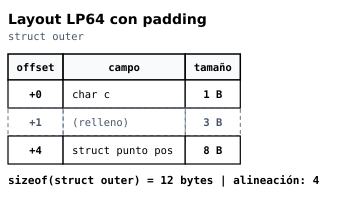
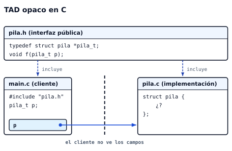

[Manual](../../README.md) › [Estructuras de datos y algoritmos](../README.md) › [Memoria, tipos y recursión](README.md)

# Struct (`struct`)

Con la variante `layout` (por omisión) dibuja los campos de un struct como los ubica gcc en 64
bits: offset, tamaño y relleno de cada uno, y el `sizeof` total. Con `opaque` muestra qué ve
cada archivo de un tipo opaco: el `.h` con el `typedef` y las operaciones, el cliente con un
puntero y el `.c` con los campos.

## Qué calcula

- El offset, el relleno y el `sizeof` con los tamaños y alineaciones de gcc en 64 bits (`char` 1, `short` 2, `int` y `float` 4, `long`, `double`, `size_t` y punteros 8, y los `intN_t`).

## Variantes

| `variant` | Qué dibuja |
| :--- | :--- |
| `layout` | Por omisión. La disposición en memoria. |
| `opaque` | Lo que ve cada archivo de un tipo opaco. |

## Campos

| Campo | Tipo | Valores y valor por defecto | Descripción |
| :--- | :--- | :--- | :--- |
| `type` | texto | `struct` | Obligatorio. |
| `fields` | lista |  | Los campos: `"char nombre[8]"`, `"int edad = 30"` o `{name, type, value, size, align, blank}` (hasta 16). `size` y `align` sirven para un tipo que dibu no conoce, como un struct anidado. |
| `name` | texto |  | Nombre del struct (`struct persona`). |
| `typedef` | texto |  | Nombre del `typedef`. |
| `variant` | texto |  | Variante, ver arriba. |
| `packed` | sí/no |  | Sin relleno, como `__attribute__((packed))`. |
| `showAddresses` | sí/no |  | Muestra la dirección de cada campo. |
| `baseAddr` | número |  | Dirección del comienzo del struct. |
| `variable` | texto |  | El nombre de la variable de ese tipo. |
| `blankValues` | sí/no |  | Deja los valores en blanco. |
| `blankOffsets` | sí/no |  | Deja los offsets en blanco. |
| `blankSizes` | sí/no |  | Deja los tamaños en blanco. |
| `blankPadding` | sí/no |  | Saca las filas de relleno, para deducirlas de los offsets. |
| `blankSizeof` | sí/no |  | Deja el `sizeof` en blanco. |
| `operations` | lista |  | En `opaque`, las operaciones del `.h`. |
| `header` | texto |  | En `opaque`, el nombre del `.h`. |
| `source` | texto |  | En `opaque`, el nombre del `.c`. |
| `client` | texto |  | En `opaque`, el código del cliente. |
| `hidden` | sí/no |  | En `opaque`, oculta los campos (lo que ve el cliente); no hace falta `fields`. |

Además, los campos comunes a todos los tipos: `title`, `subtitle`, `id`, `inkSaver` y `theme` (ver [Campos comunes](../../campos-comunes.md)).

## Modo ejercicio

Campos que dejan casilleros para completar: `blankValues`, `blankOffsets`, `blankSizes`, `blankPadding`, `blankSizeof`.

## Ejemplos

### Layout LP64 con padding

```yaml
type: struct
title: Layout LP64 con padding
name: struct outer
fields:
  - {name: c, type: char}
  - {name: pos, type: struct punto, size: 8, align: 4}
```



### TAD opaco en C

```yaml
type: struct
title: TAD opaco en C
variant: opaque
name: struct pila
typedef: pila_t
operations: ["void f(pila_t p)"]
fields: ["int *datos", "size_t tope"]
hidden: true
inkSaver: false
```



## Ver también

[`call_stack`](call_stack.md), [`call_tree`](call_tree.md), [`adt`](adt.md)
