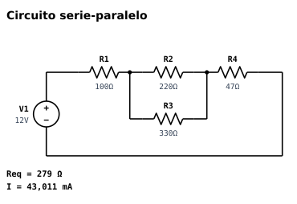
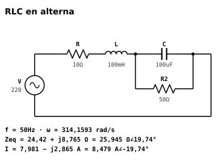

[Manual](../../README.md) › [Matemática aplicada](../README.md) › [Circuitos eléctricos](README.md)

# Circuito (`circuit`)

Dibuja un circuito con una fuente y una red de resistencias, inductores, capacitores y
fuentes armada como serie y paralelo anidados. Calcula la resistencia o la impedancia
equivalente (a la frecuencia dada) y la corriente de la fuente.

## Qué calcula

- La impedancia de cada elemento (R, jωL, 1/(jωC)) y la equivalente, en forma rectangular y polar.
- La corriente I = V/Z.

## Campos

| Campo | Tipo | Valores y valor por defecto | Descripción |
| :--- | :--- | :--- | :--- |
| `type` | texto | `circuit` | Obligatorio. |
| `network` | objeto |  | La red: `{series: […]}` o `{parallel: […]}` anidados; cada elemento es un texto (`"R1 = 10k"`, `"C2: 100uF"`) o `{type, name, value}`. Tipos: R, L, C, V, I y Z. |
| `source` | texto |  | La fuente, como un elemento: `"V1 = 12V"` o `{type: I, name, value}`. |
| `frequency` | número |  | La frecuencia, en Hz (para los inductores y capacitores). |
| `style` | texto | `ansi`, `iec` · por defecto `ansi` | `ansi` (resistencias en zigzag) o `iec` (rectángulos). |
| `results` | sí/no |  | Escribe la impedancia equivalente y la corriente (por omisión, sí). |
| `blank` | sí/no |  | Deja los resultados en blanco. |
| `blankValues` | sí/no |  | Con `blank`, oculta también los valores de los elementos. |

Además, los campos comunes a todos los tipos: `title`, `subtitle`, `id`, `inkSaver` y `theme` (ver [Campos comunes](../../campos-comunes.md)).

## Modo ejercicio

Campos que dejan casilleros para completar: `blank`, `blankValues`.

## Ejemplos

### Circuito serie-paralelo

```yaml
type: circuit
title: Circuito serie-paralelo
source: "V1 = 12V"
network:
  series:
    - "R1 = 100Ω"
    - parallel: ["R2 = 220Ω", "R3 = 330Ω"]
    - "R4 = 47Ω"
```

[](https://ingcom-unrn.github.io/dibu-web/#z=K6ksSLVSSM4sSi7NLOEqySzJAXKdIdx8heLUosxU3YLEosSc1Jx8ruL80qJkoLxSmKGCrYKhUZgSV15qSXl-UbYVlwJEcTGIpaCgq6AUBFZjYHBupRJUCGwO0CArhWilICOgrJERSFYHqNYYyDM2BvFi4fpNgGIm5iDtAA)

[Abrir en el editor](https://ingcom-unrn.github.io/dibu-web/#z=K6ksSLVSSM4sSi7NLOEqySzJAXKdIdx8heLUosxU3YLEosSc1Jx8ruL80qJkoLxSmKGCrYKhUZgSV15qSXl-UbYVlwJEcTGIpaCgq6AUBFZjYHBupRJUCGwO0CArhWilICOgrJERSFYHqNYYyDM2BvFi4fpNgGIm5iDtAA) para explorarlo y modificarlo.

### RLC en alterna

```yaml
type: circuit
title: RLC en alterna
frequency: 50
source: "V = 220"
network:
  series:
    - "R = 10Ω"
    - "L = 100mH"
    - parallel: ["C = 100uF", "R2 = 50Ω"]
```

[](https://ingcom-unrn.github.io/dibu-web/#z=NYsxCsJAEEX7OcUwtcIaSLNgFRCLVCnSiMWyjLC4buLsLJIjeRnP5EZJ99_7_-sys0UfxJegoEFjxaHvkBO6qCzJwU34WTj5xWJrIE9FfB3RiEdsGkOQWF-T3C0gZpbAeU2Ie6ShTg7m86ZN9D9hHufNzE5cjBwtXqj7l-VEu3ptKrXr9wpf)

[Abrir en el editor](https://ingcom-unrn.github.io/dibu-web/#z=NYsxCsJAEEX7OcUwtcIaSLNgFRCLVCnSiMWyjLC4buLsLJIjeRnP5EZJ99_7_-sys0UfxJegoEFjxaHvkBO6qCzJwU34WTj5xWJrIE9FfB3RiEdsGkOQWF-T3C0gZpbAeU2Ie6ShTg7m86ZN9D9hHufNzE5cjBwtXqj7l-VEu3ptKrXr9wpf) para explorarlo y modificarlo.

## Notas

- Los valores aceptan prefijos del SI: `4.7k`, `10mH`, `100uF`, `2,2µF`, `1M`.

## Ver también

[`phasor`](phasor.md)
