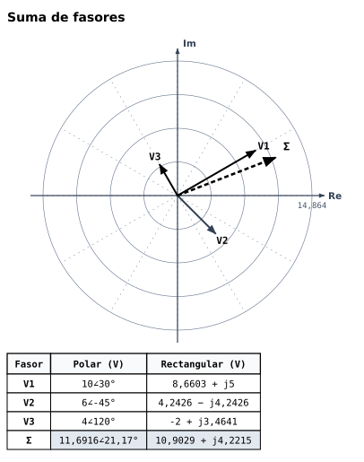

[Manual](../../README.md) › [Matemática aplicada](../README.md) › [Circuitos eléctricos](README.md)

# Diagrama fasorial (`phasor`)

Dibuja los fasores como flechas en el plano complejo, sobre una grilla polar, y opcionalmente
su suma (desde el origen o encadenados punta con cola). Debajo, una tabla con cada fasor en
forma polar y rectangular.

## Qué calcula

- La suma, en forma polar y rectangular.

## Campos

| Campo | Tipo | Valores y valor por defecto | Descripción |
| :--- | :--- | :--- | :--- |
| `type` | texto | `phasor` | Obligatorio. |
| `phasors` | lista |  | Los fasores (hasta 12): `{label, magnitude, angle}` (el ángulo en grados) o `{label, re, im}`. |
| `sum` | sí/no |  | Dibuja la suma. |
| `tipToTail` | sí/no |  | Encadena los fasores punta con cola. |
| `sumLabel` | texto |  | El rótulo de la suma (por omisión Σ). |
| `unit` | texto |  | La unidad, para la tabla. |
| `table` | sí/no |  | La tabla de fasores (por omisión, sí). |
| `blank` | sí/no |  | Oculta la suma y sus valores. |

Además, los campos comunes a todos los tipos: `title`, `subtitle`, `id`, `inkSaver` y `theme` (ver [Campos comunes](../../campos-comunes.md)).

## Modo ejercicio

Campos que dejan casilleros para completar: `blank`.

## Ejemplos

### Suma de fasores

```yaml
type: phasor
title: Suma de fasores
phasors:
  - { label: V1, magnitude: 10, angle: 30 }
  - { label: V2, magnitude: 6, angle: -45 }
  - { label: V3, magnitude: 4, angle: 120 }
sum: true
unit: V
```



## Ver también

[`circuit`](circuit.md)
